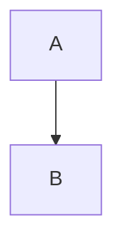

# 1. 前言

Mermaid是一种基于文本的图表绘制工具，允许用户使用简单的文本描述创建各种图表。本文将详细介绍Mermaid的语法和使用方法。

&nbsp;
# 2. 基础语法

## 2.1. 图表定义

所有Mermaid图表都以以下格式开始：

```markdown
图表类型
  图表内容
```

## 2.2. 注释

使用`%%`添加注释，注释必须单独一行，不能添加到语句末尾：

```markdown
flowchart TD
  %% 这是一条注释
  A --> B
```



## 2.3. 图表方向

对于流程图、时序图等，可以指定图表方向：

- `TD` 或 `TB`: 从上到下
- `LR`: 从左到右
