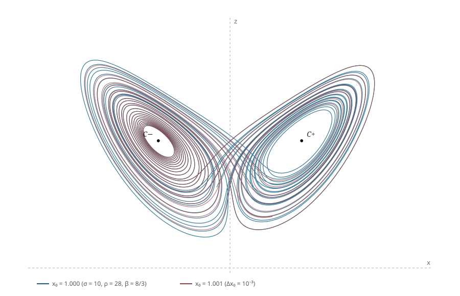

1961年冬，气象学家[爱德华·洛伦兹](https://zh.wikipedia.org/wiki/%E6%84%9B%E5%BE%B7%E8%8F%AF%C2%B7%E8%AB%BE%E9%A0%93%C2%B7%E5%8B%9E%E4%BE%96%E6%AC%A1)为了节省时间，将一组中间运算结果舍入至小数点后三位后重新键入计算机。待他喝完咖啡回到办公室时，却发现模拟出的天气演化序列已与原先截然不同。

<!--more-->

那台[Royal McBee](https://en.wikipedia.org/wiki/Royal_McBee) [LGP-30](https://en.wikipedia.org/wiki/LGP-30)计算机内部保留六位小数，打印纸上呈现的却只有三位：\(0.506127\)变成了\(0.506\)。
千分之一以下的微小差异，在经历数月尺度的数值演化后，被非线性机制放大成了完全不同的气象图景。



洛伦兹后来把这一发现概括为那个著名的问题：

> 一只蝴蝶在巴西扇动翅膀，会在得克萨斯引起一场龙卷风吗？

这并非指蝴蝶直接「导致」了[蝴蝶效应](https://zh.wikipedia.org/wiki/%E8%9D%B4%E8%9D%B6%E6%95%88%E5%BA%94)中的风暴，而是表明：对于此类非线性动力系统，初始条件中任何无法测量的微小差异，都足以在演化中令长期预测失去意义。确定性并不等同于可预测性——这或许是[混沌理论](https://zh.wikipedia.org/wiki/%E6%B7%B7%E6%B2%8C%E7%90%86%E8%AE%BA)留给科学界最深刻的洞见之一。

## 附图生成脚本

上方的洛伦兹吸引子相空间轨线图由以下Python脚本生成：通过四阶龙格-库塔法（RK4）积分洛伦兹方程，并利用方程解析导数构造埃尔米特样条转为SVG三次贝塞尔曲线。

```python {.wrap}
#!/usr/bin/env python3
"""生成洛伦兹吸引子双轨线相空间SVG图（Hermite三次贝塞尔曲线）。"""

import math
from pathlib import Path

SIGMA, RHO, BETA = 10.0, 28.0, 8.0 / 3.0
W, H = 900, 580
SCALE_X = 760.0 / 46.0
SCALE_Y = -480.0 / 52.0


def deriv(x: float, y: float, z: float) -> tuple[float, float, float]:
    return SIGMA * (y - x), x * (RHO - z) - y, x * y - BETA * z


def rk4_step(x: float, y: float, z: float, dt: float) -> tuple[float, float, float]:
    k1 = deriv(x, y, z)
