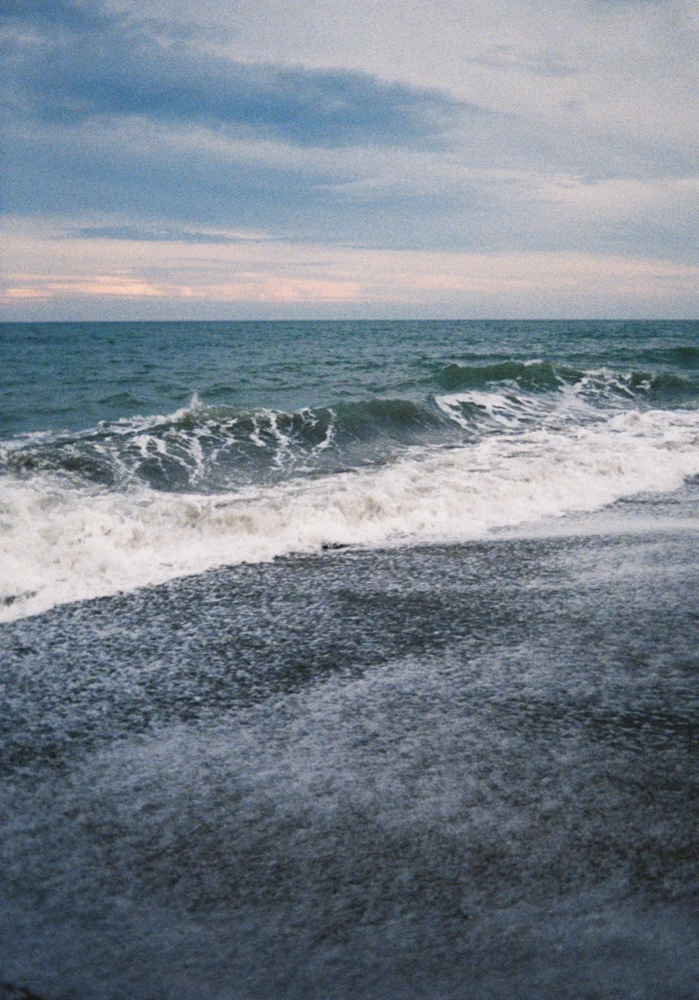

## スカラー場をつくる

等高線を引くには、まず「各地点の標高」を返す関数が必要になる。ここでは置換テーブルを使った
value noise を 4 オクターブ重ねた fBm を土台に、低周波の山塊をドメインワープで歪ませてから
細部ノイズを混ぜている。座標をそのままノイズに通すだけだと均質な「さざ波」にしかならないが、
ワープを挟むと尾根や盆地らしい大きな構造が現れる。

海面の決め方にも一工夫ある。固定のしきい値ではなく、標高分布の分位点を海面とすることで、
どんな地形が生成されても水域の面積比が常に 40〜60% に収まる。
構図が毎回それなりに成立するのはこのためだ。



しきい値というと抽象的だが、実物はいつも目の前にある。海面は標高 0 m の等値線そのもので、
波打ち際は地形と水位が交差する場所を刻々と描き直している。marching squares がやっているのは、
要するにこの汀線をグリッドの上で見つけることだ。

## セルを 16 通りに分類する

標高場をグリッドにサンプリングしたら、隣接する 4 点を 1 セルとして、各頂点が等高線レベル
`t` より上か下かを 4 ビットにまとめる。これで各セルは 16 通りのいずれかに分類され、
線分をどの辺からどの辺へ通すかが一意に（鞍点の 2 ケースを除いて）決まる。

```js
let c = 0;
if (tl > t) c |= 8;
if (tr > t) c |= 4;
if (br > t) c |= 2;
if (bl > t) c |= 1;
if (c === 0 || c === 15) continue; // 全点が同じ側なら線は通らない

switch (c) {
  case 1:  case 14: seg(left, bottom); break;
  case 2:  case 13: seg(bottom, right); break;
  case 3:  case 12: seg(left, right); break;
  case 4:  case 11: seg(top, right); break;
  case 6:  case 9:  seg(top, bottom); break;
  case 7:  case 8:  seg(left, top); break;
