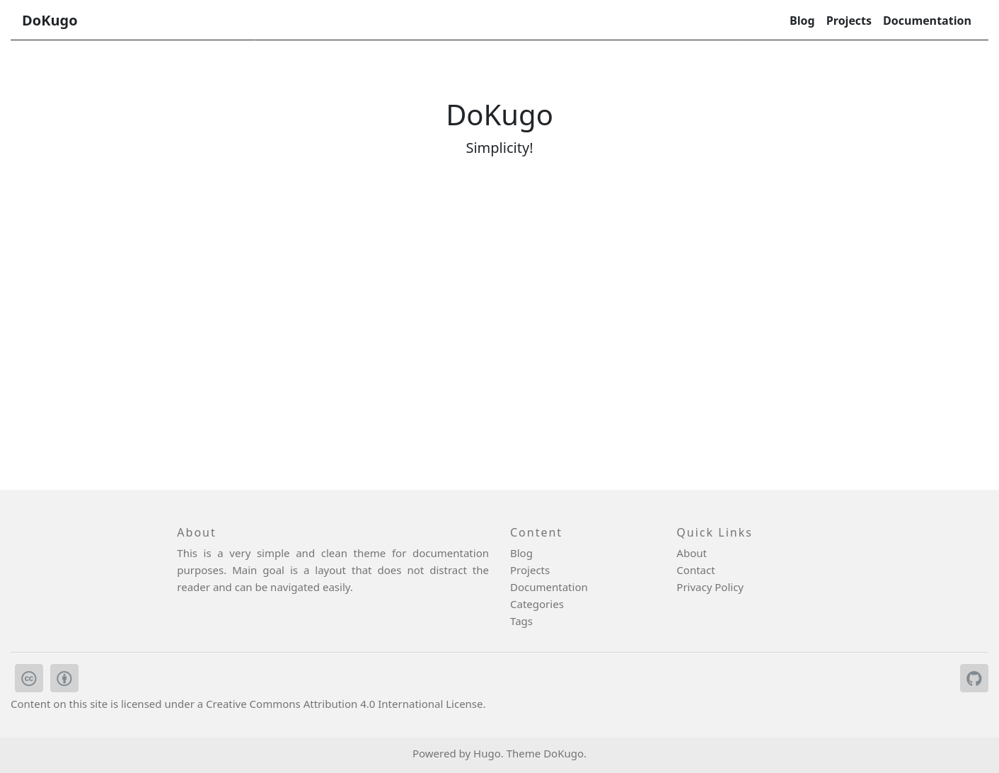

A simple theme for technical documentation purposes.



## Features

- LaTeX with MathJax
- Mermaid - generation of diagrams and flowcharts
- Breadcrumbs
- Table of Contents for articles

## Preview Theme with `exampleSite` Content

Just visit https://akutschi.github.io/dokugo to preview this theme. 
But if you want to test this theme locally for playing around, just clone this repository with

```bash
git clone git@github.com:akutschi/dokugo.git
```

and then

```bash
cd exampleSite
hugo server --themesDir ../../
```

The output of the command above shows you the address, but usually you can find the page at [http://localhost:1313/dokugo](http://localhost:1313/dokugo).

## How To

### Install

Basically you have to do this:

```bash
mkdir -p <SITENAME>/content
cd <sitename>
