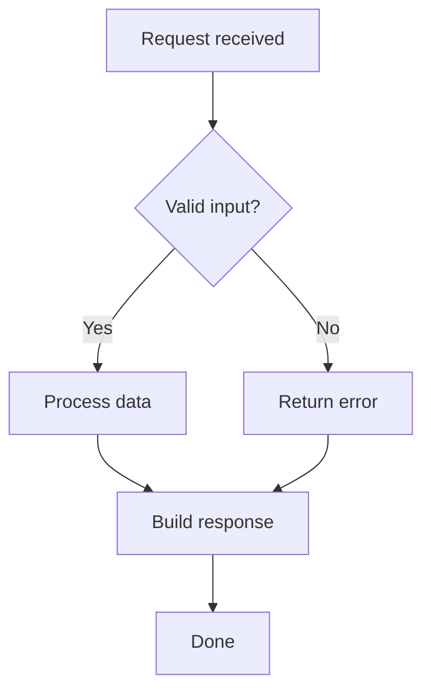

The theme loads Mermaid only on pages that contain at least one `mermaid` code block. Diagrams are re-rendered automatically when the visitor switches between Light, Mirage, and Dark — colors always match the active Ayu theme.

<!--more-->


Use standard fenced code blocks with the `mermaid` language tag. No shortcodes, no extra config — just write the diagram and Hugo handles the rest.


## How it works

A Hugo render hook detects `mermaid` code blocks and sets a page-level flag (`hasMermaid`). The base template loads `mermaid.min.js` only when that flag is set, keeping every other page free of the library.

The theme configures Mermaid with `securityLevel: strict` and a custom `base` theme that maps the eight Ayu syntax colors to the diagram color scales.


Do not use HTML tags, angle brackets, or HTML entities inside node labels. Write plain text only — for example, use `A[my node]` not `A[<b>my node</b>]`.


## Flowchart

A simple request-handling pipeline:



## Sequence diagram

Browser, API, and database interaction:

```mermaid
sequenceDiagram
