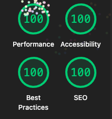
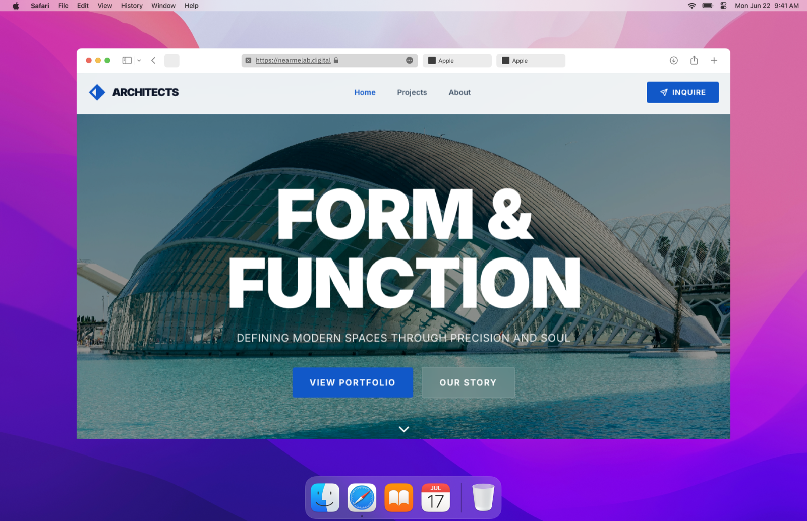

<!-- wasmer:start -->
## Deploy on Wasmer

This folder is the [3dinterior](https://github.com/nearmelab/3dinterior) Astro theme by nearmelab, copied from commit `3f8b3ae59ae9a064a17d5e9fd1e6572e53f1c26a` so it can be deployed as a Wasmer Edge template.

- **Demo:** https://astro-3dinterior.wasmer.app
- **Deploy:** open the template on [wasmer.io/templates](https://wasmer.io/templates) and click **Deploy**, or run `wasmer deploy` in this folder. Wasmer installs with pnpm, runs the build script with Node 24 and serves the static `dist/` folder.
- **Changed for Wasmer:**
  - Removed files used only by other hosts: wrangler.jsonc.
  - Removed the @astrojs/cloudflare adapter from astro.config.mjs and build a static site, since every page can be prerendered. The package stays in package.json so the lockfile is unchanged.
  - Resized 2 images over 300 KB to at most 1600 px wide, keeping file names and formats.
- **Environment variables:** None.
- **Credit:** theme by [nearmelab](https://github.com/nearmelab), MIT. The theme's license file is kept unchanged.
<!-- wasmer:end -->

# 🌆 3dinterior



**Free Astro theme built for architects and design studios.** Blazing-fast performance meets stunning minimalist design.

<p align="center">
  <a href="https://astro.build">
    
  </a>
  <a href="https://tailwindcss.com">
    
  </a>
  <a href="LICENSE">
    
  </a>
</p>

## 📌 Key Features

- ✅ **100/100 Lighthouse score** - Optimized for performance
- ✅ **Portfolio-first design** - Showcase projects beautifully
- ✅ **Mobile-responsive** - Target different devices
- ✅ **Zero JavaScript** (optional) - Fast by default
- ✅ **Easy customization** - Tailwind + clean components



---

## 🚀 Quick Start
```bash
# Clone and install
git clone https://github.com/nearmelab/3dinterior.git
cd 3dinterior
pnpm install

# Start dev server
pnpm dev
```

Visit `localhost:4321` - that's it! 🧑‍🚀

---

## 🎨 Customization

**Colors & Fonts:**
Edit `src/styles/global.css`

**Content:**
- Images: Replace in `src/assets/img/`
- Contact: Edit `src/pages/contact.astro`

**Components:**
All components in `src/components/` use standard Astro + Tailwind

---

## 📸 Image Credits

All images are sourced from [Pexels](https://pexels.com) and are free to use under the Pexels License.

For full attribution details, see **[src/assets/attribution.md](./src/assets/attribution.md)**.

---

## 🤝 Contributing

Found a bug? Want to improve something? PRs welcome!

1. Fork the repo
2. Create your branch (`git checkout -b feature/improvement`)
3. Commit changes (`git commit -m 'Add feature'`)
4. Push (`git push origin feature/improvement`)
5. Open a Pull Request

---

## 📄 License

MIT License - see [LICENSE](./LICENSE) for details.

**Free to use for personal and commercial projects.**

---

## ⭐ Show Your Support

If you found this theme helpful, give it a star on GitHub!

Designed from 🫀 by [Nearmelab](https://nearmelab.digital)

[](https://astro.build)