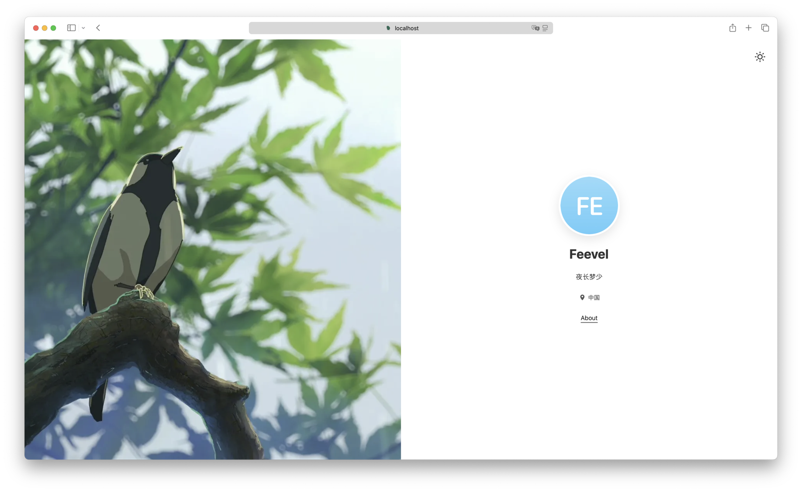
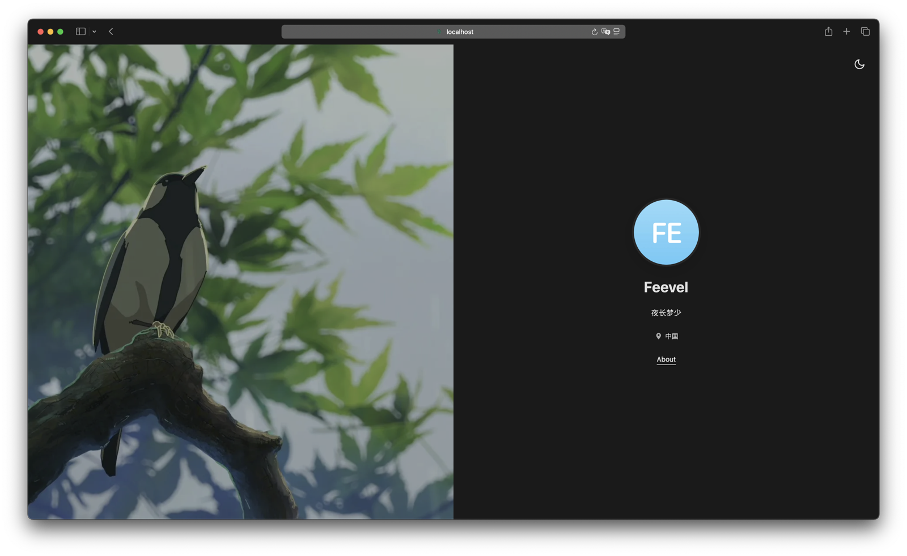
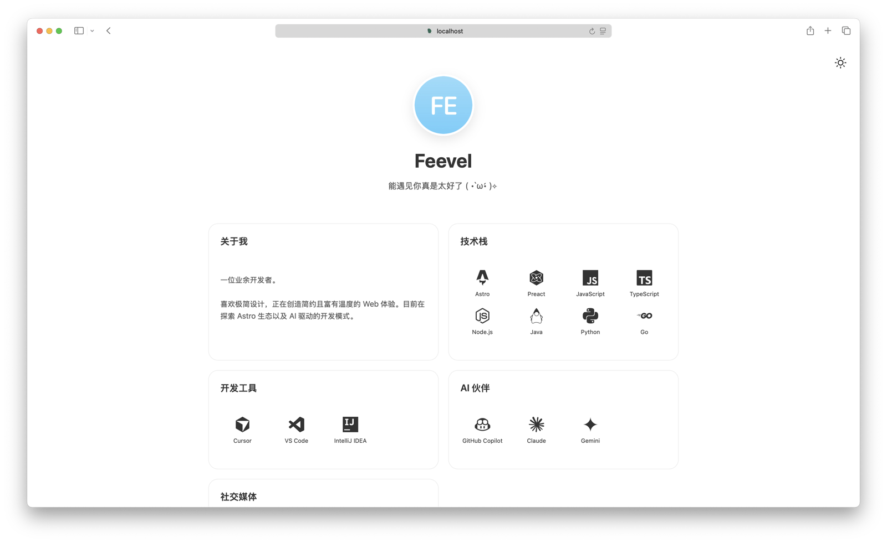
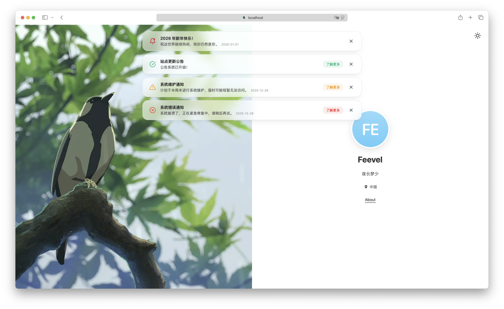

# Airy Personal Page

A minimal, elegant, and high-performance personal landing page built for the modern web.

<p align="center">
  <span>English</span> | <a href="README.md">简体中文</a>
</p>

<p align="center">
  
  
  
  
  
</p>

<p align="center"></p>
<p align="center"></p>

## Tech Stack

- **Astro 5.0+**: A modern high-performance web framework with zero JavaScript runtime by default.
- **Preact**: A lightweight React alternative for complex client-side interactive islands.
- **TypeScript**: Used across the site for a more reliable development experience and type safety.

## Features

- **Modern architecture**: Built on Astro 5.0+ with a Zero-JS runtime model for extremely fast first-screen loading.
- **Hybrid component development**: Core pages use Astro for maximum performance, while complex local interactions are implemented with **Preact (TSX) islands**, balancing development efficiency and runtime performance.
- **Configuration-driven**: Navigation links, site settings, and content data are all managed in `config/site.yaml`; changes take effect directly.
- **Dark mode support**: Built-in dark theme with system preference detection, one-click switching, and local preference persistence.
- **Responsive design**: Optimized for mobile, tablet, and desktop to keep the experience consistent across devices.
- **Bento layout**: Content pages use a modern Bento Grid style with configurable content modules, combining structure and visual refinement.

## Project Structure

The project follows Astro's standard directory conventions. Core logic lives under `src/`:

```text
├── src/
│   ├── assets/             # Static assets (images, fonts)
│   ├── components/         # Components
│   │   ├── common/           # Shared Preact island components
│   │   ├── layout/           # Layout components
│   │   └── theme/            # Theme toggle components
│   ├── constants/          # Constants (runtime enums and mappings)
│   ├── layouts/            # Layout components (page shells)
│   ├── pages/              # Page routes (file names become routes)
│   ├── styles/             # Global styles (CSS)
│   ├── types/              # Type definitions (global TypeScript definitions)
│   ├── utils/              # Utility functions
│   └── content.config.ts   # Content configuration (Astro)
├── public/                 # Static assets (images, favicon)
├── config/                 # Configuration files
│   └── site.yaml           # Site information configuration
├── astro.config.mjs        # Astro configuration
├── tsconfig.json           # TypeScript configuration (with JSX path aliases)
├── package-lock.json       # Dependency lock file
└── package.json            # Project dependency management
```

## Architecture

### 1. Component System

This project uses Astro's standard component model:

- **BaseLayout**: The shell shared by all pages. It manages the unified `<body>` structure and includes the theme toggle component and `BaseFooter`.
- **SplitLayout**: A split-column layout component with configurable column ratios, Banner support, and custom content slot injection.
- **BaseHead**: A standalone head component that encapsulates SEO meta tags, favicon, viewport settings, and other shared logic. It includes a tiny inline script to prevent theme flicker and supports slot injection.
- **BaseFooter**: A standalone footer component adapted for the split-column layout.
- **ThemeToggle**: Standalone theme switching logic.
- **Preact Islands**: Interactions that require complex state management are powered by Preact island components (`.tsx`) and partially hydrated through `client:*` directives.
  - **Announcement**: A global announcement component (Preact island). Based on `site.yaml`, it supports multiple rotating announcements, semantic colors (Info/Success/Warning/Error), and user dismissal persistence via `localStorage`.

### 2. Styling

| File | Responsibility |
|------|----------------|
| `src/styles/global.css` | Global style entry that imports base styles |
| `src/styles/base/*.css` | Base component styles such as CSS Reset, global fonts, and theme colors |
| `src/components/*.css` | Component styles |

## Build Guide

### Requirements

- Node.js (v18.20.8 or later)
- npm

### 1. Install Dependencies

```bash
npm install
```

### 2. Start the Local Development Server

```bash
npm run dev
```

Open `http://localhost:4321` to preview the site.

### 3. Build for Production

```bash
npm run build
```

The production output will be generated in `dist/` and can be deployed to any static hosting service, such as Vercel, Netlify, GitHub Pages, or Nginx.

## Customization

Want to turn this homepage into your own? It is straightforward:

1. **Update site configuration**: Edit `config/site.yaml` to update the site title, description, announcements, and related information.
2. **Adjust styles**: Modify CSS files under `src/styles/` and `src/components/` when you need custom styling.
3. **Add or modify pages**: Add or edit page files under `src/pages/`.
4. **SEO and Sitemap**: Adjust SEO settings in `src/components/BaseHead.astro` and the `site` configuration in `astro.config.mjs` as needed.

Astro 5.0+ advanced `View transitions` support is prepared but not enabled by default:

1. Follow the [Astro documentation](https://docs.astro.build/en/guides/client-side-routing/) for setup.
2. Uncomment the `ClientRouter` adaptation code.
3. Add attributes such as `transition:persist` and `transition:name` to global or shared page components as needed.

## Deployment

Because this is a purely static website, the following free options are recommended:

- **GitHub Pages**: Push the code to GitHub and enable Pages. GitHub Actions is recommended for automatic builds.
- **Vercel / Netlify**: Connect the GitHub repository; the Astro framework will be detected automatically for one-click deployment.
- **Self-hosted Nginx**: Upload the `dist/` directory to your server and configure Nginx to point to its `index.html`.

## License

[MIT License](LICENSE)
