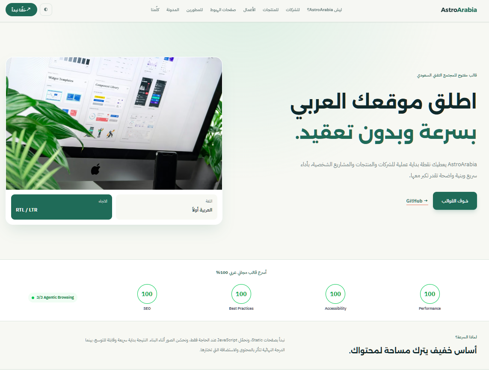

<!-- wasmer:start -->
## Deploy on Wasmer

This folder is the [AstroArabia](https://github.com/almahers/astroarabia) Astro theme by almahers, copied from commit `43f242c93929758c929875852a5e92f692610ff7` so it can be deployed as a Wasmer Edge template.

- **Demo:** https://astro-astroarabia.wasmer.app
- **Deploy:** open the template on [wasmer.io/templates](https://wasmer.io/templates) and click **Deploy**, or run `wasmer deploy` in this folder. Wasmer installs with npm, runs the build script with Node 24 and serves the static `dist/` folder.
- **Changed for Wasmer:**
  - Resized 3 images over 300 KB to at most 1600 px wide, keeping file names and formats.
  - Added .nvmrc with Node 24, the Node version Wasmer builds with.
- **Environment variables:** The theme's example env file lists `PUBLIC_WHATSAPP_NUMBER`, `PUBLIC_GOOGLE_SITE_VERIFICATION`, `PUBLIC_GA_ID`. The demo builds and runs without them; set them in the app's settings to turn on the features that use them.
- **Credit:** theme by [almahers](https://github.com/almahers), MIT. The theme's license file is kept unchanged.
<!-- wasmer:end -->

# AstroArabia

[🇸🇦 العربية](./README.md) | [🇬🇧 English](./README.en.md)

[](./LICENSE)




> [شاهد الديمو الحي](https://astroarabia.pages.dev) — يتحدث تلقائياً من فرع `main`.

ثيم (Theme) Astro عربي مفتوح المصدر، مصمم للمجتمع التقني السعودي. يوفر نقطة بداية سريعة وواضحة للشركات والمنتجات الرقمية والمشاريع الشخصية، مع RTL أصيل وأقل قدر ممكن من JavaScript.

## المميزات الرئيسية

• مبني على Astro لإخراج صفحات ثابتة وسريعة.

• متكامل مع Tailwind CSS v4 ونظام ألوان ومسافات قابل للتخصيص.

• RTL-first في التخطيطات والمسافات والتفاعلات الدقيقة.

• نموذج التواصل جاهز للتخصيص، بدون فرض مزود إرسال أو خدمة خارجية.

• وضع داكن يدعم فئة `dark:` ويحفظ اختيار الزائر محلياً.

• أساس SEO جاهز: canonical وOpen Graph وSitemap وبيانات وصفية لكل صفحة.

• خمسة مسارات جاهزة: الشركات، المنتجات الرقمية، التوثيق، معرض الأعمال، وصفحة الهبوط.

• مكونات UI قابلة لإعادة الاستخدام عبر CVA للأزرار والبطاقات.

## التثبيت السريع

```bash
npm create astro@latest -- --template almahers/astroarabia
```

بعد إنشاء المشروع:

```bash
cd astroarabia
npm install
npm run dev
```

يتطلب Astro في هذا المشروع Node.js `22.12.0` أو أحدث وnpm `9.6.5` أو أحدث. استخدم رقمًا زوجيًا أو إصدار LTS من Node.js.

## النسخ والمكدس التقني

هذه النسخ هي النسخ المقفلة في `package-lock.json` وقت آخر تدقيق للمشروع. حدّث هذا الجدول بعد ترقية الاعتمادات.

| المجال       | الأداة أو المكتبة                        | النسخة             |
| ------------ | ---------------------------------------- | ------------------ |
| الأساس       | Astro                                    | `7.2.9`            |
| البناء       | Vite                                     | `8.2.2`            |
| التصميم      | Tailwind CSS و`@tailwindcss/vite`        | `4.3.3`            |
| الأنواع      | TypeScript                               | `6.0.3`            |
| التحقق       | `@astrojs/check`                         | `0.9.10`           |
| الجودة       | ESLint و`eslint-plugin-astro`            | `10.9.1` / `1.7.0` |
| التنسيق      | Prettier و`prettier-plugin-astro`        | `3.9.6` / `0.14.1` |
| SEO          | `@astrojs/sitemap`                       | `3.7.3`            |
| المحتوى      | `astro-toc-smol`                         | `0.4.4`            |
| الواجهة      | CVA و`clsx`                              | `0.7.1` / `2.1.1`  |
| الخطوط       | Alexandria وIBM Plex Sans Arabic         | `5.3.0`  |
| المشاركة     | `astro-social-share`                     | `2.2.0`            |

## أبرز هيكلة المشروع

```text
src/
├── components/
│   ├── ui/                 # Button و Card بمتحكمات CVA
│   ├── SiteHeader.astro
│   ├── SiteFooter.astro
│   └── QuoteForm.astro
├── layouts/
│   └── BaseLayout.astro
├── content/
│   └── blog/               # مقالات Markdown
├── content.config.ts        # مخطط محتوى Astro
├── assets/                  # الصور المحسّنة وقت البناء
├── lib/                     # دوال مساعدة مشتركة
├── pages/
│   ├── index.astro         # الصفحة الرئيسية
│   ├── agency/             # الشركات والخدمات
│   ├── saas/               # المنتجات الرقمية
│   ├── docs/               # التوثيق
│   ├── portfolio/          # معرض الأعمال
│   └── landing/            # صفحة الهبوط
└── styles/
    └── global.css
public/                      # ملفات عامة وrobots.txt
astro.config.mjs             # تكاملات Astro وإعدادات الموقع
tailwind.config.mjs          # Theme وأدوات Tailwind
```

## أوامر التشغيل

| الأمر                  | الاستخدام                                  |
| ---------------------- | ------------------------------------------ |
| `npm install`          | تثبيت الاعتمادات                           |
| `npm run dev`          | تشغيل بيئة التطوير المحلية                 |
| `npm run build`        | إنشاء نسخة الإنتاج داخل `dist`             |
| `npm run check`        | فحص أنواع Astro والمكونات                  |
| `npm test`             | تشغيل اختبارات المشروع                     |
| `npm run lint`         | فحص جودة الكود                             |
| `npm run format:check` | التحقق من تنسيق Prettier دون تعديل الملفات |
| `npm run format`       | تنسيق الملفات باستخدام Prettier            |

## تخصيص الهوية والثيم (Theme)

ابدأ بتعديل `tailwind.config.mjs` لتغيير ألوان الهوية والخطوط والمسافات المستخدمة في المكونات. توجد رموز مماثلة في `src/styles/global.css` داخل `@theme`؛ حدّث الموضعين معًا عند تغيير هوية القالب. الخط العربي المحلي هو IBM Plex Sans Arabic، والعناوين تستخدم Alexandria.

## إعدادات القالب

انسخ `.env.example` إلى `.env` ثم غيّر `PUBLIC_WHATSAPP_NUMBER` إلى رقم واتساب مشروعك بالأرقام فقط ومن دون علامة `+`. الرقم الموجود في القالب تجريبي حتى لا يرتبط القالب برقم شخصي.

نموذج الطلب واجهة جاهزة فقط؛ لا يرسل أي بيانات ولا يفرض عليك مزودًا خارجيًا. اربطه بالطريقة التي تناسب مشروعك، مثل Cloudflare Pages Functions أو Worker أو خدمة نماذج خارجية، مع إضافة الحماية والتحقق المناسبين.

AstroArabia متاح مجانًا للمجتمع العربي تحت رخصة [MIT](./LICENSE). استبدل الروابط والمحتوى التجريبي بهوية مشروعك قبل النشر العام. درجات Lighthouse تعتمد على المحتوى والاستضافة وإضافاتك؛ افحص النسخة النهائية قبل إطلاقها.

## النشر المباشر

[](https://vercel.com/new/clone?repository-url=https://github.com/almahers/astroarabia)

[](https://app.netlify.com/start/deploy?repository=https://github.com/almahers/astroarabia)

[](https://dash.cloudflare.com/?to=/:account/pages/new/provider/github)

للنشر اليدوي، استخدم أمر البناء التالي واجعل مجلد الإخراج `dist`:

```bash
npm run build
```

## المساهمة والترخيص

المساهمات التي تحسن تجربة الويب العربي مرحب بها. راجع [دليل المساهمة](./CONTRIBUTING.md) قبل فتح طلب دمج.

المشروع مرخص بموجب [MIT](./LICENSE).
