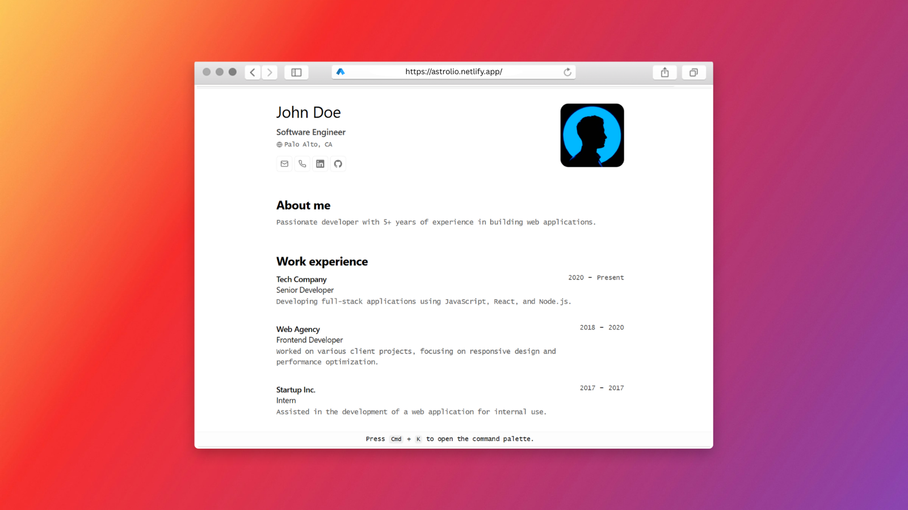
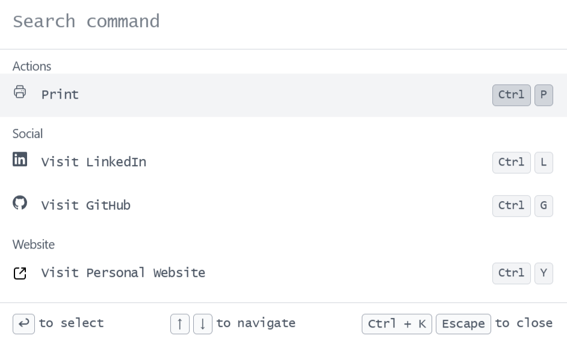

<!-- wasmer:start -->
## Deploy on Wasmer

This folder is the [Astrolio](https://github.com/dakodonnell/astrolio) Astro theme by dakodonnell, copied from commit `19412e56bf27c14807700a9fe5d765972dd5eb2a` so it can be deployed as a Wasmer Edge template.

- **Demo:** https://astro-astrolio.wasmer.app
- **Deploy:** open the template on [wasmer.io/templates](https://wasmer.io/templates) and click **Deploy**, or run `wasmer deploy` in this folder. Wasmer installs with npm, runs the build script with Node 24 and serves the static `dist/` folder.
- **Changed for Wasmer:**
  - Added .nvmrc with Node 24, the Node version Wasmer builds with.
- **Environment variables:** None.
- **Credit:** theme by [dakodonnell](https://github.com/dakodonnell), MIT. The theme's license file is kept unchanged.
<!-- wasmer:end -->

<div align="center">

<h1>
    ASTROLIO: A one-page portfolio template
</h1>
</div>

<div align="center">
    <a href="#-get-started">
        🚀 Get Started
    </a>
    <span>&nbsp;✦&nbsp;</span>
    <a href="#-site-commands">
        🪄 Command Palette
    </a>
    <span>&nbsp;✦&nbsp;</span>
    <a href="#-license">
        🔑 License
    </a>
    <span>&nbsp;✦&nbsp;</span>
    <a href="https://dakodonnell.com">
        🔗 Author
    </a>
</div>

<p></p>

<div align="center">

[](https://app.netlify.com/sites/astrolio/deploys)


</div>

</img>

## 🚀 Get Started

### 0. Ensure you have the proper dev tools:

- For Astro to run on your system, you will also need to have Node.js installed, version `v18.17.1` or `v20.3.0` or later. (`v19` is not supported.)

```bash
# Check if you already have a compatible version of Node.js installed
node -v
```

- If the command returns a version number higher than `v18.17.1` or `v20.3.0` (excluding any `v19`), you’re good to go!

- If the command returns an error message like `Command 'node' not found`, or a version number lower than the required, then you need to [install a compatible Node.js version.](https://docs.npmjs.com/downloading-and-installing-node-js-and-npm)

### 1. Use this repo as a _template_ for an Astro project:

- Using the command line:
```bash
# Initialize the project
npm create astro@latest -- --template dakodonnell/astrolio
```
- Or, simply [clone](https://github.com/new?template_name=astrolio&template_owner=dakodonnell) as a template from Github

### 2. Add your content:
Add your portfolio content:

- Place your CV file as `src/cv.json`  
- Must follow the JSON Resume [schema](https://jsonresume.org/schema)  
- Sample CV is included for demo or editing  
- Optional attributes for projects:
  ```json
  "isActive": true,
  "GitHub": "https://github.com/GitHubUsername/GitHubRepo"


### 3. Launch the development server:

```bash
# See the result
npm run dev
```

- Open [**http://localhost:4321**](http://localhost:4321/) in your browser to see the result 🚀

- If you wish to deploy your portfolio site to the web, continue to [step 4](#4-push-your-portfolio-to-the-web)

### 4. Push your portfolio to the web:

Connect your portfolio repo to a platform that deploys static web applications ([Netlify](https://netlify.com) or [Vercel](https://vercel.com) are good options)

- If you know what you are doing, you can deploy your portfolio site directly from here:

[](https://app.netlify.com/start/deploy?repository=https://github.com/dakodonnell/astrolio) [](https://vercel.com/new/clone?repository-url=https%3A%2F%2Fgithub.com%2Fdakodonnell%2Fastrolio)

## 🪄 Command Palette
The Command Palette is a quick-access menu for portfolio actions, accessible via a hotkey on PC (`Cmd+K` / `Ctrl+K`) or a button on mobile.

Quickly use it to:

- Export your portfolio as a **PDF**
- Navigate to any **project, publication, or website link** from the resume
- Jump to the **Astrolio template** page to create your own portfolio


|      |       |
|------|-------|
| Hotkeys match each action for instant access |  |

## 🔑 License

[MIT](LICENSE.txt) - Go crazy.

## 🫂 Special Thanks

- My wife Melissa, for her feedback and for being a delight

- [Bartosz Jarocki](https://github.com/BartoszJarocki/cv), for inspiring the project

- [Miguel Ángel Durán](https://github.com/midudev/minimalist-portfolio-json), for the shoulders I stand on

