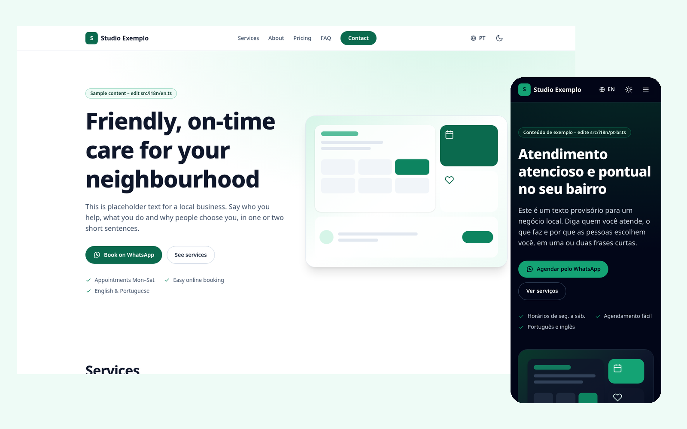

<!-- wasmer:start -->
## Deploy on Wasmer

This folder is the [Balcao](https://github.com/rbmrs/astro-balcao) Astro theme by rbmrs, copied from commit `ef2d665595652c6711d75a2311c9c0e12ec6f496` so it can be deployed as a Wasmer Edge template.

- **Demo:** https://astro-balcao.wasmer.app
- **Deploy:** open the template on [wasmer.io/templates](https://wasmer.io/templates) and click **Deploy**, or run `wasmer deploy` in this folder. Wasmer installs with npm, runs the build script with Node 24 and serves the static `dist/` folder.
- **Changed for Wasmer:**
  - None. The theme builds as published.
- **Environment variables:** None.
- **Credit:** theme by [rbmrs](https://github.com/rbmrs), MIT. The theme's license file is kept unchanged.
<!-- wasmer:end -->

# Balcão – free bilingual Astro landing page for local businesses

**English + Português (pt-BR)** one-page website template for clinics, salons, studios, consultants and other local services. Built with Astro and Tailwind CSS, with no backend and no paid dependencies.



**Live demo:** https://rbmrs.github.io/astro-balcao/ · **Want more pages, presets and a blog?** [Balcão Pro](https://rafaelbastos2.gumroad.com/l/balcao-pro)

> 🇧🇷 [Leia em português](#português)

## Features

- 🌐 **Bilingual out of the box:** English at `/`, Portuguese at `/pt-br/`, a language toggle, `hreflang` tags and a localised sitemap. You can make Portuguese the default language with one line.
- 🧩 **Sections:** hero, services, about, pricing, testimonials (placeholder), FAQ and a contact call-to-action.
- 💬 **WhatsApp and email CTAs:** `wa.me` links with a prefilled message, plus `mailto:`. No forms backend is needed.
- 🌙 **Dark mode** that follows the system setting, with a toggle that remembers the visitor's choice and no flash on load.
- 🔎 **SEO:** title and description, canonical URL, Open Graph and Twitter card, `@astrojs/sitemap`, `robots.txt`.
- ⚡ **Fast:** static HTML, system fonts, inline SVG icons and almost no JavaScript. Lighthouse scored 100 in Performance, Accessibility, Best Practices and SEO in our local test (mobile and desktop).
- 🎨 **One config file** (`src/site.config.ts`) for the business name, contact links, brand colours and languages.
- 🚀 **GitHub Pages workflow** included (`.github/workflows/deploy.yml`).

All demo text is sample content. Replace it with your own business details. Don't publish testimonials, numbers or credentials that aren't real.

## Quick start

```bash
npm create astro@latest -- --template rbmrs/astro-balcao
# or: git clone https://github.com/rbmrs/astro-balcao && cd astro-balcao
npm install
npm run dev        # http://localhost:4321
npm run build      # astro check + static build to ./dist
```

Requires Node.js 22.23.4 or newer.

## Customise

| What | Where |
| --- | --- |
| Business name, URL, WhatsApp, email, colours, default language | `src/site.config.ts` |
| English text | `src/i18n/en.ts` |
| Portuguese text | `src/i18n/pt-br.ts` (type-checked against the English file, so nothing goes missing) |
| Sections and their order | `src/components/HomePage.astro` |
| Styles and brand utilities | `src/styles/global.css` |
| Social preview image | `public/og.png` (1200×630) |

**Make Portuguese the default:** set `defaultLocale: 'pt-br'` in `src/site.config.ts`. Portuguese is then served at `/` and English at `/en/`.

## Deploy

- **GitHub Pages:** push to `main`, then go to *Settings → Pages → Source: GitHub Actions*. The workflow sets `SITE_URL` and `BASE_PATH` for project pages.
- **Netlify / Vercel / Cloudflare Pages:** build command `npm run build`, output folder `dist`. Set `site.url` in `src/site.config.ts` to your domain.

## Balcão Pro

[Balcão Pro](https://rafaelbastos2.gumroad.com/l/balcao-pro) is a paid, one-time purchase. It adds:

- 3 niche presets (clinic, salon, consultant), each with its own colours, hero layout, sample copy and section order, chosen with one config line
- More sections: process, team, gallery, hours and location, and a WhatsApp booking form (no backend)
- Blog with content collections in both languages, with linked translations
- schema.org `LocalBusiness` (`MedicalClinic` / `BeautySalon` / `ProfessionalService`), `FAQPage` and `BlogPosting` JSON-LD
- Floating WhatsApp button and a 404 page
- Step-by-step setup guide in English and Portuguese

## License

MIT. See [LICENSE](LICENSE). Use it for personal and client projects.

---

## Português

**Balcão** é um template gratuito de landing page em **português e inglês** para negócios locais (clínicas, salões, estúdios, consultorias), feito com Astro e Tailwind CSS.

- Rotas `/` (inglês) e `/pt-br/` (português), com botão de idioma e `hreflang`. Para deixar o português como idioma principal, use `defaultLocale: 'pt-br'` em `src/site.config.ts`.
- Seções: destaque, serviços, sobre, preços, depoimentos (espaço reservado), dúvidas frequentes e contato.
- Botões de WhatsApp (mensagem pronta) e e-mail, sem necessidade de servidor.
- Modo escuro, SEO, sitemap e `robots.txt`.
- Textos em `src/i18n/pt-br.ts`; nome, WhatsApp, e-mail e cores em `src/site.config.ts`.

```bash
npm install
npm run dev
npm run build
```

Todo o conteúdo da demonstração é de exemplo. Publique apenas depoimentos, números e registros reais.

Precisa de mais páginas, presets de nicho e blog? Veja o [Balcão Pro](https://rafaelbastos2.gumroad.com/l/balcao-pro).

Licença MIT.
