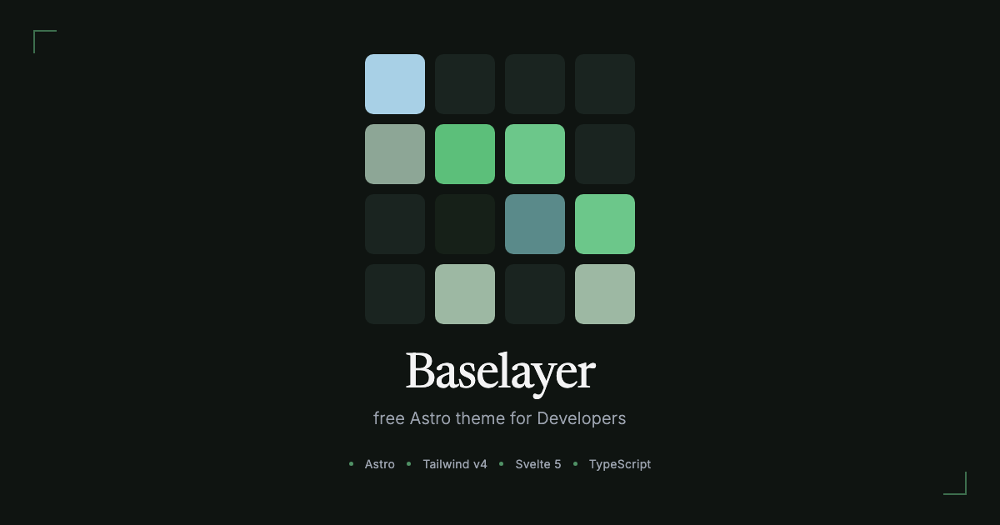

<!-- wasmer:start -->
## Deploy on Wasmer

This folder is the [Baselayer](https://github.com/baflow/baselayer) Astro theme by baflow, copied from commit `6c4828a387668878feb5e2010bf1336b0182a064` so it can be deployed as a Wasmer Edge template.

- **Demo:** https://astro-baselayer.wasmer.app
- **Deploy:** open the template on [wasmer.io/templates](https://wasmer.io/templates) and click **Deploy**, or run `wasmer deploy` in this folder. Wasmer installs with npm, runs the build script with Node 24 and serves the static `dist/` folder.
- **Changed for Wasmer:**
  - Removed files used only by other hosts: wrangler.toml.
- **Environment variables:** None.
- **Credit:** theme by [baflow](https://github.com/baflow), MIT. The theme's license file is kept unchanged.
<!-- wasmer:end -->

# Astro Dev Template

[](https://astro.build)
[](https://tailwindcss.com)
[](https://svelte.dev)
[](./LICENSE)

> A free, design-token-driven Astro 6 starter for dark-mode blogs and product showcases.

**[Live Demo](https://baselayer-pk4.pages.dev/)**



---

## One-Click Deploy

Deploy your own copy in under 2 minutes:

[](https://vercel.com/new/clone?repository-url=https://github.com/baflow/baselayer)
[](https://app.netlify.com/start/deploy?repository=https://github.com/baflow/baselayer)

Or use the CLI:

```bash
# Clone
git clone https://github.com/baflow/baselayer.git my-site
cd my-site

# Install & dev
npm install
npm run dev
```

---

## Stack

Built with **Astro 6**, **Tailwind CSS v4**, **Basecoat CSS**, **Svelte 5**, Solar icons, and Inter + Newsreader fonts. Deploys to Cloudflare Pages.

---

## Features

- **Content Collections** with typed frontmatter for blog posts and projects
- **Design-token-driven** Tailwind theme — tweak colors, typography, and spacing through a single source of truth
- **Basecoat UI** — debloated components, no React needed
- **Expressive Code** for beautiful fenced code blocks
- **RSS, Sitemap, Open Graph** out of the box, thanks to Astro
- **Optional contact form** — Cloudflare Workers + Resend API

---

## Project Structure

```text
├── public/                          # Static assets
├── src/
│   ├── assets/                      # Images processed by Astro
│   ├── components/                  # Astro + Svelte UI components
│   │   └── ui/                      # Reusable Svelte components
│   ├── content/                     # Markdown/MDX collections
│   ├── layouts/                     # Page layouts
│   ├── pages/                       # File-based routes
│   ├── styles/                      # Tailwind theme + Basecoat imports
│   └── types/                       # Local type definitions
├── integrations/                    # Git submodules (optional)
│   └── email-cloudflare-resend/     # Email worker (separate deploy)
├── scripts/                         # Dev / deploy helpers
├── DESIGN.md                        # Design system spec
├── astro.config.mjs
├── wrangler.toml
└── README.md
```

---

## Before you publish your site

1. **Set your site URL** in `astro.config.mjs`:
   ```js
   site: 'https://your-domain.com',
   ```
2. **Update placeholders** in `src/consts.ts` (title, description, contact links).
3. **Replace the footer** text in `src/components/Footer.astro`.
4. **Add your own content** to `src/content/blog/` and `src/content/projects/`.
5. **Replace thumbnail** — add `public/thumbnail.png` (1200x630 recommended).
6. **Configure Wrangler** (optional) in `wrangler.toml` and `.env`.
7. **Update repo URL** in the deploy buttons above.


---

## Git Submodules

This template uses a **git submodule** for the email worker so it can evolve independently while remaining version-pinned here.

```bash
# After cloning, initialise the submodule
git submodule update --init

# The submodule is mounted at:
# integrations/email-cloudflare-resend/
```

The submodule points to [`email-cloudflare-resend`](https://github.com/baflow/email-cloudflare-resend) — a standalone Cloudflare Worker that acts as a secure email proxy (Turnstile, rate limiting, Resend relay). It is **deployed separately** from the Astro site. The frontend talks to it via `EMAIL_WORKER_URL`.

---

## Email Worker (submodule)

The worker lives in `integrations/email-cloudflare-resend/` (git submodule). It validates contact-form submissions from the static Astro site and relays them in a secure way through **Resend**.

### Required secrets & variables (inside submodule)

| Name | Type | How to set | Purpose |
|------|------|------------|---------|
| `RESEND_API_KEY` | Secret | `wrangler secret put RESEND_API_KEY` | Resend API bearer token |
| `TURNSTILE_SECRET` | Secret | `wrangler secret put TURNSTILE_SECRET` | Cloudflare Turnstile site secret |
| `RATE_LIMIT_KV` | KV binding | `wrangler.toml` (`[[kv_namespaces]]`) | KV namespace for rate-limit storage |
| `SENDER_DOMAIN` | Variable | `wrangler.toml` (`[vars]`) | Allowed sender domain |
| `RATE_LIMIT_MAX` | Variable | `wrangler.toml` (`[vars]`) | Max requests per IP (default `2`) |
| `RATE_LIMIT_WINDOW_MINUTES` | Variable | `wrangler.toml` (`[vars]`) | Sliding window in minutes (default `15`) |
| `EMAIL_ENABLED` | Variable | `wrangler.toml` (`[vars]`) | Set `false` to disable `/send` (returns `503`) |

### Quick start

1. **Initialise the submodule** (if you haven't yet):
   ```bash
   git submodule update --init
   ```

2. **Install & configure** inside the submodule:
   ```bash
   cd integrations/email-cloudflare-resend
   npm install
   ```
   Edit `wrangler.toml` with your `SENDER_DOMAIN` and create a KV namespace if needed.

3. **Add secrets**:
   ```bash
   npx wrangler secret put RESEND_API_KEY
   npx wrangler secret put TURNSTILE_SECRET
   ```

4. **Deploy**:
   ```bash
   npm run email:deploy
   # or manually: cd integrations/email-cloudflare-resend && npx wrangler deploy
   ```

5. **Wire the frontend** — set the worker URL in `.env`:
   ```bash
   EMAIL_WORKER_URL=https://email-cloudflare-resend.<subdomain>.workers.dev/send
   EMAIL_RECIPIENT=hello@yourdomain.com
   ```

---

## Contributing

Feature requests and PRs are welcome. See [CONTRIBUTING.md](./CONTRIBUTING.md) for guidelines.

---

## License

MIT -- free for personal and commercial use.
