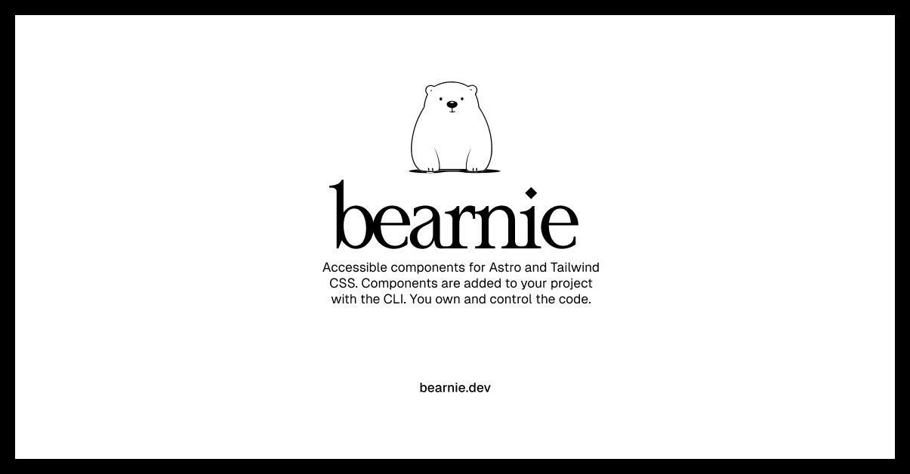

<!-- wasmer:start -->
## Deploy on Wasmer

This folder is the [Bearnie](https://github.com/michael-andreuzza/bearnie) Astro theme by michael-andreuzza, copied from commit `cf84f7b90d73bec8a5a90d66c3dcbd3297d3eae4` so it can be deployed as a Wasmer Edge template.

- **Demo:** https://astro-bearnie.wasmer.app
- **Deploy:** open the template on [wasmer.io/templates](https://wasmer.io/templates) and click **Deploy**, or run `wasmer deploy` in this folder. Wasmer installs with npm, runs the build script with Node 24 and serves the static `dist/` folder.
- **Changed for Wasmer:**
  - Added .nvmrc with Node 24, the Node version Wasmer builds with.
- **Environment variables:** None.
- **Credit:** theme by [michael-andreuzza](https://github.com/michael-andreuzza), MIT. The theme's license file is kept unchanged.
<!-- wasmer:end -->

# Bearnie

A set of accessible components that you can customize, extend, and build on. Start here then make it your own. Open Source. Open Code. **Use this to build your own component library.**

## Documentation

Visit [https://bearnie.dev/docs](https://bearnie.dev/docs) to view the documentation.

## Contributing

Please read the [contributing guide](./CONTRIBUTING.md).

## Sponsors

If you find Bearnie useful, consider [sponsoring the project](https://github.com/sponsors/michael-andreuzza).

## License

Licensed under the [MIT license](./LICENSE).
