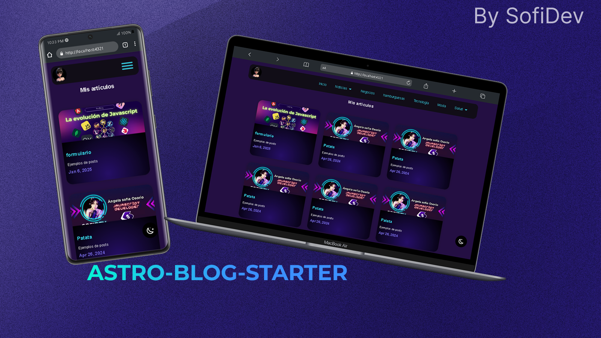

<!-- wasmer:start -->
## Deploy on Wasmer

This folder is the [astro-blog-starter](https://github.com/SofiDevO/astro-blog-starter) Astro theme by SofiDevO, copied from commit `0f400014788970c0139e3785ec24d3fae19e318d` so it can be deployed as a Wasmer Edge template.

- **Demo:** https://astro-blog-starter.wasmer.app
- **Deploy:** open the template on [wasmer.io/templates](https://wasmer.io/templates) and click **Deploy**, or run `wasmer deploy` in this folder. Wasmer installs with npm, runs the build script with Node 24 and serves the static `dist/` folder.
- **Changed for Wasmer:**
  - Added .nvmrc with Node 24, the Node version Wasmer builds with.
- **Environment variables:** None.
- **Credit:** theme by [SofiDevO](https://github.com/SofiDevO), MIT. The theme's license file is kept unchanged.
<!-- wasmer:end -->


# Astro Blog Starter 🌟

A lightweight starter template with atomic design structure, SEO optimization, and modern features. Perfect for fast-paced development!

## Features ✨

- ⚡ SEO Pre-configured (OpenGraph, Meta Tags)
- 🌓 Light/Dark theme toggle
- 🧩 Atomic Design structure
- 🪝 Dynamic dropdown menu
- 🎨 Vanilla CSS (no frameworks)
- 📦 Iconify integration
- 🚀 Production-ready configuration

## Installation ⚙️

```bash
# Clone template
npm create astro@latest -- --template SofiDevO/astro-blog-starter

# Install dependencies
npm install

# Start dev server (port 4321)
npm run dev

# Build for production
npm run build
````


[](https://opensource.org/licenses/MIT)
[](https://astro.build)



## Key Components 🔑

### Atomic Design Implementation
- **Atoms**:
  `ToggleTheme.astro` (+ CSS) | `HamburgerButton.astro` | `FormattedDate.astro`
- **Molecules**:
  `Blogcards.astro` (Post grids)
- **Organisms**:
  `Header.astro` (Responsive nav with dropdowns)

### Content Management
```astro
// Example blog post (content/blog/post.md)
---
title: "My First Post"
date: 2024-01-01
---

Article content...
```


## Core Structure 🌐

```
src/
├── components/
│   ├── atoms/
│   │   ├── CardBlog/           # Blog post cards
│   │   ├── HamburgerButton/    # Mobile menu toggle
│   │   ├── Icons/              # Iconify wrapper
│   │   ├── ToggleTheme/        # Dark/light switcher (+ CSS)
│   │   └── utilsComponents/    # Date formatter
│   ├── molecules/
│   │   └── Blogcards/          # Blog post grid system
│   └── organisms/
│       ┗── Header/             # Navigation with dropdowns
├── content/
│   ├── blog/                   # Markdown posts
│   └── config.ts               # Content collection config
├── data/
│   └── menuElements.js         # Navigation items
├── layouts/
│   ├── Layout.astro            # Default layout
│   └── LayoutBlogPost.astro    # Article template
├── pages/
│   ├── blog/
│   │   ├── [...slug].astro     # Dynamic blog routes
│   │   └── index.astro         # Blog archive
│   └── index.astro             # Homepage
└── styles/
    └── global.css              # Base styles
```


## Support Development ☕
[](https://github.com/sponsors/SofiDevO?o=esb)
[](https://ko-fi.com/sofidev)

---

**MIT Licensed** | Optimized for Astro v5+ | [Full Documentation](https://github.com/SofiDevO/astro-blog-starter)
