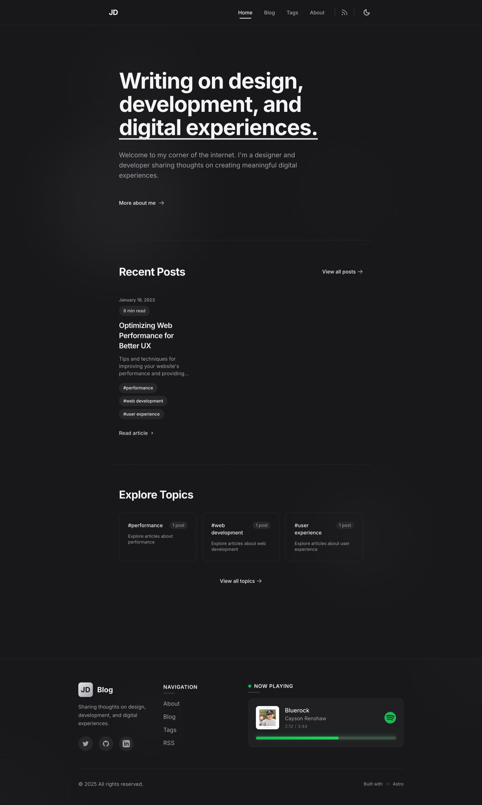

<!-- wasmer:start -->
## Deploy on Wasmer

This folder is the [Minimalistic Astro Blog](https://github.com/williamcachamwri/astro-blog) Astro theme by williamcachamwri, copied from commit `6caad67d9ef1ba81e75e4bbeea7363aa1068fd04` so it can be deployed as a Wasmer Edge template.

- **Demo:** https://astro-blog-williamcachamwri.wasmer.app
- **Deploy:** open the template on [wasmer.io/templates](https://wasmer.io/templates) and click **Deploy**, or run `wasmer deploy` in this folder. Wasmer installs with npm, runs the build script with Node 24 and serves the static `dist/` folder.
- **Changed for Wasmer:**
  - Resized 2 images over 300 KB to at most 1600 px wide, keeping file names and formats.
  - Added .nvmrc with Node 24, the Node version Wasmer builds with.
- **Environment variables:** The theme's example env file lists `SPOTIFY_CLIENT_ID`, `SPOTIFY_CLIENT_SECRET`, `SPOTIFY_REFRESH_TOKEN`. The demo builds and runs without them; set them in the app's settings to turn on the features that use them.
- **Credit:** theme by [williamcachamwri](https://github.com/williamcachamwri), MIT. The theme's license file is kept unchanged.
<!-- wasmer:end -->


# ✨ Astro Blog

<p align="center">
  
</p>

<p align="center">
  <strong>A modern, minimalist, high-performance blog platform built with Astro.js</strong>
</p>

<p align="center">
  <a href="#demo">Demo</a> •
  <a href="#features">Features</a> •
  <a href="#getting-started">Getting Started</a> •
  <a href="#project-structure">Project Structure</a> •
  <a href="#customization">Customization</a> •
  <a href="#deployment">Deployment</a> •
</p>

<p align="center">
  
</p>

## Demo

[View Live Demo](https://astro-blog-pi-ashen.vercel.app/)

## Features

- 🚀 **Maximum Performance** - Built with Astro.js for lightning-fast static sites
- 🎨 **Minimalist Design** - Clean UI that focuses on content
- 🌓 **Light/Dark Mode** - Smooth theme switching
- 📱 **Responsive** - Perfect experience on all devices
- ⚡ **SPA Transitions** - Smooth page navigation with transition effects
- 📝 **Markdown & MDX** - Write posts with Markdown and extend with MDX
- 🔍 **SEO Optimized** - Meta tags, Open Graph, and Twitter Cards
- 📊 **Analytics** - Reading time, views, and statistics
- 🔖 **Categorization** - Tags and categories system
- 🔄 **RSS Feed** - Automatically generated RSS feed
- 🎵 **Spotify Integration** - Display currently playing track
- 🌐 **Internationalization Ready** - Prepared for multiple languages
- 🔒 **Secure** - No unnecessary client-side JavaScript

## Getting Started

### Requirements

- Node.js 16+ and npm/yarn
- Spotify account (optional, for Now Playing feature)

### Installation

```bash
# Clone repository
git clone https://github.com/williamcachamwri/astro-blog

# Navigate to project directory
cd astro-blog

# Install dependencies
npm install

# Create .env file from template
cp .env.example .env

# Edit .env with your information
```

### Development

```bash
# Start development server
npm run dev

# Open browser at http://localhost:4321
```

### Build

```bash
# Create production build
npm run build

# Preview production build
npm run preview
```

## Project Structure

```
/
├── public/             # Static assets
├── src/
│   ├── components/     # Reusable UI components
│   ├── content/        # Blog content (Markdown/MDX)
│   ├── layouts/        # Page layouts
│   ├── pages/          # Pages and routes
│   ├── styles/         # CSS and Tailwind
│   └── utils/          # Utilities and helpers
├── astro.config.mjs    # Astro configuration
├── tailwind.config.js  # Tailwind configuration
└── tsconfig.json       # TypeScript configuration
```

## Customization

### Changing Theme

Edit `tailwind.config.js` to change colors, fonts, and other design variables:

```js
// tailwind.config.js
module.exports = {
  theme: {
    extend: {
      colors: {
        primary: {...},
        secondary: {...}
      },
      fontFamily: {
        sans: ['Inter', ...],
        serif: [...]
      }
    }
  }
}
```

### Adding New Posts

Create a new Markdown or MDX file in the `src/content/blog` directory:

```md
---
title: "Optimizing Web Performance for Better UX"
description: "Tips and techniques for improving your website's performance and providing a better user experience."
pubDate: 2023-01-18
heroImage: "/placeholder.svg?height=630&width=1200"
readingTime: "8 min read"
tags: ["performance", "web development", "user experience"]
---

Your post content here...
```

## Spotify Integration

To enable the "Now Playing" feature from Spotify:

1. Create an app at [Spotify Developer Dashboard](https://developer.spotify.com/dashboard/)
2. Get your Client ID and Client Secret
3. Add them to your `.env` file:

```env
SPOTIFY_CLIENT_ID=your_client_id
SPOTIFY_CLIENT_SECRET=your_client_secret
SPOTIFY_REFRESH_TOKEN=your_refresh_token
```

## Deployment

### Netlify

[](https://app.netlify.com/start/deploy?repository=https://github.com/williamcachamwri/astro-blog)

### Vercel

[](https://vercel.com/new/clone?repository-url=https://github.com/williamcachamwri/astro-blog)
---

<p align="center">
  Made with ❤️ by <a href="https://github.com/williamcachamwri">William Cachamwri</a>
</p>
