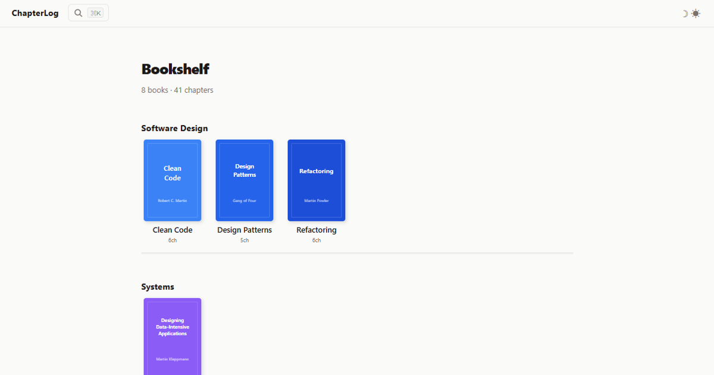

<!-- wasmer:start -->
## Deploy on Wasmer

This folder is the [ChapterLog](https://github.com/IMMINJU/astro-theme-chapterlog) Astro theme by IMMINJU, copied from commit `e9c8663af9342a2d94255c8cc4395c571fb352d0` so it can be deployed as a Wasmer Edge template.

- **Demo:** https://astro-chapterlog.wasmer.app
- **Deploy:** open the template on [wasmer.io/templates](https://wasmer.io/templates) and click **Deploy**, or run `wasmer deploy` in this folder. Wasmer installs with npm, runs the build script with Node 24 and serves the static `dist/` folder.
- **Changed for Wasmer:**
  - Added .nvmrc with Node 24, the Node version Wasmer builds with.
- **Environment variables:** None.
- **Credit:** theme by [IMMINJU](https://github.com/IMMINJU), MIT. The theme's license file is kept unchanged.
<!-- wasmer:end -->

# astro-theme-chapterlog

A minimal Astro theme for building your personal bookshelf. Organize books by chapter with a clean wiki-style layout.



[Live Demo](https://astro-theme-chapterlog.vercel.app)

## Features

- Bookshelf home page with cover images and category grouping
- Wiki-style chapter reader with sidebar navigation
- Search (Ctrl+K) across books and chapters
- Dark/light theme toggle
- Mobile responsive with slide-in sidebar
- SEO-ready (sitemap, RSS, Open Graph, canonical URLs)
- 404 page
- Fully static — deploy anywhere

## Quick Start

```bash
# Create a new project from this theme
npm create astro@latest -- --template IMMINJU/astro-theme-chapterlog

# Install dependencies
npm install

# Start dev server
npm run dev
```

## Adding a Book

Each book lives in `src/content/books/{slug}/` with a `book.yaml` and chapter markdown files.

### 1. Create `book.yaml`

```yaml
# src/content/books/my-book/book.yaml
title: My Book
author: Author Name
translator: ""
publisher: Publisher
publishedAt: "2024.01.01"
category: Software Design
cover: /covers/my-book.svg
parts:
  - title: Part 1
    chapters:
      - slug: chapter-01
        number: 1
        title: Introduction
      - slug: chapter-02
        number: 2
        title: Getting Started
```

### 2. Write chapters

```markdown
<!-- src/content/books/my-book/chapter-01.md -->
---
sections:
  - "1.1 Why This Book"
  - "1.2 How to Read It"
---

## Why This Book

Your chapter notes here...
```

### 3. Add a cover image (optional)

Place a cover image in `public/covers/` and reference it in `book.yaml`. SVG or JPG/PNG both work.

## Configuration

Edit `src/data/site.ts` to personalize:

```typescript
export const site = {
  name: "ChapterLog",
  description: "My personal bookshelf — chapter-by-chapter book notes",
  url: "https://your-site.vercel.app",
  author: "Your Name",
};
```

### Categories

Books are grouped by the `category` field in `book.yaml`. Colors are assigned automatically per category — up to 5 distinct palettes cycle through.

### Labels

UI strings are in `src/data/labels.ts`. Edit them to localize or customize wording.

## Project Structure

```
src/
├── components/
│   ├── Sidebar.astro        # Book navigation sidebar
│   └── Search.astro         # Search modal (Ctrl+K)
├── content/books/
│   └── {slug}/
│       ├── book.yaml         # Book metadata + chapter definitions
│       ├── chapter-01.md
│       └── ...
├── data/
│   ├── books.ts              # YAML loader → Book[]
│   ├── labels.ts             # UI strings
│   └── site.ts               # Site configuration
├── layouts/
│   ├── Layout.astro          # Base HTML layout
│   └── WikiLayout.astro      # Sidebar + content layout
├── pages/
│   ├── index.astro           # Bookshelf home
│   ├── 404.astro             # Not found page
│   ├── api/search-index.json.ts
│   ├── rss.xml.ts
│   └── [book]/
│       ├── index.astro       # Book overview
│       └── [chapter].astro   # Chapter reader
└── styles/
    └── global.css            # CSS variables + theme
```

## Deploy

[](https://vercel.com/new/clone?repository-url=https://github.com/IMMINJU/astro-theme-chapterlog)

Or deploy to any static hosting (Netlify, Cloudflare Pages, GitHub Pages).

## Tech Stack

- [Astro](https://astro.build) — Static site framework
- [marked](https://marked.js.org) — Markdown parser
- [js-yaml](https://github.com/nodeca/js-yaml) — YAML parser

## License

MIT
