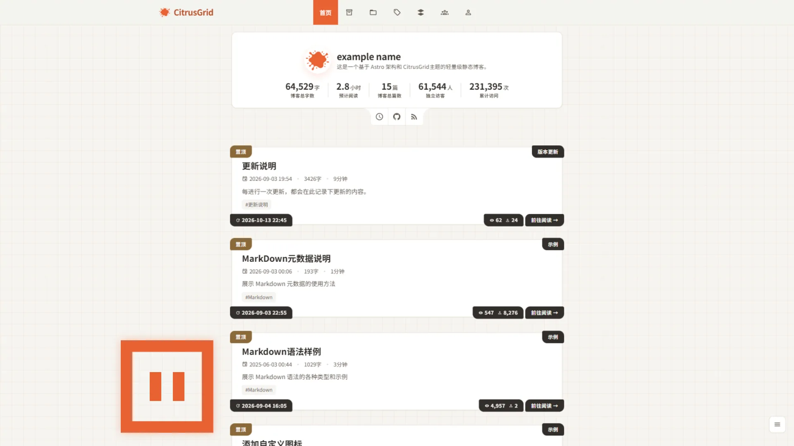
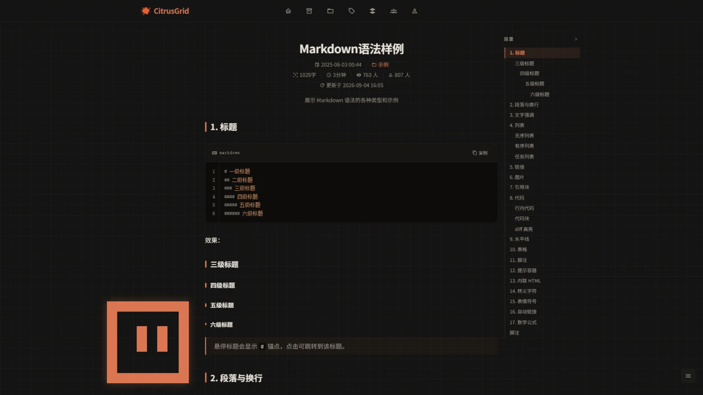
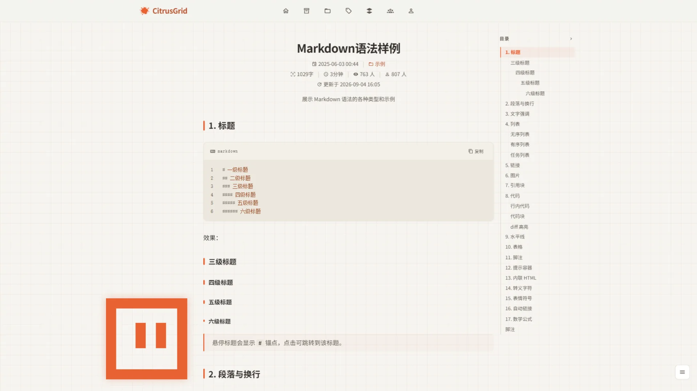

<!-- wasmer:start -->
## Deploy on Wasmer

This folder is the [CitrusGrid](https://github.com/rightdoor/citrus-grid) Astro theme by rightdoor, copied from commit `f2015b88f8ffdd473cda21430e177a7aee5b60c1` so it can be deployed as a Wasmer Edge template.

- **Demo:** https://astro-citrus-grid.wasmer.app
- **Deploy:** open the template on [wasmer.io/templates](https://wasmer.io/templates) and click **Deploy**, or run `wasmer deploy` in this folder. Wasmer installs with pnpm, runs the build script with Node 24 and serves the static `dist/` folder.
- **Changed for Wasmer:**
  - None. The theme builds as published.
- **Environment variables:** None.
- **Credit:** theme by [rightdoor](https://github.com/rightdoor), MIT. The theme's license file is kept unchanged.
<!-- wasmer:end -->

<div align="center">
  
  <h1 align="center">CitrusGrid 柑橘格子</h1>
  <p>基于 Astro 的轻量级静态博客主题，以<strong>柑橘色（#E86233）</strong>为主色调，方格草稿纸为背景样式，带来轻量级的 markdown 博客需求。</p>
  
  
  
  <br>
  <a href="https://citrusgrid.pages.dev">Demo</a> | <a href="./docs/README.en.md">English</a> | <a href="./docs/README.ja.md">日本語</a> | <a href="https://dev.citrusgrid.pages.dev">Dev Demo</a>
</div>

---

<table width="100%" align="center" cellpadding="8" cellspacing="0">
  <tr>
    <th colspan="2" align="center">暗夜模式</th>
  </tr>
  <tr>
    <td align="center"><br>暗夜模式</td>
    <td align="center"><br>白天模式</td>
  </tr>

  <tr>
    <td align="center"><br>暗夜模式文章</td>
    <td align="center"><br>白天模式文章</td>
  </tr>

  <tr>
    <th colspan="2" align="center">PageSpeed Insights 性能测试</th>
  </tr>
  <tr>
    <td align="center"><br>桌面端性能</td>
    <td align="center"><br>手机性能</td>
  </tr>
</table>

---

## 快速开始

### 环境要求

- Node.js ≥ 22.14.0
- Astro ≥ 7.2.9

### 本地开发部署

1. 克隆仓库：

    ```bash
    git clone https://github.com/rightdoor/citrus-grid.git
    cd citrus-grid
    ```

2. 安装依赖

    ```bash
    # 本项目使用 pnpm 安装依赖，如果没有安装请先安装
    npm install -g pnpm

    pnpm install
    ```

3. 配置博客：

    编辑 `src/site.config.ts` 自定义博客设置

4. 启动开发服务器：

    ```bash
    pnpm dev
    ```

    访问 `http://localhost:4321` 即可查看博客效果

### 平台托管部署

- [Astro 部署指南](https://docs.astro.build/guides/deploy/)
- 网页部署请使用 `pnpm build` 命令构建网站，随后将 `dist` 目录部署至目标平台。

### 主题升级

二次开发用户升级主题：预演 `pnpm theme:update` 看报告，确认后 `pnpm theme:update --apply` 一键合并上游（用户层冲突自动保留你的版本，只读层冲突列出清单供人工处理）。定制白名单契约与完整流程见 [UPGRADING.md](UPGRADING.md)。

## 配置说明

详细内容请查看配置文件 [site.config.ts](src/site.config.ts)。

## 文章 Frontmatter

```markdown
---
title: example
slug: example
index: 0
description:  example description
category: example
tags: [example, example1]
published: 2026-01-01 00:01:02
updated: 2026-01-01 00:01:03
draft: false
---
```

| 字段 | 是否必填 | 示例 | 描述 |
| --- | --- | --- | --- |
| `title` | 是 | "example" | 文章标题 |
| `slug` | 是 | example | 运行时自动生成，可手动填写，使用`-`分隔单词 |
| `index` | 是 | 0 | 默认为0不置顶，大于0的整数置顶，数值越大越靠前 |
| `description` | 是 | "展示 Markdown 语法的各种类型和示例" | 文章描述 |
| `category` | 是 | "示例" | 文章分类 |
| `tags` | 是 | [Markdown] | 文章标签，多个标签用逗号隔开 |
| `published` | 是 | 2026-01-01 00:01:02 | 文章发布时间，格式为`YYYY-MM-DD HH:mm:ss`，脚本生成自带 |
| `updated` | 否 | 2026-01-01 00:01:03 | 文章更新时间，格式为`YYYY-MM-DD HH:mm:ss`，启动和构建时由脚本按文件修改时间自动写入（可在 `site.config.ts` 关闭） |
| `draft` | 否 | false | 是否草稿，不自动生成 |

## 文章格式

文章统一放在 `src/content/posts/` 目录下，同时支持 `.md` 与 `.mdx` 两种扩展名，frontmatter 字段完全一致：

- `.md`：纯 Markdown 写作；
- `.mdx`：在 Markdown 基础上支持内联表达式（`{1 + 1}`）、JSX 与 `import` 引入组件（参考 `src/components/mdx/Callout.astro`），并与 `.md` 共用同一套 remark/rehype 管线（代码高亮、数学公式、脚注、提示容器、图片 LQIP、相对链接解析等均可用）。注意正文中的裸花括号会被当作表达式解析，普通文本需用反引号包裹或转义。

参考示例：[MDX 示例文章](src/content/posts/MDX示例文章.mdx)。

## 命令说明

| 命令 | 作用 |
| --- | --- |
| `pnpm dev` / `start` | 启动开发服务器；启动前自动校验 markdown 渲染管线指纹 |
| `pnpm build` | 生产构建，随后自动注入 `modulepreload`、压缩内联脚本，并执行 `pagefind` 生成站内搜索索引 |
| `pnpm build:fresh` | 手动强制清 Astro 缓存（`.astro`、`node_modules/.astro`、`node_modules/.cache/jiti`）再构建 |

> **关于内容缓存**：Astro 内容层只按文章文件内容计算 digest，修改 `src/lib/md/` 下的插件或 `astro.config.mjs` 的插件顺序不会让已渲染的文章失效。`dev` / `build` 启动前会由 `scripts/sync-md-cache.js` 比对渲染管线指纹，变化即自动清缓存并重新渲染全部文章；指纹未变则保留缓存，不损失增量速度。`build:fresh` 保留为手动强制兜底——若 dev server 长时间运行、改了插件却没重启，重启一次即可，必要时用它。
| `pnpm preview` | 预览 `dist` 构建产物 |
| `pnpm check` | Astro 类型检查（`astro check`） |
| `pnpm type-check` | TypeScript 类型检查（`tsc --noEmit`，覆盖 `src` 与 `scripts`） |
| `pnpm check-i18n` | 校验 zh / ja / en 语言包键集合一致 |
| `pnpm check-swup-ignore` | 校验 `shouldIgnoreSwup` 内联正则与 `ASSET_EXT_RE` / `RESERVED_PATH_RE` 常量一致 |
| `pnpm verify` | 依次执行 `astro check`、`tsc --noEmit`、`check-i18n`、`check-swup-ignore`，任一失败即中断 |
| `pnpm new-post [slug] [--mdx]` | 新建文章模板 `src/content/posts/<slug>.md`；带 `--mdx` 时改为生成带 Callout 导入的 `.mdx` 模板（省略 slug 时按当天日期命名） |
| `pnpm theme:update [--apply]` | 从上游（GitHub `main` 分支）同步主题更新；默认预演只出报告，`--apply` 实际合并，见 [UPGRADING.md](UPGRADING.md) |
| `pnpm format-post-meta` | 统一重排所有文章 frontmatter 字段顺序 |
| `pnpm format` | Biome 格式化 `src` |
| `pnpm format:all` | Biome 检查并修复全项目代码（src、scripts、根目录配置文件） |
| `pnpm lint` | Biome 检查并修复 `src` |
| `preinstall` | 自动执行 `only-allow pnpm`，强制使用 pnpm |

## 提交前检查

*文章写完提交前（`pnpm build` 会改写 md 补全 `slug`，必须在 commit 之前执行）：

```bash
pnpm format-post-meta
pnpm build
pnpm check
```

代码改完提交前：

```bash
pnpm format:all
pnpm check
pnpm type-check
```

- 改了 i18n 文案加跑 `pnpm check-i18n`；改了 `src/lib/url.ts` 加跑 `pnpm check-swup-ignore`。

## 功能

- [x] i18n 支持（zh、en、ja三语）
- [x] 支持 GFM 语法
- [x] 支持 KaTeX 数学公式
- [x] 明暗主题切换
- [x] 搜索功能（pagefind）
- [x] 评论功能（评论系统可插拔，当前适配 utterances）
- [x] 目录功能（桌面端侧边固定 + 移动端弹窗）
- [x] RSS 订阅功能
- [x] 友链功能
- [x] 代码高亮（Prism 构建期高亮，客户端零 JS）与代码复制按钮
- [x] 图片灯箱（PhotoSwipe）与 LQIP 渐变占位骨架
- [x] 阅读统计（已预留接口）
- [x] 文章相对链接自动转换
- [x] 表格表头栏（左侧开关切换换行显示 / 横向滚动，默认换行，构建期生成零 JS 交互）
- [x] 代码块换行切换（头部按钮切换换行 / 不换行；折行时保留行号栏，仅隐藏发生折行的那几行行号，其余行号仍逐行对齐）
- [x] 音乐播放器组件
- [x] 左下角宠物（视线跟随 / 眨眼 / 休眠，可在配置中开关）
- [x] 纯净阅读模式（文章页右下角一键隐藏头部 / 侧栏 / 评论等外壳组件，专注正文，换页或 Esc 退出）

## 插件

### 评论插件

当前适配 utterances 评论系统，支持自定义评论插件。

支持自定义评论插件，详细参考 [评论插件](src/comments/使用规则.md)。

### 统计插件

支持全局和文章PV/UV统计，已预留接口。

当前自带统计插件有 `visitor-stats.ts`，项目地址为 [visitor-stats](https://github.com/rightdoor/visitor-stats)。需要在cloudflare worker中自行部署统计服务。

支持自定义统计插件，详细参考 [统计插件](src/stats/使用规则.md)。

## 二次开发文档

需要改造主题（换主色、改布局、加组件、接入评论/统计、排查构建问题）请查阅 [`src/content/posts/all/00-index.md`](src/content/posts/all/00-index.md)：

| 文档 | 内容 |
| --- | --- |
| [00-index.md](src/content/posts/all/00-index.md) | 总览与二次开发任务索引 |
| [01-项目结构.md](src/content/posts/all/01-项目结构.md) | 目录树、技术栈、构建流水线、数据流 |
| [02-组件说明.md](src/content/posts/all/02-组件说明.md) | 全部组件 Props 表、DOM 结构、事件协议、图标系统 |
| [03-主题与样式定制.md](src/content/posts/all/03-主题与样式定制.md) | `--wp-*` 变量全表、暗色模式、换肤步骤 |
| [04-站点配置.md](src/content/posts/all/04-站点配置.md) | `site.config.ts` 等 6 个配置文件的参数表 |
| [05-内容与Markdown.md](src/content/posts/all/05-内容与Markdown.md) | Frontmatter 表、markdown 插件链、图片与相对链接 |
| [06-构建与脚本.md](src/content/posts/all/06-构建与脚本.md) | 7 个构建脚本、产物结构、部署 |
| [07-页面与路由.md](src/content/posts/all/07-页面与路由.md) | 路由表、SEO、i18n 现状与扩展 |
| [08-插件系统.md](src/content/posts/all/08-插件系统.md) | 评论 / 统计插件契约、音乐播放器 |
| [09-常见改造与排错.md](src/content/posts/all/09-常见改造与排错.md) | 任务式改造速查、FAQ、自检清单 |

> 基于 `DeepSeek-V4.1-Flash` 检索生成+手动修改，仅供参考。

## 贡献者

<a href="https://github.com/rightdoor/citrus-grid/graphs/contributors">
  
</a>

## License

本项目使用 [MIT License](LICENSE.txt) 开源。详细条款请参阅项目根目录下的 `LICENSE.txt` 文件。
