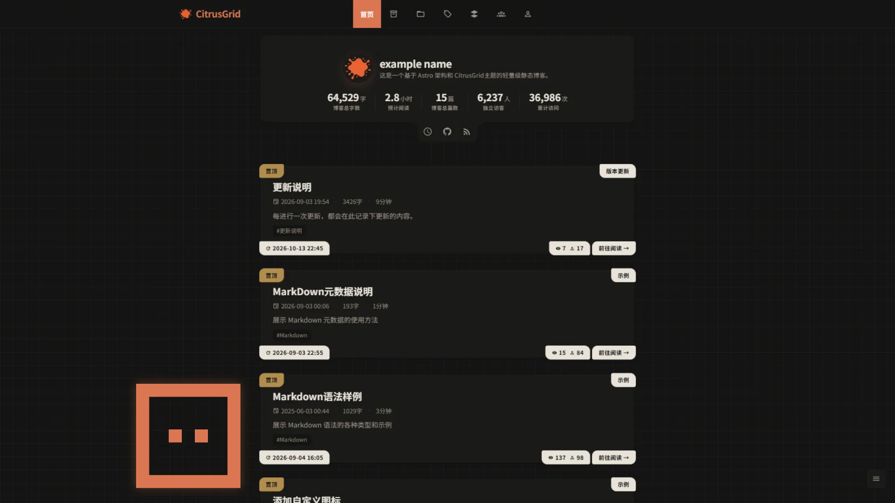
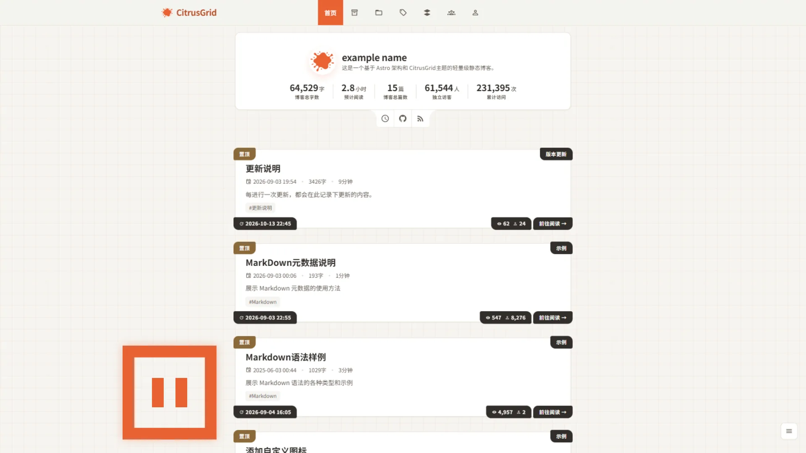
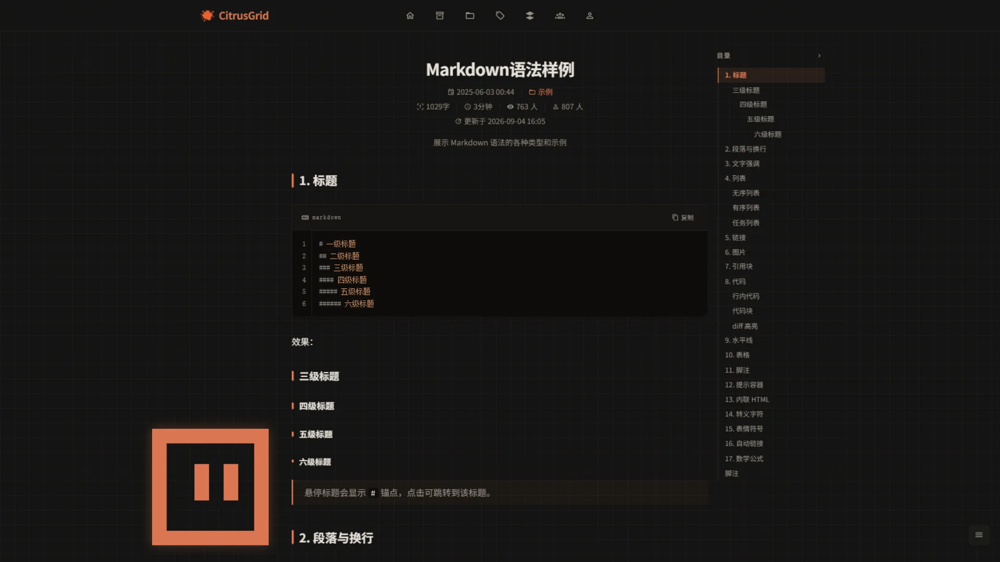
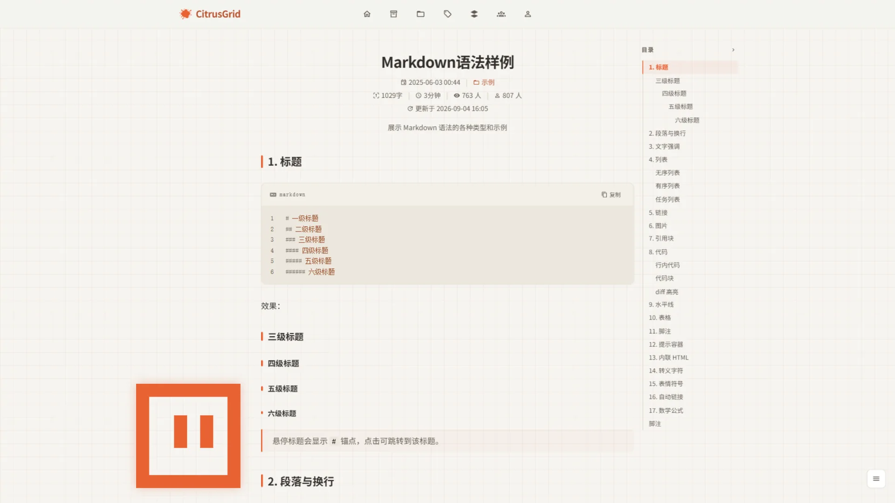

<div align="center">
  
  <h1 align="center">CitrusGrid 柑橘格子</h1>
  <p>A lightweight static blog theme based on Astro, with <strong>tangerine (#E86233)</strong> as the primary color and a grid paper background, fulfilling lightweight Markdown blog needs.</p>
  
  
  
  <br>
  <a href="https://citrusgrid.pages.dev">Demo</a> | <a href="../README.md">中文</a> | <a href="./README.ja.md">日本語</a> | <a href="https://dev.citrusgrid.pages.dev">Dev Demo</a>
</div>

---

<table width="100%" align="center" cellpadding="8" cellspacing="0">
  <tr>
    <th colspan="2" align="center">Dark Mode</th>
  </tr>
  <tr>
    <td align="center"><br>Dark Mode</td>
    <td align="center"><br>Light Mode</td>
  </tr>

  <tr>
    <td align="center"><br>Dark Mode Post</td>
    <td align="center"><br>Light Mode Post</td>
  </tr>

  <tr>
    <th colspan="2" align="center">PageSpeed Insights Performance Test</th>
  </tr>
  <tr>
    <td align="center"><br>Desktop Performance</td>
    <td align="center"><br>Mobile Performance</td>
  </tr>
</table>

---

## Quick Start

### Environment Requirements

- Node.js ≥ 22.14.0
- Astro ≥ 7.2.9

### Local Development Setup

1. Clone the repository:

    ```bash
    git clone https://github.com/rightdoor/citrus-grid.git
    cd citrus-grid
    ```

2. Install dependencies

    ```bash
    # This project uses pnpm for dependency installation. Install it first if you don't have it.
    npm install -g pnpm

    pnpm install
    ```

3. Configure the blog:

    Edit `src/site.config.ts` to customize blog settings.

4. Start the development server:

    ```bash
    pnpm dev
    ```

    Visit `http://localhost:4321` to preview the blog.

### Platform Deployment

- [Astro Deployment Guide](https://docs.astro.build/guides/deploy/)
- For web deployment, build the site with `pnpm build`, then deploy the `dist` directory to your target platform.

## Configuration Guide

For details, see the configuration file [site.config.ts](../src/site.config.ts).

## Article Frontmatter

```markdown
---
title: example
slug: example
index: 0
description:  example description
category: example
tags: [example, example1]
published: 2026-01-01 00:01:02
updated: 2026-01-01 00:01:03
draft: false
---
```

| Field | Required | Example | Description |
| --- | --- | --- | --- |
| `title` | Yes | "example" | Post title |
| `slug` | Yes | example | Automatically generated at runtime; can be manually set, use `-` to separate words |
| `index` | Yes | 0 | Default 0 means no pin; integers greater than 0 pin the article, larger numbers appear higher |
| `description` | Yes | "Shows various types and examples of Markdown syntax" | Article description |
| `category` | Yes | "Example" | Article category |
| `tags` | Yes | [Markdown] | Article tags, multiple tags separated by commas |
| `published` | Yes | 2026-01-01 00:01:02 | Publication time, format `YYYY-MM-DD HH:mm:ss`, auto-generated by scripts |
| `updated` | No | 2026-01-01 00:01:03 | Last update time, format `YYYY-MM-DD HH:mm:ss`, automatically written by scripts during startup and build, based on file modification times (can be disabled in site.config.ts) |
| `draft` | No | false | Whether it is a draft, not auto-generated |

## Commands Reference

| Command | Purpose |
| --- | --- |
| `pnpm dev` / `start` | Start development server; validates the markdown pipeline fingerprint first |
| `pnpm build` | Production build, then automatically injects `modulepreload`, minifies inline scripts, and runs `pagefind` to generate search index |
| `pnpm build:fresh` | Force-clears the Astro caches (`.astro`, `node_modules/.astro`, `node_modules/.cache/jiti`) before building |

> **Content cache**: the Astro content layer computes digests from article files only, so changes to plugins in `src/lib/md/` or the plugin order in `astro.config.mjs` do not invalidate already-rendered posts. Before every `dev` / `build`, `scripts/sync-md-cache.js` compares a pipeline fingerprint and clears the cache automatically when it changes; unchanged pipelines keep the incremental cache. `build:fresh` remains a manual escape hatch — if a long-running dev server was not restarted after a plugin edit, simply restart it, or use this command.
| `pnpm preview` | Preview the `dist` build output |
| `pnpm check` | Astro type checking (`astro check`) |
| `pnpm type-check` | TypeScript type checking (`tsc --noEmit`, covers `src` and `scripts`) |
| `pnpm check-i18n` | Verifies that the zh / ja / en message key sets match |
| `pnpm check-swup-ignore` | Verifies that the inline regexes in `shouldIgnoreSwup` match `ASSET_EXT_RE` / `RESERVED_PATH_RE` |
| `pnpm verify` | Runs `astro check`, `tsc --noEmit`, `check-i18n` and `check-swup-ignore` in sequence, stopping at the first failure |
| `pnpm new-post [slug] [--mdx]` | Create a new article template at `src/content/posts/<slug>.md`; with `--mdx` it creates a `.mdx` template including the Callout import (named after today's date when the slug is omitted) |
| `pnpm format-post-meta` | Reorder frontmatter fields of all articles uniformly |
| `pnpm format` | Biome formatting for `src` |
| `pnpm format:all` | Biome check and fix across the entire project (src, scripts, root config files) |
| `pnpm lint` | Biome check and fix for `src` |
| `preinstall` | Automatically runs `only-allow pnpm` to enforce pnpm usage |

## Before Committing

After finishing a post (`pnpm build` rewrites the `.md` files to fill in `slug`, so it must run before the commit):

```bash
pnpm format-post-meta
pnnpm build
pnnpm check
```

After changing code:

```bash
pnpm format:all
pnpm check
pnnpm type-check
```

- Editing i18n copy? Also run `pnpm check-i18n`; editing `src/lib/url.ts`? Also run `pnpm check-swup-ignore`.

## Features

- [x] i18n support (zh, en, ja)
- [x] GFM syntax support
- [x] KaTeX math formula support
- [x] Light/dark theme toggle
- [x] Search functionality (pagefind)
- [x] Comments (pluggable comment system, currently adapted for utterances)
- [x] Table of contents (fixed sidebar on desktop + modal on mobile)
- [x] RSS feed
- [x] Friend links
- [x] Code highlighting (Prism build‑time highlighting, zero client‑side JS) and copy button
- [x] Image lightbox (PhotoSwipe) with LQIP gradient placeholder skeleton
- [x] Reading statistics (reserved interface)
- [x] Article relative links auto conversion
- [x] Music player component
- [x] Bottom-left pet (gaze follow / blink / sleep, switchable in the config)
- [x] Pure reading mode (toggle from the bottom-right menu on a post page to hide header / TOC / comments and other chrome; leaves the page or press Esc to exit)

## Plugins

### Comment Plugin

Currently adapted for the utterances comment system, supports custom comment plugins.

For custom comment plugins, see [Comment Plugin](../src/comments/usageRules.md).

### Statistics Plugin

Supports global and per‑article PV/UV statistics, with reserved interfaces.

The built‑in statistics plugin is `visitor-stats.ts`, project repository: [visitor-stats](https://github.com/rightdoor/visitor-stats). You need to deploy the statistics service yourself on Cloudflare Workers.

For custom statistics plugins, see [Statistics Plugin](../src/stats/usageRules.md).

## Secondary Development Docs

To customize the theme (change the accent color, adjust the layout, add components, plug in comments/statistics, or debug the build), see [`../src/content/posts/all/00-index.md`](../src/content/posts/all/00-index.md):

| Document | Contents |
| --- | --- |
| [00-index.md](../src/content/posts/all/00-index.md) | Overview and an index of common customization tasks |
| [01-项目结构.md](../src/content/posts/all/01-项目结构.md) | Directory tree, tech stack, build pipeline, data flow |
| [02-组件说明.md](../src/content/posts/all/02-组件说明.md) | Props tables for every component, DOM structure, event protocol, icon system |
| [03-主题与样式定制.md](../src/content/posts/all/03-主题与样式定制.md) | Full `--wp-*` variable reference, dark mode, re-theming steps |
| [04-站点配置.md](../src/content/posts/all/04-站点配置.md) | Parameter tables for `site.config.ts` and the other 5 config files |
| [05-内容与Markdown.md](../src/content/posts/all/05-内容与Markdown.md) | Frontmatter reference, Markdown plugin chain, images and relative links |
| [06-构建与脚本.md](../src/content/posts/all/06-构建与脚本.md) | The 7 build scripts, output structure, deployment |
| [07-页面与路由.md](../src/content/posts/all/07-页面与路由.md) | Route table, SEO, i18n status and how to extend it |
| [08-插件系统.md](../src/content/posts/all/08-插件系统.md) | Comment / statistics plugin contracts, music player |
| [09-常见改造与排错.md](../src/content/posts/all/09-常见改造与排错.md) | Task-oriented recipes, FAQ, pre-flight checklist |

> Retrieval-generated based on DeepSeek-V4.1-Flash + manually edited; for reference only.

## Contributors

<a href="https://github.com/rightdoor/citrus-grid/graphs/contributors">
  
</a>

## License

This project is open-sourced under the [MIT License](../LICENSE.txt). For detailed terms, please refer to the `LICENSE.txt` file in the project root directory.
