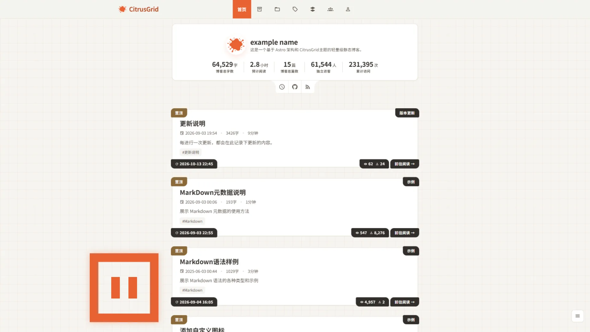
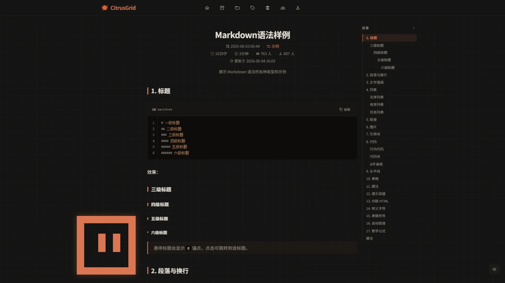
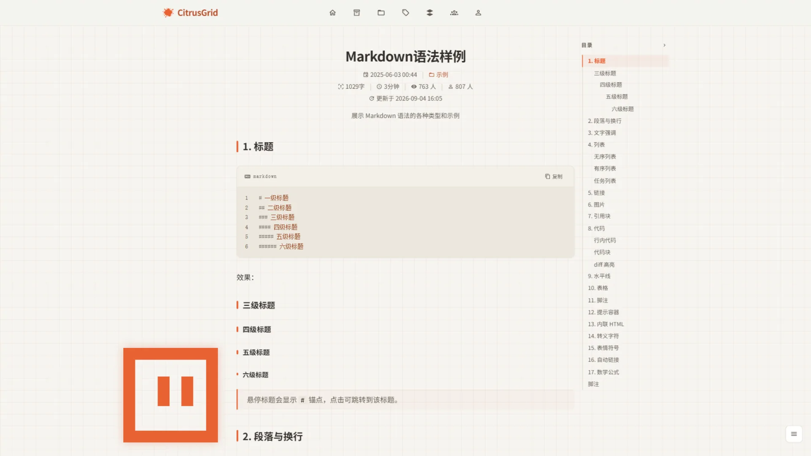

<div align="center">
  
  <h1 align="center">CitrusGrid 柑橘格子</h1>
  <p>Astro ベースの軽量静的ブログテーマ。<strong>柑橘色（#E86233）</strong>をメインカラーに、方眼紙風の背景で、軽量な Markdown ブログのニーズを満たします。</p>
  
  
  
  <br>
  <a href="https://citrusgrid.pages.dev">Demo</a> | <a href="../README.md">中文</a> | <a href="./README.en.md">English</a> | <a href="https://dev.citrusgrid.pages.dev">Dev Demo</a>
</div>

---

<table width="100%" align="center" cellpadding="8" cellspacing="0">
  <tr>
    <th colspan="2" align="center">ダークモード</th>
  </tr>
  <tr>
    <td align="center"><br>ダークモード</td>
    <td align="center"><br>ライトモード</td>
  </tr>

  <tr>
    <td align="center"><br>ダークモードの記事</td>
    <td align="center"><br>ライトモードの記事</td>
  </tr>

  <tr>
    <th colspan="2" align="center">PageSpeed Insights パフォーマンステスト</th>
  </tr>
  <tr>
    <td align="center"><br>デスクトップパフォーマンス</td>
    <td align="center"><br>モバイルパフォーマンス</td>
  </tr>
</table>

---

## クイックスタート

### 環境要件

- Node.js ≥ 22.14.0
- Astro ≥ 7.2.9

### ローカル開発環境のセットアップ

1. リポジトリをクローンします：

    ```bash
    git clone https://github.com/rightdoor/citrus-grid.git
    cd citrus-grid
    ```

2. 依存関係をインストールします：

    ```bash
    # このプロジェクトは pnpm を使用します。インストールされていない場合は先にインストールしてください。
    npm install -g pnpm

    pnpm install
    ```

3. ブログを設定します：

    `src/site.config.ts` を編集して、ブログの設定をカスタマイズします。

4. 開発サーバーを起動します：

    ```bash
    pnpm dev
    ```

    `http://localhost:4321` にアクセスしてブログをプレビューします。

### プラットフォームへのデプロイ

- [Astro デプロイガイド](https://docs.astro.build/guides/deploy/)
- Web デプロイの場合は、`pnpm build` でサイトをビルドし、生成された `dist` ディレクトリを対象プラットフォームにデプロイしてください。

## 設定説明

詳細は設定ファイル [site.config.ts](../src/site.config.ts) を参照してください。

## 記事の Frontmatter

```markdown
---
title: example
slug: example
index: 0
description:  example description
category: example
tags: [example, example1]
published: 2026-01-01 00:01:02
updated: 2026-01-01 00:01:03
draft: false
---
```

| フィールド | 必須か | 例 | 説明 |
| --- | --- | --- | --- |
| `title` | はい | "example" | 記事のタイトル |
| `slug` | はい | example | 実行時に自動生成されます。手動で設定する場合は `-` で単語を区切ってください |
| `index` | はい | 0 | デフォルトの 0 はトップ固定なしを意味します。0 より大きい整数を指定すると記事がトップ固定され、数値が大きいほど上位に表示されます |
| `description` | はい | "Markdown 構文のさまざまなタイプと例を示します" | 記事の説明 |
| `category` | はい | "例" | 記事のカテゴリ |
| `tags` | はい | [Markdown] | 記事のタグ。複数ある場合はカンマで区切ります |
| `published` | はい | 2026-01-01 00:01:02 | 公開日時。形式は `YYYY-MM-DD HH:mm:ss` で、スクリプトにより自動生成されます |
| `updated` | いいえ | 2026-01-01 00:01:03 | 更新日時。形式は `YYYY-MM-DD HH:mm:ss` で、起動時およびビルド時に、スクリプトによってファイルの変更時刻に基づいて自動的に書き込まれます（site.config.tsで無効化できます） |
| `draft` | いいえ | false | 下書きかどうか。自動生成されません |

## コマンド一覧

| コマンド | 説明 |
| --- | --- |
| `pnpm dev` / `start` | 開発サーバーを起動します（起動前に markdown パイプラインのフィンガープリントを検証） |
| `pnpm build` | 本番ビルドを実行し、その後 `modulepreload` を自動注入し、インラインスクリプトを圧縮し、`pagefind` を実行してサイト内検索インデックスを生成します |
| `pnpm build:fresh` | Astro のキャッシュ（`.astro`、`node_modules/.astro`、`node_modules/.cache/jiti`）を強制的に削除してからビルドします |

> **コンテンツキャッシュについて**：Astro のコンテンツ層は記事ファイルの内容だけで digest を計算するため、`src/lib/md/` のプラグインや `astro.config.mjs` のプラグイン順序を変更しても、レンダリング済みの記事は無効化されません。`dev` / `build` の起動前に `scripts/sync-md-cache.js` がパイプラインのフィンガープリントを比較し、変更があればキャッシュを自動削除して全記事を再レンダリングします。変更がなければキャッシュを保持し、インクリメンタルビルドの速度は落ちません。`build:fresh` は手動の保険として残しています。プラグイン変更後に長時間起動中の dev サーバーを再起動していない場合は、再起動するかこのコマンドを使用してください。
| `pnpm preview` | `dist` ビルド成果物をプレビューします |
| `pnpm check` | Astro の型チェック（`astro check`）を実行します |
| `pnpm type-check` | TypeScript の型チェック（`tsc --noEmit`、`src` と `scripts` を対象） |
| `pnpm check-i18n` | zh / ja / en の言語パックのキー集合が一致するか検証します |
| `pnpm check-swup-ignore` | `shouldIgnoreSwup` 内のインライン正規表現が `ASSET_EXT_RE` / `RESERVED_PATH_RE` 定数と一致するか検証します |
| `pnpm verify` | `astro check`、`tsc --noEmit`、`check-i18n`、`check-swup-ignore` を順に実行し、いずれかが失敗した時点で中断します |
| `pnpm new-post [slug] [--mdx]` | 新しい記事テンプレート `src/content/posts/<slug>.md` を作成します（`--mdx` を付けると Callout の import を含む `.mdx` テンプレートを生成。slug を省略すると当日の日付で命名） |
| `pnpm format-post-meta` | 全記事の frontmatter フィールドの順序を一括で整列します |
| `pnpm format` | Biome を使用して `src` をフォーマットします |
| `pnpm format:all` | Biome を使用してプロジェクト全体（src、scripts、ルート設定ファイル）をチェックし修正します |
| `pnpm lint` | Biome を使用して `src` をチェックし修正します |
| `preinstall` | `only-allow pnpm` を自動実行し、pnpm の使用を強制します |

## コミット前のチェック

記事を書き終えたとき（`pnpm build` が md を書き換えて `slug` を補完するため、commit の前に必ず実行）：

```bash
pnpm format-post-meta
pnpm build
pnnpm check
```

コードを変更したとき：

```bash
pnpm format:all
pnpm check
pnpm type-check
```

- i18n の文言を変更した場合は `pnpm check-i18n`、`src/lib/url.ts` を変更した場合は `pnpm check-swup-ignore` も実行します。

## 機能

- [x] i18n サポート（zh、en、ja）
- [x] GFM 構文サポート
- [x] KaTeX 数式サポート
- [x] ライト/ダークテーマ切り替え
- [x] 検索機能（pagefind）
- [x] コメント機能（コメントシステムはプラグイン可能で、現在は utterances に適応）
- [x] 目次機能（デスクトップではサイドバー固定、モバイルではポップアップ）
- [x] RSS フィード機能
- [x] フレンドリンク機能
- [x] コードハイライト（Prism によるビルド時ハイライト、クライアント側 JavaScript ゼロ）とコードコピーボタン
- [x] 画像ライトボックス（PhotoSwipe）と LQIP グラデーションスケルトンプレースホルダー
- [x] 閲覧統計（インターフェースは予約済み）
- [x] 記事内の相対リンク自動自動変換
- [x] 音楽プレイヤーコンポーネント
- [x] 左下のペット（視線追従・まばたき・スリープ、設定でオン／オフ切り替え可能）
- [x] 読書モード（記事ページの右下メニューからヘッダー / 目次 / コメントなどの UI を非表示にして本文に集中。ページ移動または Esc で解除）

## プラグイン

### コメントプラグイン

現在は utterances コメントシステムに適応しています。カスタムコメントプラグインをサポートします。

カスタムコメントプラグインの詳細は [コメントプラグイン](../src/comments/usageRules.md) を参照してください。

### 統計プラグイン

グローバルおよび記事単位の PV/UV 統計をサポートし、インターフェースは予約済みです。

デフォルトで同梱されている統計プラグインは `visitor-stats.ts` で、プロジェクトは [visitor-stats](https://github.com/rightdoor/visitor-stats) にあります。Cloudflare Workers に統計サービスを自前でデプロイする必要があります。

カスタム統計プラグインの詳細は [統計プラグイン](../src/stats/usageRules.md) を参照してください。

## 二次開発ドキュメント

テーマをカスタマイズする場合（メインカラーの変更、レイアウト調整、コンポーネント追加、コメント／統計の導入、ビルドのトラブルシューティング）は [`../src/content/posts/all/00-index.md`](../src/content/posts/all/00-index.md) を参照してください：

| ドキュメント | 内容 |
| --- | --- |
| [00-index.md](../src/content/posts/all/00-index.md) | 概要とカスタマイズ作業の索引 |
| [01-项目结构.md](../src/content/posts/all/01-项目结构.md) | ディレクトリ構成、技術スタック、ビルドパイプライン、データフロー |
| [02-组件说明.md](../src/content/posts/all/02-组件说明.md) | 全コンポーネントの Props 一覧、DOM 構造、イベント規約、アイコンシステム |
| [03-主题与样式定制.md](../src/content/posts/all/03-主题与样式定制.md) | `--wp-*` 変数の一覧、ダークモード、配色変更の手順 |
| [04-站点配置.md](../src/content/posts/all/04-站点配置.md) | `site.config.ts` ほか 5 つの設定ファイルのパラメータ一覧 |
| [05-内容与Markdown.md](../src/content/posts/all/05-内容与Markdown.md) | Frontmatter 一覧、Markdown プラグイン構成、画像と相対リンク |
| [06-构建与脚本.md](../src/content/posts/all/06-构建与脚本.md) | 7 つのビルドスクリプト、出力構成、デプロイ |
| [07-页面与路由.md](../src/content/posts/all/07-页面与路由.md) | ルート一覧、SEO、i18n の現状と拡張方法 |
| [08-插件系统.md](../src/content/posts/all/08-插件系统.md) | コメント／統計プラグインの契約、音楽プレイヤー |
| [09-常见改造与排错.md](../src/content/posts/all/09-常见改造与排错.md) | 目的別の改造レシピ、FAQ、チェックリスト |

> DeepSeek-V4.1-Flash に基づく検索生成＋手動修正。参考までに。

## 貢献者

<a href="https://github.com/rightdoor/citrus-grid/graphs/contributors">
  
</a>

## ライセンス

このプロジェクトは [MIT License](../LICENSE.txt) の下でオープンソース化されています。詳細な条項については、プロジェクトのルートディレクトリにある `LICENSE.txt` ファイルをご参照ください。
