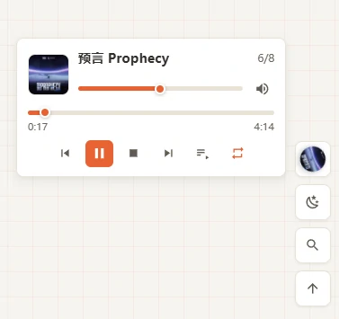

## V1.0.1 更新

### 修复 visitor-stats 插件一次大量读取导致统计服务429报错问题

1、修复 visitor-stats 插件的，使用 `/total` 来一次获取全部数据，使用 localStorage 来缓存数据。

流程：

- 访问 `/total` 接口，获取全部数据
- 缓存数据到 localStorage 中
- 从 localStorage 中读取数据，避免重复请求（TTL 为 5 分钟，过期后重新请求）。

2、修复了其他一些小问题，如路由缓存策略、URL 规范等。

---

### 统一路由尾斜杠格式

在进行页面切换时发现了多次重复请求预取的问题，导致页面流量异常，经排查为预取请求与 Canonical URL 不一致造成的。将前端路由的缓存策略与托管平台（Cloudflare Pages）的 URL 规范严格对齐，现在已修复。

## V1.0.2 更新

### 新增文章相对链接构建时自动转换功能

此前文章互链需手动写死完整 URL 或依赖拼音 slug，现支持在构建时自动转换相对链接。

示例：

```markdown
[文件](./MarkDown元数据说明.md)
[文件内链接](./添加自定义图标.md/#为什么硬编码图标)
[图片](../images/logo.webp)
[不存在文件](../images/logo.md)
```

[文件](./MarkDown元数据说明.md)
[文件内链接](./添加自定义图标.md/#为什么硬编码图标)
[图片](../images/logo.webp)

注意：若链接不可用，预取时会返回 404 错误（不影响页面正常显示），但构建过程会输出警告提醒，请及时检查并修正。

### 派生数据不再进行版本控制

派生数据`lqips.json`和`post-index.json`会自动生成和更新，统一生成放入主目录`.generated`中，并取消对该文件夹的版本控制，保持代码库的整洁。

提示：派生数据只影响构建时间，不影响构建完整性。

## V1.0.3 更新

### 评论系统插拔化

目前适配 utterances 评论系统，支持自定义评论插件。详情请查看项目对于插件的使用规则文档，项目路径为下 `src\comments\使用规则.md`。

### ***站点配置加载方式修改***（重要）

从原先的yaml改为ts，项目路径为下 `src\site.config.ts`。

> 旧版更新请重新配置站点配置文件，否则会报错

## V1.0.4 更新

### 添加自动更新更新时间脚本

现在可以自动根据文章修改时间自动更新， `src\site.config.ts` 中的 `autoUpdatePostUpdated` 字段默认开启自动更新。

注意：

- `format-post-meta` 自动为元数据排版脚本仍为手动，需要手动执行，建议先排版后执行构建。
- 建议先 `build` 再提交 `commit` 。

## V1.0.5 更新

### V1.0.5 样式修改

- 分页组件上下按钮增加背景颜色，取消第一页和最后一页的上下按钮背景颜色透明。
- markdown 文章标题（h1-h6）增加随层级递减的左侧主题色条。
- 修复提示容器 details 样式问题，增加了折叠 / 展开动画。
- 归档页新增置顶分区，置顶文章单独分组展示；其余文章仍按年份分组展示。

### V1.0.5 BUG 修复

- 修复了无上一页 / 无下一页时预取返回 404 报错的问题

### V1.0.5 其他

- 代码块的复制按钮的 [复制] 、 [已复制] 和右侧按钮的 [回到顶部] 和目录的 [脚注] 添加了 i18n 文本。
- 脚注自定义前缀，前缀由默认的 `user-content-` 自定义为 `post-` 。
- `autoUpdatePostUpdated` 自动更新文章更新时间功能改为关闭状态。
- 合并构建后脚本：`inject-modulepreloads` 与 `minify-inline-scripts` 合并为单一的 `postbuild.js`，并在构建后并行执行 pagefind 搜索索引生成。

## V1.0.6 更新

### V1.0.6 新增功能

- 音乐播放器组件，默认关闭状态。（仅有flac、mp3和url格式的音乐进行过验证）



### V1.0.6 修复问题

- 运行时间改为实时计算（根据客户端的时区进行计算，因为文章的发布时间不含时区，所以会有偏差）
- 上下一页按钮禁用态统一
- 文章页和列表卡片的标签圆角统一
- 删除无用css
- `generate-lqips.js` 改用 Node 原生`createRequire(import.meta.url)` 直接`require('sharp')` ，完全绕开 Vite module runner 。无论 dev server 处于启动、重启还是关闭状态都能稳定加载。

### V1.0.6 其他

- 新增二次开发文档到 `posts/` 目录下的 `all` 文件夹中，需要手动修改的请参考相关文档。

## V1.0.7 更新

### V1.0.7 新增功能

- 增加暗夜模式切换动画，电脑端为扩散动画，移动端为向上滑入动画。
- 增加页面切换淡入淡出动画。
- 增加返回按钮显示和消失动画。
- 增加搜索模态框关闭动画。
- 增加内部锚点跳转动画，点击锚点后切换页面然后从顶部平滑滚动到对应位置。

### V1.0.7 修复问题

- 修复了标签和分类页面搜索显示数量未变化的问题。

## V1.0.8 更新

### V1.0.8 新增功能

- 搜索支持章节级结果展示与跳转，单篇最多 3 个子结果。
- 文章页新增侧边目录折叠按钮，正文滚动加入淡入动效。
- 右侧悬浮菜单改为向左弹出，并补充音乐组件动画。

### V1.0.8 修复问题

- 统一全站日期处理为 UTC 时区，避免文章生成/修改时间、网站运行时间偏移。

### V1.0.8 其他

- 重构右侧菜单：返回顶部、搜索、主题切换、目录整合为弹出式菜单，并加入展开收起动画。
- 返回顶部改为常驻，移除显隐逻辑。
- 更新相关文档说明，调整部分文档格式显示。

## V1.0.9 更新

### V1.0.9 新增功能

- 重构顶部导航栏：导航项新增图标，悬停 / 当前页时背景板滑入、图标切换为文字，并移除原有的下划线高亮。
- 新增鼠标划过网格背景的轨迹特效，移动端无鼠标，故不会生效。
- 个人名片新增数码管时钟，可通过开关按钮在时钟与个人简介之间切换。
- 个人名片与文章卡片新增鼠标指针预览方窗。
- 顶部导航支持在 `src/site.config.ts` 中通过 `nav` 数组自定义显示项与顺序，未显示的页面构建时依然会构建。

### V1.0.9 修复问题

- 修复顶部导航栏在英文和日文下文字溢出、背景板错位的问题：按最宽词条自动统一缩小字号，并将导航项固定为 60px 宽使背景板无缝相贴，仅对非中文生效，中文显示不受影响。
- 修复文章卡片与文章页的系列标识在浅色模式下对比度不足的无障碍问题。

### V1.0.9 其他

- 个人名片从首页移入全局布局，仅在首页显示，页面切换时带有进入/离开动画。
- 名片社交按钮尺寸从 28×28 调整为 42×42，并重构社交按钮与时钟开关的布局。
- 更新相关文档说明。

### V1.0.9 PS

本次更新后后续将会对整个代码结构进行重构优化，部分文档也会进行调整，版本将会变成 V1.1.0 。

> V1.1.0 将会是一次 **破坏性** 的更新！建议对比变更内容，确认无误后再更新。

## V1.1.0 更新

### V1.1.0 代码结构重构（破坏性）

这次主要是把[一个文件干所有事]拆开，功能没变，但目录和文件位置动了不少，二次开发里引用过旧路径的记得跟着改。

- 页面组件目录 `src/components/pages/` 改名为 `src/components/views/`。
- `BaseLayout.astro` 瘦身：原来内联在布局里的客户端脚本全部搬到 `src/lib/client/`，按职责拆成启动入口 `index.ts`、Swup 钩子与锚点 `swupBindings.ts`、页面级绑定 `pageBindings.ts`，以及网格轨迹 `gridTrail.ts`、名片动画 `profileCardAnim.ts`。
- `PostPage.astro` 从 810 行拆到 367 行：系列目录、上下篇拆成 `SeriesToc.astro` / `PostNav.astro`，客户端逻辑拆到 `lib/postToc.ts`、`lib/postActions.ts`、`lib/postContent.ts`、`lib/photoswipe.ts`。
- `MusicPlayer.astro` 从 611 行拆开：播放状态机在 `lib/player.ts`，界面与 DOM 操作在 `lib/musicUi.ts`，播放列表在 `lib/musicPlaylist.ts`。
- `ProfileCard.astro` 瘦身：数码管时钟独立成 `DigitalClock.astro`，指针预览方窗合并到 `lib/pointerPreview.ts`，名片与文章卡片共用一套实现。
- 分类页和标签页本来就是同一套逻辑、只差数据源，合并成一个 `TaxonomyPage.astro`，`CategoriesPage.astro` / `TagsPage.astro` 删除。
- URL 相关规则集中到 `src/lib/url.ts`（`localePath` / `isAssetUrl` / `shouldIgnoreSwup`），`astro.config.mjs` 里 Swup 的 `ignore` 直接引用同一个函数。

### V1.1.0 新增功能

- 新增左下角宠物挂件，默认开启（`siteConfig.pet.enabled`）：方格描边造型加两只方块眼睛，视线跟着鼠标走、会自动眨眼、闲置 5 秒打瞌睡，滚动滚轮或手机上手指划动时会从框里滑出去再滑回来。
- 宠物支持长按 550ms 弹出[请去休息]气泡，点[关闭]它就散成一块块方格消失（方格消解），24 小时内不再出现；想提前叫回来，点首页名片社交条上的[唤回宠物]，它会以方格聚合的方式重新拼回来。
- 构建后新增产物统计：每次 `pnpm build` 会打印 `dist/` 总量、`_astro/` 体积和最大的 5 个文件；超过 60 MiB 只告警，不中断构建。
- 新增两个校验脚本：`pnpm check-i18n` 检查 zh / ja / en 三份语言包的键是否对得上，`pnpm check-swup-ignore` 检查 `shouldIgnoreSwup` 里的正则与 `url.ts` 里的常量是否逐字一致。

### V1.1.0 修复问题

- 修复 `siteConfig.nav` 漏写或类型写错时构建直接崩溃的问题：现在会先过一遍兜底校验（`lib/siteConfigGuard.ts`），缺项给默认值并打印告警。
- 修复锚点链接判断失效的问题：`shouldIgnoreSwup` 改为自包含写法，不再依赖外部常量，避免 Swup 序列化函数时把依赖一起丢掉。
- 修复全局链接样式压过工具类的问题：`a` 规则收进 `@layer base`，`text-accent` 之类的类名能正常覆盖。
- 修复文章页系列目录[当前篇]在浅色模式下对比度不足。
- 修复 `generate-lqips.js` 加载 `sharp` 不稳定的问题：改用 `createRequire(fileURLToPath(import.meta.url))` 直接从项目目录解析，dev server 开着也能正常跑。
- 修复统计请求和首屏渲染抢主线程的问题：统计刷新改到浏览器空闲时执行（`requestIdleCallback`，不支持的浏览器退回 200ms 定时）。

### V1.1.0 优化与其他

- 正文里真的出现公式时，文章页才动态加载 KaTeX 官方样式；构建后顺手删掉 `dist/_astro` 里 KaTeX 的 ttf / woff（约 250 KiB），只留 woff2，因为现代浏览器只用得到它。
- 文章页灯箱（PhotoSwipe）样式改为按需加载，不再每页都带上。
- 顶部导航项宽度从写死的 60px 改成 `--nav-window` 变量，字号计算也读这个变量，调整宽度只需改一处；同时把选择器收窄到 `header nav .nav-label`，避免误伤。
- i18n 文案 key 有了类型：`src/i18n/ui.ts` 从 `zh.json` 递归推导出点路径联合类型 `MessageKey`，`t()` 里键名写错在 `pnpm check` / `pnpm type-check` 阶段就会报错。为此 `src/env.d.ts` 去掉了 `declare module '*.json'` 那条宽松声明。
- Vite 监听忽略 `.pnpm-store` 与 `dist`，避免监听器被无关文件刷爆。
- `posts/all/` 下的二次开发文档已按新结构同步更新。

### V1.1.0 PS

本次是破坏性更新，目录改名与文件拆分都涉及路径变更，建议对比变更内容、确认无误后再更新。

## V1.1.1 更新

### V1.1.1 新增功能

- 新增 MDX 文章支持：`.mdx` 与 `.md` 共用 `markdown.processor` 的同一条插件链，可直接写 JSX、表达式与组件导入。同时新增 `src/components/mdx/Callout.astro` 提示框组件与示例文章；`content.config.ts` 的 loader 与四个构建脚本的扫描范围都放宽到 `.mdx`。
- 新增站内反向链接：构建期扫描文章正文里的相对链接，生成全站链接图 `.generated/backlinks.json`，文章页页脚展示「N 篇文章引用本文」，按发布时间倒序。
- 新增页脚「相关文章」推荐：按同分类 3 分、每个共同标签 2 分、同系列 2 分、存在互链 4 分累加打分，取正分前 5 篇，同分按发布时间倒序。
- `pnpm new-post` 新增 `--mdx`：直接生成带 Callout 导入的 MDX 模板，导入路径按输出文件所在目录深度动态计算，嵌套 slug 也正确。
- 新增 `pnpm build:fresh`：先清掉 `.astro`、`node_modules/.astro`、`node_modules/.cache/jiti` 再构建，用于绕开 Astro 缓存导致的「改了 markdown 插件但页面没变化」。
- 新增 `pnpm verify`：把 `astro check`、`tsc --noEmit`、`check-i18n`、`check-swup-ignore` 串成一条命令，任一失败即中断，适合提交前或 CI。

### V1.1.1 修复问题

- 修复 RSS 的 `content:encoded` 被 XML 转义的问题。此前 `@astrojs/rss` 会把正文整段转义成 `&lt;p&gt;`，部分阅读器按字面显示标签；现在改为手写整份 XML 并用 CDATA 包裹正文，`]]>` 按 XML 规则拆成 `]]]]><![CDATA[>`，标题与链接等文本节点仍正常转义。
- 修复内容图片加载完成时的布局位移：构建期为图片补上 `width` / `height` 与 `is-sized` 类，占位框从一开始就贴合图片尺寸，不再先撑满容器、加载完再回缩。
- 修复 `ProfileCard` 社交按钮组圆角与卡片不贴合的问题。

### V1.1.1 优化与其他

- 灯箱尺寸改由构建期写入 `data-pswp-width` / `data-pswp-height`，去掉了运行时等待全部图片加载的逻辑（含 2500ms 兜底超时），首次点击的缩放动画即为正确尺寸。
- 相关文章与引用本文两个区块可通过 `siteConfig.relatedPosts.enabled` 与 `siteConfig.backlinks.enabled` 关闭，默认开启。
- 移除已无引用的依赖 `@astrojs/rss`。
- `posts/all/` 下的二次开发文档已按新结构同步更新（01 / 02 / 04 / 05 / 06 / 07 / 09）。

## V1.1.2 更新

### V1.1.2 新增功能

- 新增弹层焦点管理（无障碍）：新增 `src/lib/focusTrap.ts`，搜索弹窗与 TOC 弹层补齐 `role="dialog"` / `aria-modal` / `aria-label`，打开时圈定 Tab 焦点循环、关闭时把焦点归还触发元素；左下角宠物卡片打开时移焦到确认按钮（可用 Enter 关闭），键盘用户也能操作。

### V1.1.2 修复问题

- 修复文章页 `og:image` / `twitter:image` / JSON-LD `image` 指向不存在地址的问题：首图改用与 `rehypeImages` 同款重写映射为 `/content-images/` 路径并跳过代码围栏内的示例语法，无法映射时回退站点 logo；同时 JSON-LD 注入转义 `<`，frontmatter 含 `</script>` 时不再提前闭合标签。
- 修复系列目录开关在 swup 二次进入系列页后失效的问题：绑定从模块顶层改到 `astro:page-load`，换页后对新 DOM 重新绑定。
- 修复评论在换页竞态下挂载进已脱离文档 DOM 的问题：适配器加载与挂载的 await 之后校验节点仍在文档中，挂载完成若已换页则补调 `unmountComment` 清理。
- 修复阅读渐显来回滚动时反复重播淡入动画的问题（改为一次性 reveal）；修复缓存加载失败的图片永远卡在中间态、得不到 `is-error` 的问题。
- 修复 `update-post-updated` 用字符串替换写 frontmatter 时 `$&`、`$1` 等特殊序列损坏文件的问题（改函数式替换）；修复 `generate-lqips` 遇到含裸 `%` 的文件名时 `decodeURIComponent` 抛异常、整批 LQIP 降级的问题（回退原文按单张跳过）；修复 `ensure-post-slugs` 把用户已写但不合规的 slug 当作缺失、静默用拼音覆写的问题（保留原值并告警，交由 schema 校验报错）。
- 修复 `/404` 页命中纯数字分页正则、个人名片一直显示的问题（BaseLayout 与客户端 `isHomePath` 同步修正）；修复 robots.txt 在 `site` 配置带路径时 sitemap 地址丢失路径段的问题；修复友链 `url` 为空时 name/desc 兜底成 `https://` 的问题。
- 修复文章摘要按 UTF-16 码元截断把 emoji 等代理对切成乱码、摘要携带原始换行的问题（按 Unicode 码点截断 + 折叠空白）。
- 修复音乐播放器 `toggleMute` 依赖 `this` 的解构隐患、`clampRatio` 不防 NaN、进度条在零宽元素上拖拽产生 NaN 的问题。
- 修复跨页锚点点击拦截劫持 `target="_blank"` 与 `download` 链接、replaceState 丢失 query 的问题；文章内锚点滚动补上 `prefers-reduced-motion` 支持。
- 修复 i18n 插值参数值含 `$` 序列被特殊展开的问题；容器语法未闭合时 `:::opener` 行不再被静默吞掉，按普通文本保留。
- `pnpm new-post` 校验 slug：解析后的文件路径必须仍留在 posts 目录内，拒绝 `../../foo` 与绝对路径越界；目录内的嵌套 slug（如 `all/xx`）照常可用。
- site.config 校验补充：`pet` 节点整体缺失不再误告警；`postsPerPage` 非正整数时输出告警（否则分页数为 Infinity 或 paginate 报错）。

### V1.1.2 优化与其他

- 修复卡片指针预览挂到 window/document 的监听器随 swup 换页累积的内存泄漏：`attachPointerPreview` 返回 dispose 并在换页时回收容器内实例。
- 音乐播放器元素查询改为任一缺失即整体返回 null（fail fast）；内嵌封面提取在服务器不支持 Range 时改为保留响应流断点续读，不再二次全量下载；切曲后旧封面 blob URL 延迟 60s 回收。
- 构建期性能：文章目录标题集合缓存（滚动回调不再每帧 `querySelectorAll`）；相关文章打分预计算（ownTags 与反链 Set 化，消除 O(n²·t)）；RSS 渲染的 unified 处理器按 site 记忆化复用。
- 搜索弹窗输入加 150ms 防抖；数字时钟在名片隐藏或页面不可见时跳过每秒绘制。
- 移除无引用的死导出 `totalMinutes`；`collectHrefs` 改用 `matchAll`；全量 Biome 格式化（超长行折行）。

## V1.1.3 更新

### V1.1.3 新增功能

- 新增主题低迭代升级机制（面向二次开发用户）：新增 `scripts/theme-update.js`（`pnpm theme:update`），从上游（GitHub `main` 分支）一键同步主题更新——默认预演只出报告，`--apply` 实际合并；定制白名单内的文件（`site.config.ts`、文章、`public/`、评论 / 统计插件、样式、i18n）冲突时自动保留用户版本，用户已删除的文件尊重删除意图，只读层（主题代码）冲突保留现场供人工合并（退出码 3 并给出处理步骤）。定制白名单契约与升级流程见仓库根目录 `UPGRADING.md`。
- 新增配置缺字段保守兜底：新增 `src/lib/mergedSiteConfig.ts`（主题代码读取配置的统一入口）与 `src/lib/siteConfigDefaults.ts`（兜底实现），旧版本用户的 `site.config.ts` 缺少后来新增的字段（`musicPlayer`、`nav`、`postsPerPage`、`defaultTheme`、`pet`、`relatedPosts`、`backlinks` 等）不再导致构建失败或 `astro check` 报错——按「保持升级前行为」补默认值，并输出带上游推荐值的构建告警；`defaultLang` 缺失或非法不再 `throw`（兜底为 `zh` 并告警）。`src/components` 等 16 处导入迁移至统一入口；`siteConfigGuard` 移除交由兜底接管的 `nav` / `defaultLang` 校验。
- README 新增「主题升级」小节与 `pnpm theme:update` 命令说明；二次开发文档同步升级入口、lib 目录树、配置兜底行为与脚本总览。

## V1.1.4 更新

### V1.1.4 新增功能

- 新增纯净阅读模式：文章阅读页右下角滚动控件弹层新增书本按钮（仅文章页渲染，swup 换页后按 `.post-content` 运行时同步显隐）。状态仅存 `<html>.pure-reading` 类、不写任何存储，`astro:before-swap` 摘类，换页 / 前进 / 后退 / 刷新均立即恢复常态。常态点汉堡展开菜单选「纯净阅读」后容器照常收起、触发器图标切换为书本；点书本即退出并变回汉堡，弹出组整体隐藏、全程无容器闪动，桌面端 `Esc` 亦可退出。隐藏清单集中在 `src/styles/pure-reading.css`（头部 / 页脚 / 首页名片 / 目录 / 评论 / 宠物 / 音乐播放器 / 文章页脚等），二开用户可按选择器增删；进入模式时顺手暂停音乐，词条三语 i18n。
- 表格渲染升级：`rehypeTableWrap` 重构为每张表格包成 `figure.md-table`（表头栏 + 表体容器），并移到 `rehypeRaw` 之后使手写原生 `<table>` 同样生效。默认换行显示（`width:100%` + `overflow-wrap:anywhere`，无滚动容器）；勾选表头栏开关后表体切 `width:max-content` 进 `overflow-x:auto` 容器、首列 `nowrap`。开关为纯 CSS 交互（checkbox + `:has()`），构建期生成零 JS，状态文案与 `aria-label` 由 PostPage 注入 i18n、`postContent.bindTableModes` 回填；`markdown.css` 表格改卡片式外框（去表体外圈重复描边）。
- 代码块头部新增换行 / 不换行切换按钮：`rehypeCodeBlock` 的 `code-actions` 动作区在复制按钮左侧加换行按钮，默认不换行（横向滚动），点击切换折行；激活态以 `aria-pressed` 驱动主题色，提示文案与 `aria-label` 三语 i18n（与复制按钮同款注入 + 回填模式）。

### V1.1.4 修复与优化

- 修复 Markdown 渲染插件变更被内容缓存吞掉的问题：新增 `scripts/sync-md-cache.js`，dev / build 启动前比对渲染管线指纹（`astro.config.mjs`、`content.config.ts`、`src/lib/md/*.ts`、`markdown.css`、`icons.ts`、三语 i18n），变化即清 `.astro` / `node_modules/.astro` / jiti 缓存并强制全量重渲染，指纹未变则保留增量缓存。根因是 Astro glob loader 只按文章内容算 digest，改 rehype 插件后只有同期被编辑过的文章会重新渲染；`package.json` 的 dev / start / build 前置调用该脚本，`build:fresh` 保留为手动强制兜底。
- 重做代码块折行的行号处理：不再整体隐藏行号栏。折行按容器宽度生效（`pre-wrap` + `overflow-wrap:anywhere` + `overflow-x:hidden`）；`syncWrappedGutter()` 用镜像测量每个逻辑行折行后的实际高度并写回 `.code-gutter span`，发生折行的行加 `.is-folded` 隐藏自己的行号、其余行号保留且逐行对齐，resize 重算、关闭还原。
- 文档同步：README 三语、AboutPage，以及二次开发文档 00 / 01 / 04 / 05 / 06 / 09（脚本清单与数量、命令表、构建流程图、插件链、Q9 缓存排错、代码块 HTML 结构与可调参数、表格与行号栏描述）。

## V1.1.5 更新

### V1.1.5 修复与优化

- 修复主题升级脚本 `pnpm theme:update` 的默认上游：原默认取 `origin/main`，但二次开发用户的 `origin` 通常指向自己的 fork（本次仓库的 `origin` 甚至指向内网地址、官方 GitHub 反而是名为 `github` 的 remote），导致默认上游不可靠。现默认上游改为官方仓库 `https://github.com/rightdoor/citrus-grid.git` 的 `main` 分支；fetch 结果落到固定本地 ref `refs/theme-update/upstream`（`+main:` 强制更新），差异比对与合并统一使用该 ref，不再依赖 `origin/<branch>` 跟踪引用。`--remote` 仍可覆盖，且现在既接受 remote 名也接受仓库 URL（换镜像 / 私有 fork 时用）。
- 脚本 help、日志与合并 commit message 改用可读的 `<remote>@<branch>` 来源标签；`UPGRADING.md` 同步默认上游说明。

## V1.1.6 更新

### V1.1.6 修复与优化

- 主题升级脚本 `pnpm theme:update` 改为遍历覆盖式更新，不再依赖 `git merge-base` 三向合并：直接遍历上游（官方 `main`）文件树逐个覆盖，使「独立仓库 + 手动拷文件同步」的二开站点也能升级，不再因本地与上游无共同祖先导致 `merge-base` 失败而崩溃（已在独立站点验证：覆盖 83 / 新增 18 / 保留 61）。
- 新增 `IGNORE` 数组标记用户私有内容（相对路径 / glob：`src/site.config.ts`、`src/pages/**`、`src/content/posts/**`、`public/**`、`src/comments/**`、`src/stats/**`、`src/styles/**`、`src/i18n/**`）——命中项保留本地、不覆盖、不删除；根目录 `docs/` 不在清单内，随主题一起覆盖。其余上游文件：内容不同则覆盖、本地不存在则新增；本地有而上游没有的文件一律保留，脚本不删除任何文件。清单可按需要在脚本顶部直接增删。
- 更新结果输出「覆盖 / 新增 / 保留 / 一致」四类汇总；默认仍为预演（只报告不改工作区），`--apply` 才实际写入；`--remote <name|url>`、`--branch <name>` 保持可用。
