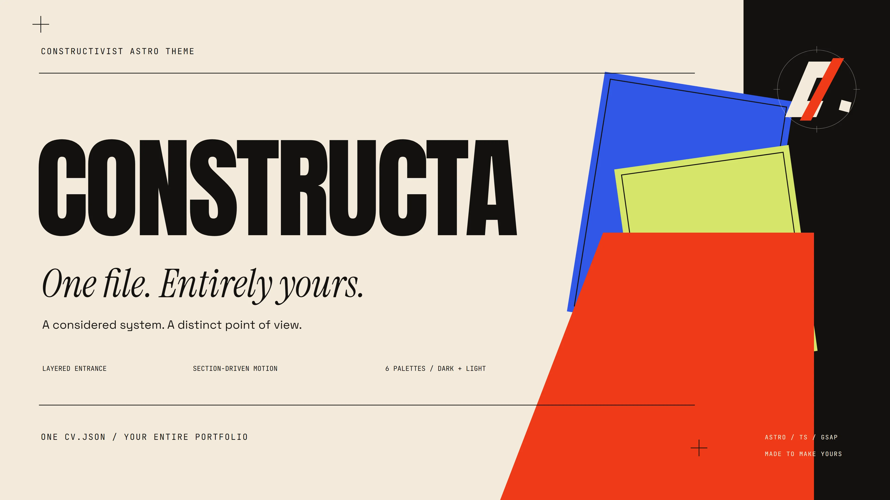
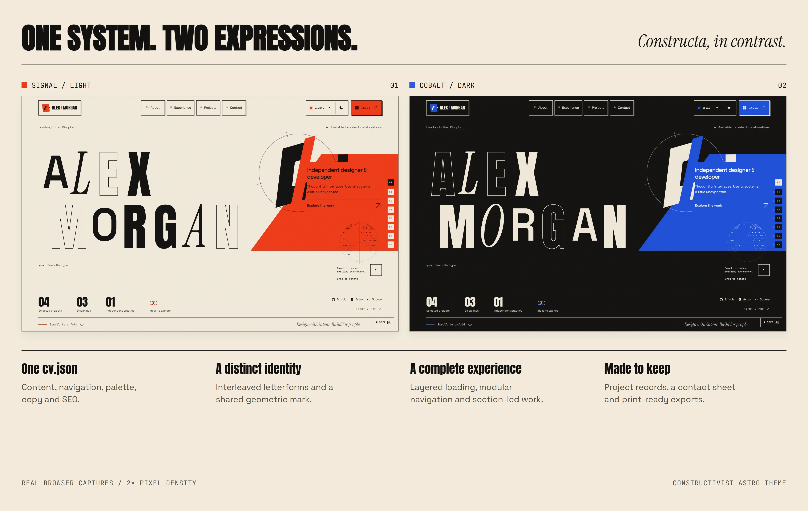
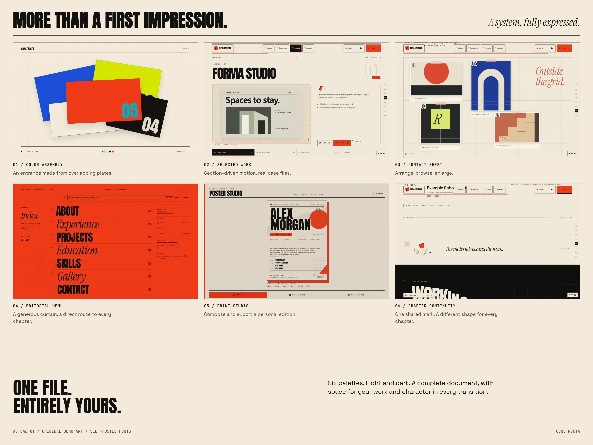
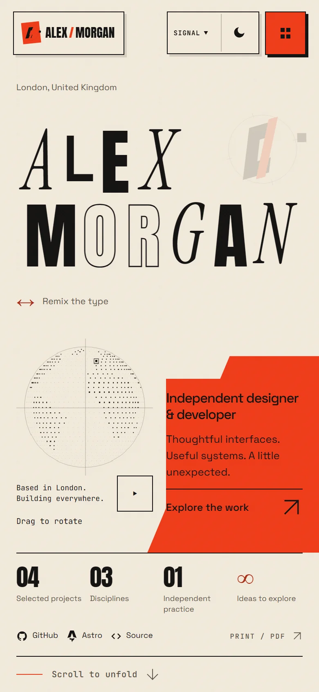

<!-- wasmer:start -->
## Deploy on Wasmer

This folder is the [Constructa](https://github.com/MiraHikari/astro-constructivist) Astro theme by MiraHikari, copied from commit `43259a8f13dc453dfe052c71061103f6cf10b503` so it can be deployed as a Wasmer Edge template.

- **Demo:** https://astro-constructivist.wasmer.app
- **Deploy:** open the template on [wasmer.io/templates](https://wasmer.io/templates) and click **Deploy**, or run `wasmer deploy` in this folder. Wasmer installs with pnpm, runs the build script with Node 24 and serves the static `dist/` folder.
- **Changed for Wasmer:**
  - Removed files used only by other hosts: netlify.toml, vercel.json.
  - Resized 4 images over 300 KB to at most 1600 px wide, keeping file names and formats.
- **Environment variables:** None.
- **Credit:** theme by [MiraHikari](https://github.com/MiraHikari), MIT. The theme's license file is kept unchanged.
<!-- wasmer:end -->

# Constructa

**Constructivist Astro Theme**

**A portfolio with the presence of a printed manifesto and the movement of the web.**

[Demo](https://mirahikari.github.io/astro-constructivist/) · [Get started](#get-started) · [Configuration](docs/CONFIGURATION.md) · [中文](README.zh-CN.md)



Constructa is a static portfolio theme for developers, designers, and independent makers. Oversized interleaved type, diagonal color planes, and an original geometric mark give your work a distinct identity. A layered entrance, separate navigation tiles, and chapter-specific motion carry that identity through the whole experience. The content remains a real document: readable, linkable, printable, and useful without the animation.

**Make it yours in `cv.json`.** Profile, projects, copy, navigation, SEO, palettes, and optional features live together in one schema-backed file. No component editing is needed for content changes, whether you edit by hand or ask an agent.

## Why Constructa

| A clear visual point of view | A usable portfolio underneath |
| --- | --- |
| Constructivist composition, not another rounded-card grid | Semantic Astro pages and real section anchors |
| Seeded, interleaved hero typography and an original pixel globe | Stable content with no React islands or hydration layer |
| Layered color-plate loading and a shared geometric identity | Bounded entrance, skip control, reduced-motion and no-JS fallbacks |
| Section-local GSAP timelines and a horizontal work exhibition | Native touch scrolling; stacked work on smaller screens |
| Six expressive palettes, each with a dark variant | Saved preferences and storage-safe controls |
| A contact-sheet gallery and full project case files | Native dialogs, keyboard navigation, and focus return |
| A compact CV, an A4 poster, and a seeded poster studio | Browser printing plus downloadable SVG and PNG |

### Motion with an exit

The hero, biography, experience, work, education, skills, gallery, and contact chapters have their own visual rhythm. Seven short chapter bridges reinterpret the same mark as unfolding planes, a track, a frame, an orbit, a matrix, scattered prints, and a gathered finale. On large screens, vertical progress carries you through the work exhibition; it never replaces the entire site with a locked screen stage.

Reduced-motion preferences are respected, including changes while the page is open. Mobile and short viewports use a natural document layout. JavaScript enhances the presentation; the biography and work do not depend on it to exist.

### Controls that do real work

- `Cmd/Ctrl + K` or `/` opens the searchable section, project, and skill index.
- Separate floating navigation tiles follow the active section; a full-color editorial menu combines oversized chapter links with searchable content.
- Project case files, gallery board/strip modes, image browsing, and skill filters operate on actual content.
- `G` opens the desktop design inspector; `Esc` closes dialogs.
- Copy-email has a manual-selection fallback when clipboard access is denied.
- Compact print restores expanded records and filtered-out skills; poster mode uses its own A4 composition.

### One file, including the small words

`cv.json` is not just a list of projects. It also controls the hero, section copy, navigation labels, SEO, default palette, feature choices, and interface wording through `cv.ui`. Configure the entrance in `site.loader`, switch chapter bridges with `site.features.sectionTransitions`, and edit their short thoughts through `ui` keys named `story.about`, `story.projects`, and their chapter equivalents. The included [`cv.schema.json`](cv.schema.json) supports editor completion, while Zod validates content during the build.

The demo uses neutral example content and original, code-generated SVG graphics. Replace images with your own public assets or remote URLs; no third-party demo photo collection is required.

## Preview

Signal / light and Cobalt / dark, shown together. This 3840 × 2432 overview uses real browser captures, not invented UI mockups.



The complete experience: color-plate loading, a full-width project spread, the contact sheet, the editorial menu, print studio, and chapter continuity. The feature board is 3840 × 2880.



[High-resolution PNG overview](docs/images/preview-dual.png) · [Feature board PNG](docs/images/preview-features.png) · [Editable SVG cover](docs/images/project-cover.svg)

<details>
<summary>Mobile preview</summary>



</details>

## Get started

Use **Node.js 24 LTS** (24.16.0 or newer; 24.22.2 recommended) and **pnpm 12.16.1**,
the package-manager version pinned by this project.

```bash
pnpm create astro@latest --template MiraHikari/astro-constructivist
cd your-project-name
pnpm install
pnpm dev
```

Or choose **Use this template** on GitHub, clone your new repository, and run the last two commands. Use the local URL printed by Astro; deployments under a repository path may include that path.

The shipped configuration uses `/astro-constructivist/`, so the default local
page is `http://localhost:4321/astro-constructivist/`. For your own root-domain
site, set `site.base` to `/` in `cv.json` and use your own `site.url`.

1. Edit your profile, work, projects, and contact details in [`cv.json`](cv.json).
2. Set the deployment address, navigation, SEO, copy, and presentation options in that same file.
3. Replace demo images and run `pnpm build` before publishing.

Read the [configuration guide](docs/CONFIGURATION.md) for the field map, images, localization, and agent workflow.

## Agent-friendly by design

Try a scoped request such as:

> Personalize Constructa from the information below. Edit only cv.json. Update my profile, projects, navigation, SEO, and interface copy; keep the design and application code unchanged. Validate the result against cv.schema.json, then run the project checks.

[`AGENTS.md`](AGENTS.md) makes that boundary explicit. An agent should not rewrite components to change your name, hardcode a new menu, or invent credentials to fill the layout.

## Deploy anywhere static

```bash
pnpm build
pnpm preview
```

The output is `dist/`. There is no application server, database, or React runtime to deploy.

**GitHub Pages:** configure your public origin and repository base path in `cv.json`, then select **GitHub Actions** under repository **Settings → Pages**. The demo's destination is `https://mirahikari.github.io/astro-constructivist/`. A fork must use its own address; a custom domain normally uses `/` as its base path.

Vercel, Netlify, Cloudflare Pages, and other static hosts can publish the same build. See [deployment instructions](docs/DEPLOYMENT.md) for base-path, metadata, and custom-domain checks.

## Commands

| Command | Purpose |
| --- | --- |
| `pnpm dev` | Start the local Astro development server. |
| `pnpm build` | Check types and build the static site. |
| `pnpm preview` | Preview the production build locally. |
| `pnpm lint` | Check source and documentation conventions. |
| `pnpm typecheck` | Run Astro and TypeScript diagnostics. |
| `pnpm check-config` | Validate `cv.json` with the runtime schema. |
| `pnpm schema` | Regenerate editor hints after a schema change. |
| `pnpm schema:check` | Check that the committed editor schema is current. |
| `pnpm test` | Run schema and utility tests. |
| `pnpm test:e2e` | Run browser interaction and fallback tests. |
| `pnpm knip` | Check for unused code and dependencies. |
| `pnpm run ci` | Run schema, configuration, lint, typecheck, dead-code, and unit-test gates. |

Install the browser once before running end-to-end tests: `pnpm exec playwright install chromium`.

## Inside the theme

Astro · TypeScript · Tailwind CSS 4 · GSAP ScrollTrigger · Lenis · Zod · Fontsource · Iconify · Vitest · Playwright

```text
cv.json                    Site content and configuration
cv.schema.json             Editor-facing configuration schema
src/data/                  Runtime validation and typed data
src/components/sections/   The eight portfolio chapters
src/scripts/               Scroll, navigation, dialogs, and interaction
src/styles/                Section-driven layout rules
public/                    Your images and public assets
tests/                     Unit and browser regression tests
docs/                      Configuration, deployment, and design notes
```

See [architecture](docs/architecture.md) for implementation details, [design direction](docs/SCROLL-DIRECTION.md) for the motion contract, [the layered design refresh](docs/design-refresh.md) for the visual rationale and editable promotional assets, and [contributing](CONTRIBUTING.md) for proposed changes. Accessibility support is a design constraint, not a claim of universal certification; test your own content and target browsers.

Toolchain versions and the TypeScript compatibility pin are documented in
[TOOLCHAIN.md](docs/TOOLCHAIN.md). Git hooks are opt-in with `pnpm hooks:install`;
installation does not replace an existing hook or change your Git configuration.

[Quality evidence](docs/QUALITY.md) records actual release-candidate checks and
their limits. A successful local build is not a deployment or a Lighthouse score.

## License and credits

Constructa's original theme code is [MIT licensed](LICENSE). Dependencies, fonts, and icon sets retain their respective licenses; see [third-party notices](LICENSES/THIRD_PARTY.md). Brand icons do not imply endorsement.

The pixel globe is an independent implementation, not a redistributed React Bits component. Visual references are credited in the design notes. Constructa does not claim an Awwwards award, an unmeasured performance score, or an accepted Astro theme listing.
