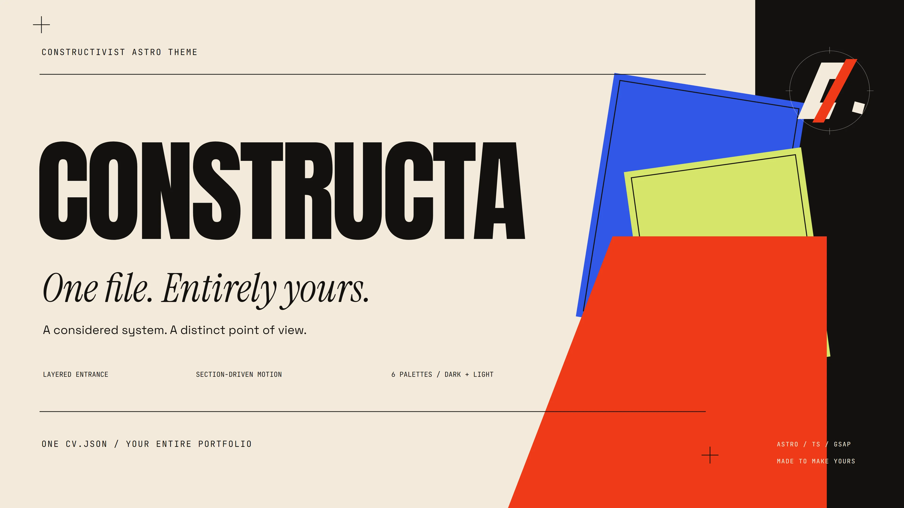
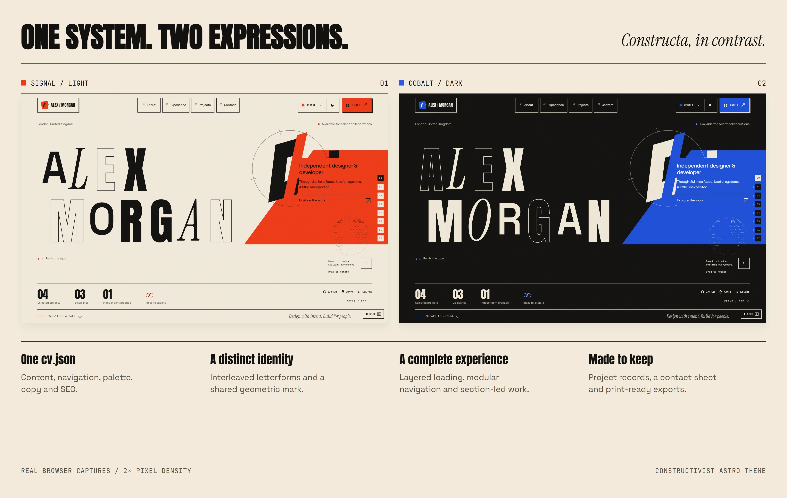
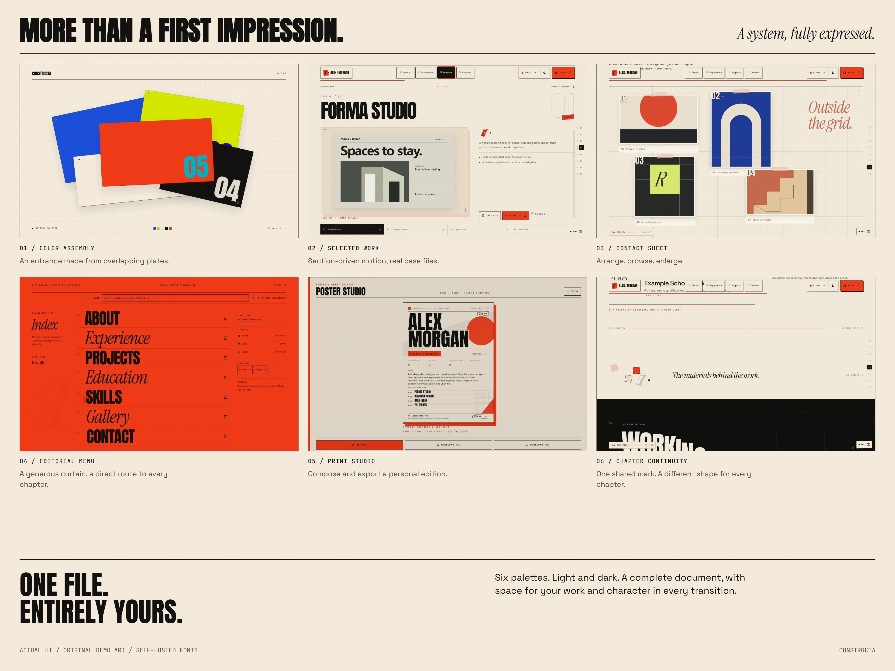
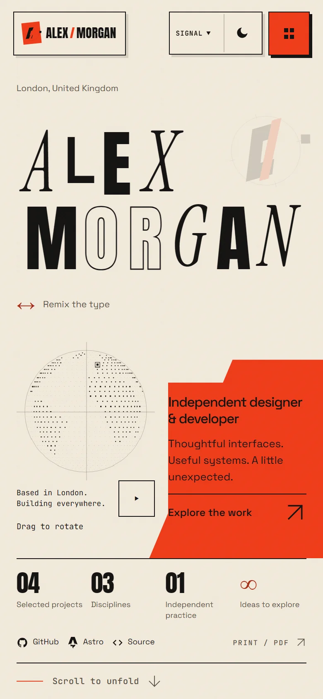

# Constructa

**构成主义 Astro 主题**

**像一张有态度的纸质海报，也像一个真正可用的网站。**

[演示站](https://mirahikari.github.io/astro-constructivist/) · [快速开始](#快速开始) · [配置指南](docs/CONFIGURATION.md) · [English](README.md)



Constructa 是面向开发者、设计师和独立创作者的静态作品集主题。巨幅交错字体、斜向色面与原创几何标记构成鲜明的视觉语言；多色板 Loader、分体浮动导航和章节专属动效把这个身份贯穿全站。页面仍然是真实的文档，可以阅读、链接、打印，也能在关闭动效后正常使用。

**日常定制只需要修改 `cv.json`。** 个人资料、项目、文案、导航、SEO、配色和功能选项集中在一个有 schema 约束的文件中。手动编辑或交给 Agent，都不需要为了改内容去重写组件。

## 不止是外观

| 有辨识度的表达 | 有可靠基础的交互 |
| --- | --- |
| 构成主义构图，而非通用圆角卡片堆叠 | Astro 静态页面、语义化章节与真实锚点 |
| 带种子的随机交错字体与原创像素地球 | 稳定的正文内容，不引入 React island |
| 多色板装配过场与全站共享几何标记 | 有时间上限，可跳过，尊重减少动效和无 JS 回退 |
| 每个 section 独立驱动的 GSAP 动效与横向作品展 | 触屏原生滚动，小屏改为纵向阅读 |
| 六套配色，均支持深色模式 | 保存偏好，存储受限时仍可切换 |
| 摄影接触印样式画板与完整项目案例 | 原生 dialog、键盘操作与焦点恢复 |
| 简历打印、A4 海报和种子海报工作台 | 浏览器打印，以及 SVG / PNG 下载 |

### 动效不是阅读门槛

首页、关于、经历、作品、教育、技能、画廊和联系章节各自拥有视觉节奏。七段短章节开场将同一个几何标记转译为展开、轨迹、画框、轨道、矩阵、接触印样散开和结尾聚合。桌面端的纵向滚动驱动局部横向作品展，而不是把整个页面锁进单屏切换器。

主题尊重系统的“减少动态效果”设置，也响应页面打开后的偏好变化。手机、低高度窗口和无 JavaScript 环境保留自然文档结构；内容不会因为没有播放动画而消失。

### 功能不是装饰

- `Cmd/Ctrl + K` 或 `/` 打开可搜索的章节、项目和技能索引。
- 分体浮动导航跟随当前章节；全色面编辑式菜单把巨幅章节链接与内容搜索放在同一个任务空间。
- 案例详情、画廊画板 / 胶片条切换、图片浏览和技能筛选使用真实内容。
- `G` 打开桌面设计检查器；`Esc` 关闭对话框。
- 剪贴板权限被拒绝时，复制邮箱会选择实际邮箱文本，方便手动复制。
- 紧凑简历打印恢复完整经历与被筛选隐藏的技能；A4 海报使用独立版面。

### 小到按钮文字，也在同一份配置里

`cv.json` 不只是项目数组。首页内容、章节文案、导航标签、SEO、默认配色、功能开关和 `cv.ui` 中的界面文字都由它控制。`site.loader` 配置入场；`site.features.sectionTransitions` 控制章节开场；`ui` 中的 `story.about`、`story.projects` 等章节键编辑对应短句。[`cv.schema.json`](cv.schema.json) 提供编辑器补全，构建时由 Zod 校验。

演示内容使用中性示例与原创代码生成 SVG，不依赖第三方照片集合。图片可以替换为 `public/` 内的文件，也可以使用远程 URL；请确认你拥有所用图片的授权。

## 预览

Signal 浅色与 Cobalt 深色同时展示。3840 × 2432 的介绍图使用真实浏览器截图，不是虚构的 UI 概念图。



完整展示多色板 Loader、整幅作品版面、接触印样画廊、编辑式菜单、海报工作台与章节连续性。功能图版分辨率为 3840 × 2880。



[高分辨率介绍图 PNG](docs/images/preview-dual.png) · [功能图版 PNG](docs/images/preview-features.png) · [可编辑 SVG 封面](docs/images/project-cover.svg)

<details>
<summary>移动端预览</summary>



</details>

## 快速开始

环境要求：**Node.js 24 LTS**（至少 24.16.0，推荐 24.22.2）、**pnpm 12.16.1**。
项目的 `packageManager` 已锁定 pnpm 版本。

```bash
pnpm create astro@latest --template MiraHikari/astro-constructivist
cd your-project-name
pnpm install
pnpm dev
```

也可以在 GitHub 点击 **Use this template** 创建自己的仓库，克隆后执行最后两条命令。以 Astro 输出的本地地址为准；配置了仓库子路径时，地址会包含该路径。

示例配置使用 `/astro-constructivist/`，因此默认本地页面为
`http://localhost:4321/astro-constructivist/`。如果自己的站点部署在域名根路径，
在 `cv.json` 中把 `site.base` 改成 `/`，并将 `site.url` 设置为自己的公开域名。

1. 在 [`cv.json`](cv.json) 中修改个人资料、经历、项目和联系方式。
2. 在同一文件中设置部署地址、导航、SEO、文案与表现选项。
3. 替换演示图片，执行 `pnpm build` 后再发布。

字段说明、图片路径、本地化和 Agent 工作流见[配置指南](docs/CONFIGURATION.md)。

## 给 Agent 一个清晰边界

可以这样提出定制请求：

> 根据以下信息个性化 Constructa。只修改 cv.json，更新个人资料、项目、导航、SEO 和界面文案，不改变设计和应用代码。不要编造履历或指标。按 cv.schema.json 校验，再运行项目检查。

[`AGENTS.md`](AGENTS.md) 将这个约定写进仓库。修改名字不应该触发组件重构，调整菜单不应该产生硬编码的第二份数据。

## 部署到静态托管

```bash
pnpm build
pnpm preview
```

发布目录为 `dist/`，不需要应用服务器、数据库或 React 运行时。

**GitHub Pages：** 在 `cv.json` 配置公开域名和仓库 base 路径，在仓库 **Settings → Pages** 将来源设为 **GitHub Actions**。演示站目标地址为 `https://mirahikari.github.io/astro-constructivist/`。Fork 后应改成自己的地址；自定义域名通常使用 `/` 作为 base。

Vercel、Netlify、Cloudflare Pages 及其他静态主机也可以托管同一份构建产物。子路径、元数据和自定义域名注意事项见[部署指南](docs/DEPLOYMENT.md)。

## 常用命令

| 命令 | 用途 |
| --- | --- |
| `pnpm dev` | 启动本地开发服务器。 |
| `pnpm build` | 类型检查并构建静态站点。 |
| `pnpm preview` | 本地预览生产构建。 |
| `pnpm lint` | 检查源代码与文档规范。 |
| `pnpm typecheck` | Astro / TypeScript 诊断。 |
| `pnpm check-config` | 使用运行时 schema 校验 `cv.json`。 |
| `pnpm schema` | 修改 schema 后生成编辑器配置提示。 |
| `pnpm schema:check` | 检查已提交的编辑器 schema 是否最新。 |
| `pnpm test` | 数据 schema 和工具函数单元测试。 |
| `pnpm test:e2e` | 浏览器交互与回退行为测试。 |
| `pnpm knip` | 检查未使用代码和依赖。 |
| `pnpm run ci` | 执行 schema、配置、lint、类型、未使用代码和单元测试检查。 |

首次运行端到端测试前安装 Chromium：`pnpm exec playwright install chromium`。

## 技术与维护

Astro · TypeScript · Tailwind CSS 4 · GSAP ScrollTrigger · Lenis · Zod · Fontsource · Iconify · Vitest · Playwright

[架构说明](docs/architecture.md) · [视觉与动效约定](docs/SCROLL-DIRECTION.md) · [本轮设计分析与宣传素材](docs/design-refresh.md) · [参与贡献](CONTRIBUTING.md) · [安全报告](SECURITY.md)

无障碍是实现约束，不等于对所有浏览器、辅助设备或自定义内容作认证承诺。发布前请测试自己的数据、文字长度和目标设备。

工具链版本及 TypeScript 的兼容性锁定见[工具链说明](docs/TOOLCHAIN.md)。Git hook
需要主动执行 `pnpm hooks:install` 才会安装，不覆盖已有 hook，也不修改 Git 配置。

[质量记录](docs/QUALITY.md) 只记录实际完成的发布候选检查与覆盖范围，不把本地构建
成功描述为已经部署，也不提供未测量的 Lighthouse 分数。

## 许可与致谢

Constructa 的原创主题代码使用 [MIT 许可](LICENSE)。依赖、字体与图标保留各自许可，详见[第三方声明](LICENSES/THIRD_PARTY.md)。品牌图标不代表品牌背书。

像素地球为独立实现，并非重新分发 React Bits 组件。设计参考在视觉文档中注明。主题不宣称获得 Awwwards 奖项、未实际测量的性能分数或已经被 Astro 主题目录收录。
