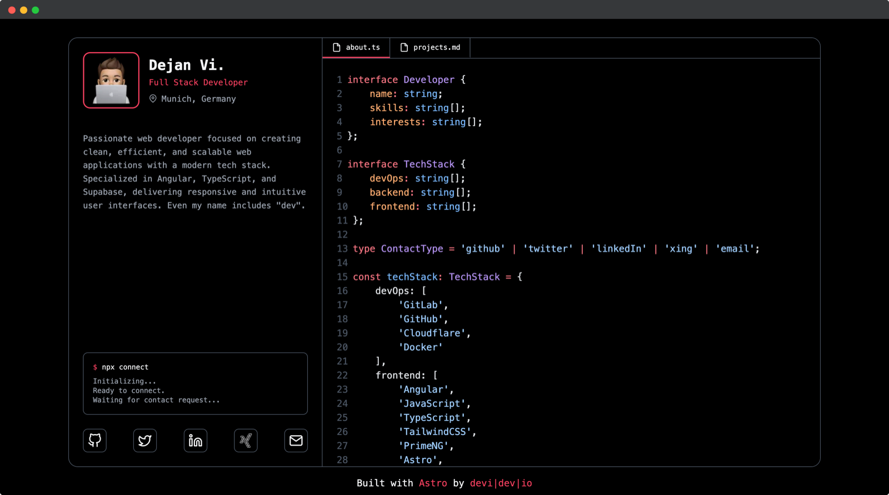
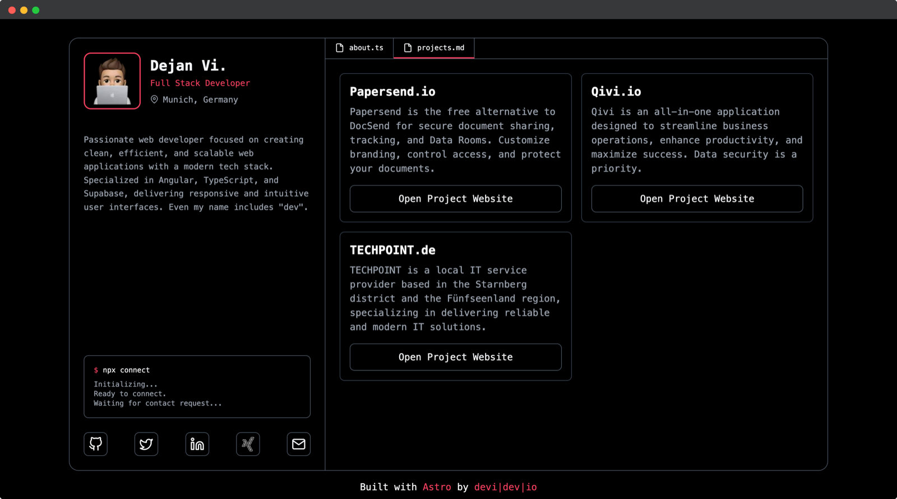

<!-- wasmer:start -->
## Deploy on Wasmer

This folder is the [Astro Developer Portfolio Template](https://github.com/devidevio/astro-developer-portfolio-template) Astro theme by devidevio, copied from commit `545806f0b6d50d0cb57b3c83235c33cc631a12df` so it can be deployed as a Wasmer Edge template.

- **Demo:** https://astro-developer-portfolio.wasmer.app
- **Deploy:** open the template on [wasmer.io/templates](https://wasmer.io/templates) and click **Deploy**, or run `wasmer deploy` in this folder. Wasmer installs with npm, runs the build script with Node 24 and serves the static `dist/` folder.
- **Changed for Wasmer:**
  - Resized 2 images over 300 KB to at most 1600 px wide, keeping file names and formats.
  - Added .nvmrc with Node 24, the Node version Wasmer builds with.
  - The theme has no lockfile, so this folder adds a package-lock.json generated with npm.
- **Environment variables:** None.
- **Credit:** theme by [devidevio](https://github.com/devidevio), NOASSERTION. The theme's license file is kept unchanged.
<!-- wasmer:end -->

# Astro Developer Portfolio Template
A minimal, easy-to-customize developer portfolio template built with [Astro](https://astro.build/) and [TailwindCSS](https://tailwindcss.com/). No JavaScript in final build.

## Demo
Check out a real-world example: [devidev.io](https://devidev.io)





## Features
- No bundled JavaScript – optimized for performance and speed.
- Fully responsive – mobile-friendly and adaptable across all devices.
- SEO & Social Media Ready – includes OpenGraph, Twitter, and DublinCore metadata.
- 100/100 Google PageSpeed Score – for both mobile and desktop.
- Code highlighting – clean and readable syntax with [Shiki](https://github.com/shikijs/shiki).
- Developer Portfolio & Projects Showcase – display your work with ease.
- Code Editor-Inspired Design – modern and developer-friendly aesthetics.

## Tech Stack
- [Astro](https://astro.build/)
- [TailwindCSS](https://tailwindcss.com/)
- [Shiki](https://github.com/shikijs/shiki)

## Getting Started

```sh
# 1. Clone the repository
git clone https://github.com/devidevio/astro-developer-portfolio .

# 2. Install dependencies
npm install

# 3. Run the development server
npm run dev

# 4. Build for production
npm run build

# Deploy the contents of the `./dist` folder wherever you like.
```

## Customization
### Site & Domain Configuration
- Modify `astro.config.mjs` to update your `site` settings, including metadata for SEO.

### Theme Customization
- Adjust the primary theme color in `tailwind.config.js`, to fit your branding.

### Updating Content & SEO
Edit the **Frontmatter** variables in these files:
- `src/layouts/Layout.astro` – General page info (title, SEO, etc.)
- `src/components/Socials.astro` – Update your social media links.
- `src/components/Profile.astro` – Personal profile information.
- `src/components/ContentProjects.astro` – Projects/portfolio section content.
- `src/components/ContentAbout.astro` – About section content.

### Profile Picture
- Replace `/src/assets/profile.png` with your own image.

### Logo & OpenGraph Image
- Update these files:
  - `/public/img/logo.svg` (your logo)
  - `/public/img/meta.png` (your OpenGraph image)

Need a free OpenGraph image?
- https://tailwind-generator.com/og-image-generator/generator

### Sitemap & Robots.txt
- Adjust `/public/robots.txt` to match your domain.

## ⭐ Contributing
Feel free to fork, customize, and contribute to this project. If you find it useful, leaving a star would be greatly appreciated.
