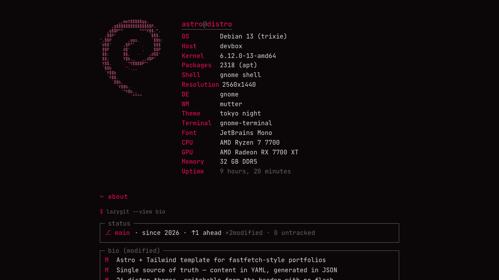
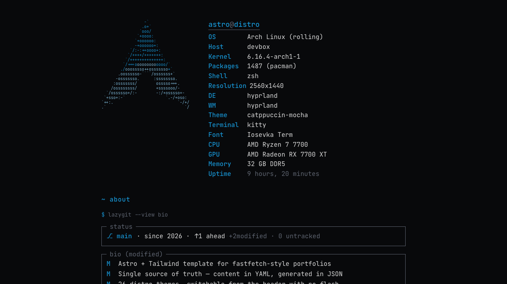
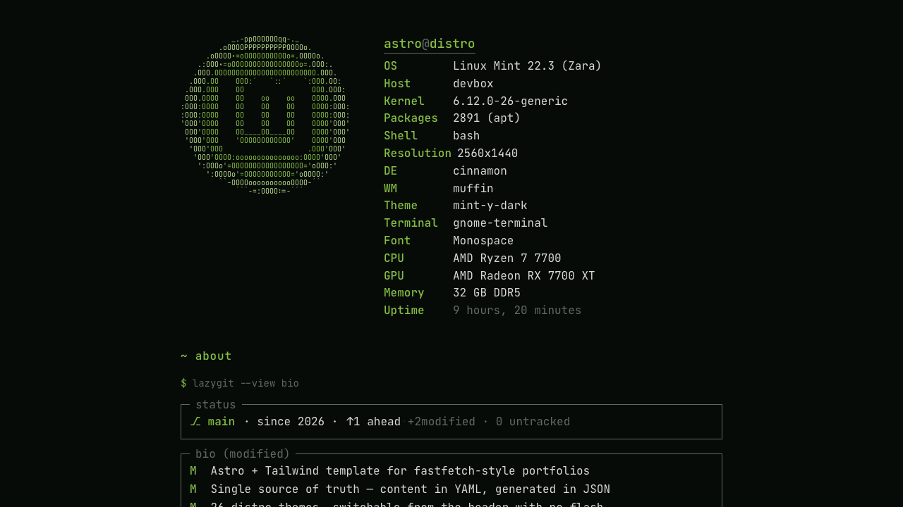
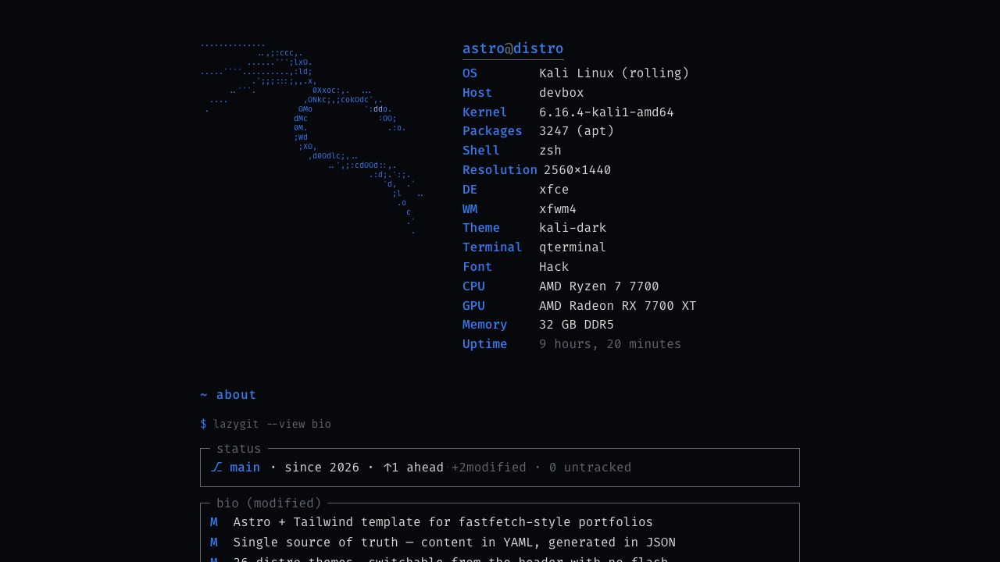

<!-- wasmer:start -->
## Deploy on Wasmer

This folder is the [astro-distro](https://github.com/ansango/astro-distro) Astro theme by ansango, copied from commit `6e3ee8f80041d9e4bd0743c25eb2e1f7d7802bdb` so it can be deployed as a Wasmer Edge template.

- **Demo:** https://astro-distro.wasmer.app
- **Deploy:** open the template on [wasmer.io/templates](https://wasmer.io/templates) and click **Deploy**, or run `wasmer deploy` in this folder. Wasmer installs with bun, runs the build script with Node 24 and serves the static `dist/` folder.
- **Changed for Wasmer:**
  - None. The theme builds as published.
- **Environment variables:** The theme's example env file lists `GH_TOKEN`. The demo builds and runs without them; set them in the app's settings to turn on the features that use them.
- **Credit:** theme by [ansango](https://github.com/ansango), MIT. The theme's license file is kept unchanged.
<!-- wasmer:end -->

# astro-distro



Astro template for a `fastfetch` / `neofetch`-style terminal portfolio. Two YAML files drive the site, project metadata is synced from GitHub, and the generated `config.json` is gitignored — clean repo, single source of truth, reproducible builds.

> Built initially as a personal portfolio, designed to be reused as a template: every piece of content lives in `src/data.yml` or `src/systems.yml`.

## Themes

26 distro color schemes, switchable from the header. Four shown below:

<div style="display: flex; gap: 0.75rem; flex-wrap: wrap;">
  
  
  
  
</div>

All 26: `arch`, `archcraft`, `debian`, `ubuntu`, `linuxmint`, `kali`, `fedora`, `opensuse`, `alpine`, `gentoo`, `manjaro`, `centos`, `void`, `nixos`, `slackware`, `pop`, `elementary`, `cachyos`, `windows`, `macos`, `android`, `raspbian`, `proxmox`, `truenas_scale`, `parrot`, `gnu`. Each one defined in [`src/systems.yml`](./src/systems.yml) with its own color palette, kernel, shell, DE, WM, theme, terminal, font, and ASCII logo (fetched from [fastfetch-cli](https://github.com/fastfetch-cli/fastfetch)).

## Stack

- [Astro](https://astro.build) — static site generator
- [Tailwind CSS 4](https://tailwindcss.com) — via `@tailwindcss/vite`
- [Bun](https://bun.sh) — runtime, package manager, YAML parser
- [Biome](https://biomejs.dev) — lint + format
- [GitHub Actions](https://github.com/features/actions) — CI

## Project layout

```
.
├── .github/workflows/sync.yml        # CI: build on push to data files
├── .env.example                      # optional GH_TOKEN
├── astro.config.mjs                  # Tailwind plugin + @/* alias
├── tsconfig.json                     # extends astro/tsconfigs/strict + @/* alias
├── package.json
├── public/
│   ├── robots.txt                    # crawler config
│   ├── apple-touch-icon.png          # iOS home screen (180×180)
│   ├── favicon.svg
│   └── favicon.ico
├── scripts/
│   ├── lib/project.ts                # shared GitHub fetch helpers
│   └── sync.ts                       # YAML + GitHub → config.json
└── src/
    ├── components/
    │   ├── seo.astro                 # <title>, OG, Twitter Card, JSON-LD…
    │   ├── distro-toggle.astro       # theme picker
    │   ├── section-title.astro
    │   ├── logos/                    # fastfetch-style ASCII logos
    │   └── tui/                      # TUI-style sections
    │       ├── btop/                 # CPU / memory / hardware / peripherals
    │       ├── lazygit/              # bio + status + paths
    │       ├── mutt/                 # contact + inbox
    │       └── ranger/               # projects tree + detail
    ├── data.yml                      # site + content config
    ├── systems.yml                   # the 26 distro entries
    ├── layouts/default.astro         # base layout (uses Seo)
    ├── lib/                          # cn util, themes, fonts, fastfetch cache
    ├── pages/index.astro
    └── styles/global.css
```

## Source of truth

Two YAML files are the **only** manual config. Everything else is generated.

### `src/data.yml`

Top-level site config + manual content that doesn't come from GitHub:

```yaml
site:            # SEO defaults (title, description, url, image, theme_color…)
current:         # active system slug
booted_at:       # ISO timestamp for the live-computed uptime
host:            # hardware info (manual, doesn't change often)
about:           # bio, paths, lazygit-style status block
uses:            # btop: cpu/memory/hardware/peripherals
contact:         # email, inbox, hints
projects_ui:     # projects section command + root
projects:        # list of GitHub repo URLs to fetch
```

### `src/systems.yml`

The 26 distro entries shown in every per-distro row (kernel, shell, DE, WM, theme, terminal, font, colors…). Lives in its own file because it's ~570 lines and would dwarf `data.yml`.

### `src/config.json` (gitignored)

Generated by `scripts/sync.ts` from the two YAML files + GitHub. Do not edit by hand — it gets overwritten. The page reads this at build time.

## Sync script

`scripts/sync.ts` is the build pipeline:

1. Reads `data.yml` + `systems.yml`
2. Skips entirely if neither YAML changed since the last `config.json` (mtime check)
3. For each URL in `data.yml.projects`:
   - Cached? Use it (`SYNC_TTL` controls cache age, default 1h; `SYNC_TTL=0` disables cache)
   - Otherwise fetch from GitHub (uses `GH_TOKEN` / `GITHUB_TOKEN` if set, raises rate limit 60/h → 5000/h)
   - Refresh existing project entries in place, append new ones
   - Drop entries no longer in the queue
4. Writes `src/config.json` + `.cache/sync.json`

It runs automatically as a `predev` and `prebuild` hook in `package.json`, so `bun run dev` and `bun run build` always have fresh data.

### Env vars

- `GH_TOKEN` / `GITHUB_TOKEN` — optional, raises API rate limit
- `SYNC_TTL` — cache TTL in ms (default `3600000` = 1h, `0` disables cache)
- `SYNC_FORCE` — if set, ignore the mtime skip check

Copy `.env.example` to `.env` to set them locally.

## Commands

| Command | Action |
| :-- | :-- |
| `bun install` | Install dependencies |
| `bun run dev` | Start dev server (auto-runs sync via `predev`) |
| `bun run build` | Build static site to `dist/` (auto-runs sync via `prebuild`) |
| `bun run preview` | Preview the build locally |
| `bun run sync` | Run the sync script standalone |
| `bun run check` | Biome lint + format |

## CI

`.github/workflows/sync.yml` runs on:

- `push` to `src/data.yml` or `src/systems.yml` on `main`
- bi-weekly cron (`0 0 */14 * *`)
- manual `workflow_dispatch`

It installs deps and runs `bun run build`, which auto-runs `sync` via the `prebuild` hook. Since `config.json` is gitignored, no commit step is needed — Astro just builds from the freshly-generated file.

The workflow passes `secrets.GITHUB_TOKEN` as `GH_TOKEN` so the sync script uses authenticated requests.

## SEO

`src/components/seo.astro` renders a complete meta block from `data.yml.site`:

- **Primary** — `<title>`, `description`, `theme-color`, `canonical`, `apple-touch-icon`
- **Open Graph** — `og:type`, `og:url`, `og:title`, `og:description`, `og:image` + `og:image:width`/`height`, `og:locale`, `og:site_name`
- **Twitter Card** — `twitter:card`, `twitter:url`, `twitter:title`, `twitter:description`, `twitter:image`, `twitter:creator` (only if set)
- **Structured data** — JSON-LD `WebSite` schema with a nested `Person` author block (auto-generated from `site.social.github`/`twitter`/`linkedin`)
- **robots.txt** — `public/robots.txt` allows everything by default

The page sets `<title>` via the `title` prop on `<Layout>`. If the title already contains `site.title` (case-insensitive), no suffix is added; otherwise ` · {site.title}` is appended.

## Caches

Two caches, both in `.cache/` (gitignored):

| Path | Purpose | TTL |
| :-- | :-- | :-- |
| `.cache/sync.json` | GitHub repo metadata (stars, descriptions, dates) | 1h (env-overridable) |
| `.cache/logos/` | ASCII logos fetched from fastfetch-cli | no TTL (delete to refresh) |

## Aliases

TypeScript + Vite resolve `@/*` to `src/*`. Use it in imports:

```ts
import config from "@/config.json";
import { cn } from "@/lib/cn";
import Prompt from "@/components/tui/commons/prompt.astro";
```

`cn` is a small util in `src/lib/cn.ts` that wraps `tailwind-merge` to merge Tailwind classes safely.

## Using as a template

1. Fork or clone the repo
2. Edit `src/data.yml` — replace `site` block (title, description, url, author, social)
3. Edit `src/systems.yml` — keep, remove, or add distros
4. Replace `src/data.yml#projects` with your own GitHub repo URLs
5. Edit `src/data.yml#about.bio`, `paths`, `contact.inbox` for your content
6. Add your own `public/og.png` (1200×630) and replace `public/apple-touch-icon.png`
7. (Optional) set `GH_TOKEN` in `.env` for higher API rate limits
8. `bun install && bun run dev`
