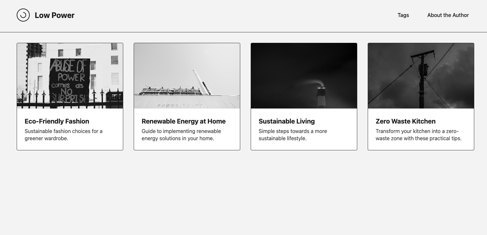
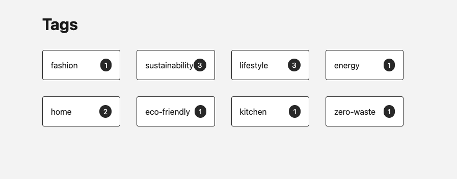
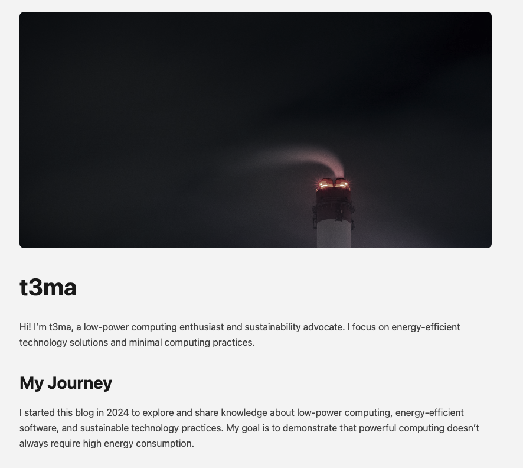

<!-- wasmer:start -->
## Deploy on Wasmer

This folder is the [Low Power Blog](https://github.com/temaprint/eco) Astro theme by temaprint, copied from commit `836e2b1db4d963ffefed39f2f53478cb587f8ef2` so it can be deployed as a Wasmer Edge template.

- **Demo:** https://astro-eco.wasmer.app
- **Deploy:** open the template on [wasmer.io/templates](https://wasmer.io/templates) and click **Deploy**, or run `wasmer deploy` in this folder. Wasmer installs with npm, runs the build script with Node 24 and serves the static `dist/` folder.
- **Changed for Wasmer:**
  - Resized 1 image over 300 KB to at most 1600 px wide, keeping file names and formats.
  - Added .nvmrc with Node 24, the Node version Wasmer builds with.
- **Environment variables:** None.
- **Credit:** theme by [temaprint](https://github.com/temaprint), MIT. The theme's license file is kept unchanged.
<!-- wasmer:end -->

# Low Power Blog

A minimalist blog template focused on energy efficiency and low-power computing. Built with Astro and designed to be lightweight and performant.




## Features

- Minimalist monochrome design
- Lightweight and fast loading
- Content collections for blog posts and pages
- Tag system for content organization
- Responsive grid layout
- Energy-efficient grayscale images
- Used astro-imagetools

## Getting Started

```bash
npm install
npm run dev
npm run build  
npm run preview
```

## Content Structure

- `/src/content/blog/` - Blog posts
- `/src/content/page/` - Static pages
- `/public/images/` - Image assets

## License

This project is licensed under the MIT License - see the LICENSE file for details.
