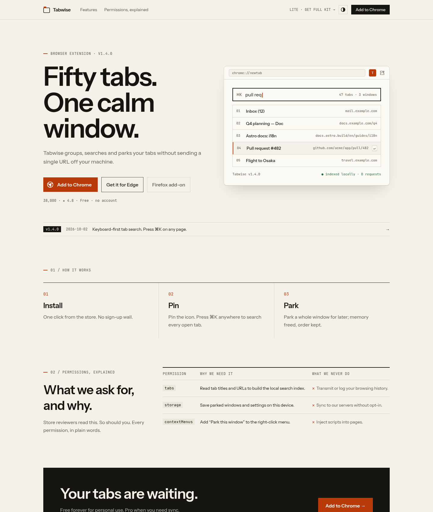

<!-- wasmer:start -->
## Deploy on Wasmer

This folder is the [Extension Kit Lite](https://github.com/smallbench-labs/astro-extension-kit-lite) Astro theme by smallbench-labs, copied from commit `15f5e53108621669cbac979b9b7e61df59fc70ec` so it can be deployed as a Wasmer Edge template.

- **Demo:** https://astro-extension-kit-lite.wasmer.app
- **Deploy:** open the template on [wasmer.io/templates](https://wasmer.io/templates) and click **Deploy**, or run `wasmer deploy` in this folder. Wasmer installs with npm, runs the build script with Node 24 and serves the static `dist/` folder.
- **Changed for Wasmer:**
  - None. The theme builds as published.
- **Environment variables:** None.
- **Credit:** theme by [smallbench-labs](https://github.com/smallbench-labs), MIT. The theme's license file is kept unchanged.
<!-- wasmer:end -->

**[Full version US$39](https://themes.formchime.com/themes/extension-kit/)**



# Astro Extension Kit Lite

A one-page landing site for a browser extension. Free and MIT-licensed.

Astro 7 + Tailwind CSS 4, static output, no framework JavaScript (two small inline scripts: light/dark mode and Esc to close the menu). Lighthouse 100 in all four categories, light and dark (mobile profile, local build, 2026-11-19).

## What's on the page
- **Hero with install buttons** for the Chrome Web Store, Microsoft Edge Add-ons and Firefox Add-ons.
- **Browser-window product mock** you can replace with a screenshot of your extension.
- **Latest-release strip**, read from the newest Markdown file in `src/content/changelog/en/`.
- **How it works**, three steps.
- **Permissions table**: one row per permission, with why your extension needs it and what it never does with it. Store reviewers and users both read this.
- Light and dark mode, one CSS variable to recolor.

## Use
```bash
nvm use && npm install && npm run dev   # Node 22, http://localhost:4321
npm run build                           # outputs ./dist
```
1. `src/site.config.ts`: name, version, store links and the list of permissions.
2. `src/i18n/ui.ts`: the page copy, including the "why" and "never" text for each permission.
3. `src/content/changelog/en/`: one Markdown file per release.
4. Recolor with `--signal` in `src/styles/global.css`.

Deploy `dist/` to Cloudflare Pages, Netlify, Vercel or any static host (Node 22).

## Before you go live
The demo user count and rating (`users`, `rating` in `src/site.config.ts`) are labelled on the page as demo figures, in every language. Replace them — and the changelog entries and store URLs — with your real ones before you go live. Publishing made-up ratings can break store and consumer-protection rules.

## Lite or the full kit
Lite is a complete landing page and stays free. The paid **[Astro Extension Kit](https://themes.formchime.com/themes/extension-kit/#lite-vs-full)** is for the day you submit to a store and need the rest of the paperwork.

| | Lite (this repo) | Full kit |
|---|---|---|
| License | MIT | Commercial: unlimited projects, client work allowed |
| Pages | One landing page | Home, pricing, docs, changelog, what's new, privacy policy, welcome, uninstall |
| Languages | English | English, 日本語, 繁體中文 |
| Permissions table | Written by hand in `site.config.ts` | Generated from your `manifest.json`; the build fails on a permission with no explanation |
| Privacy policy | — | Full template, including Chrome Web Store Limited Use and Firefox data collection |
| Store images and listing copy | — | Screenshot frames, promo tiles and icons exported as PNG; listing copy checked against store limits |
| Install button | Links to all three stores | Matches the visitor's browser; UTM tags; "Installed" state in Chrome and Edge (other browsers keep the install button); email-me link on phones |
| Welcome, what's new, uninstall pages | — | All three, plus the `background.js` code that opens them |
| Pricing page | — | ExtensionPay, Polar or any checkout link, monthly / yearly |

The full kit is US$39 once, with 12 months of updates; the code is yours to keep. Compare them side by side, with screenshots, at **[themes.formchime.com/themes/extension-kit](https://themes.formchime.com/themes/extension-kit/#lite-vs-full)**.

## License
MIT. See `LICENSE`. Questions: support@formchime.com.
