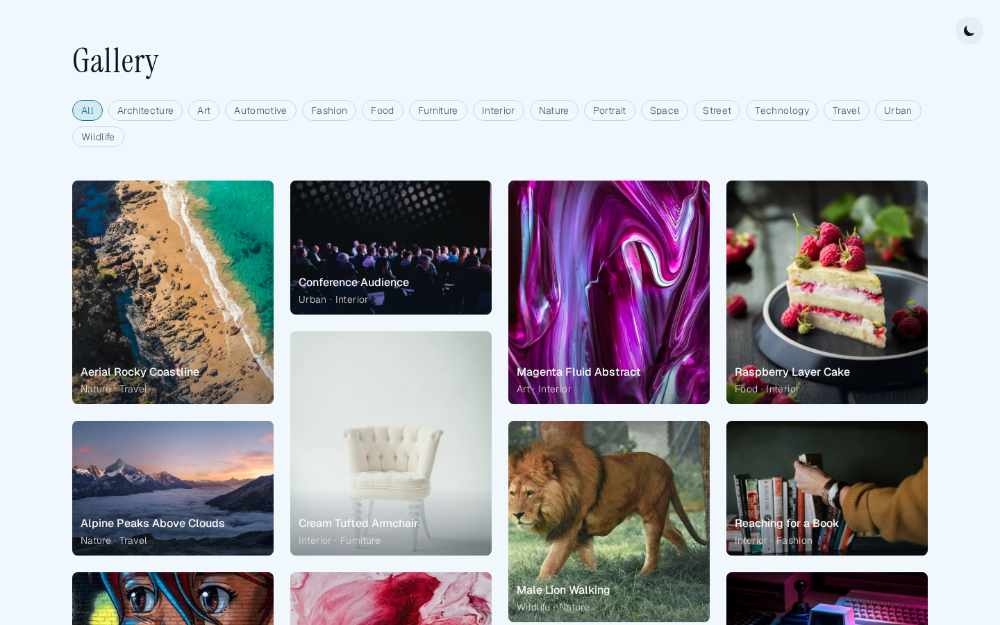
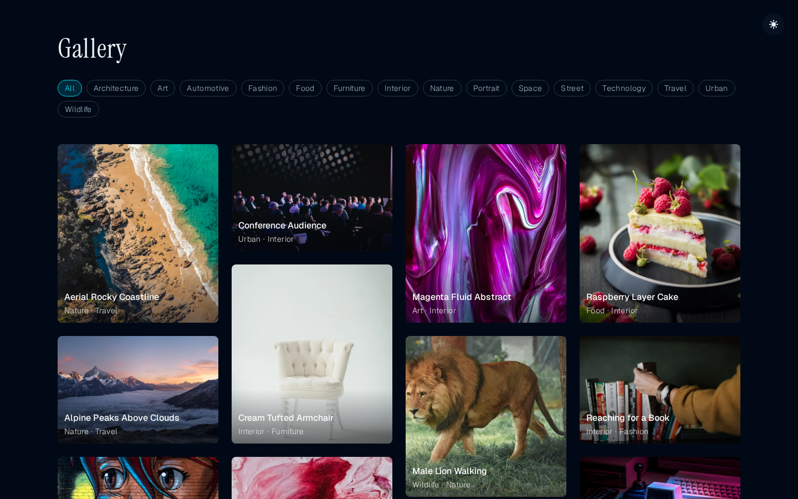
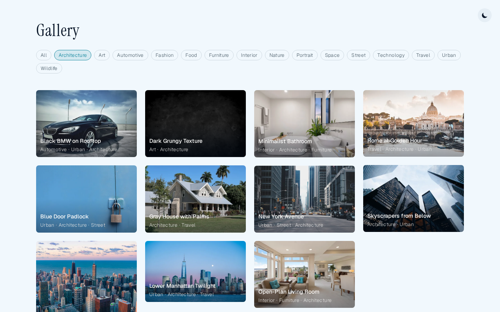
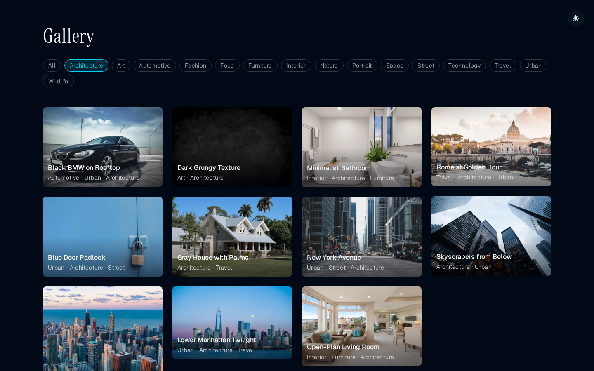
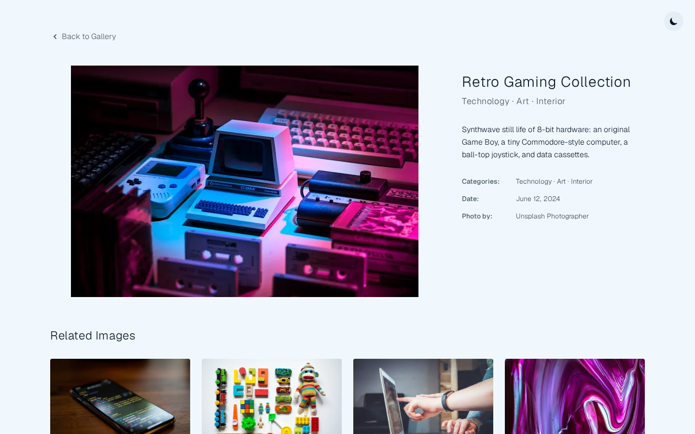
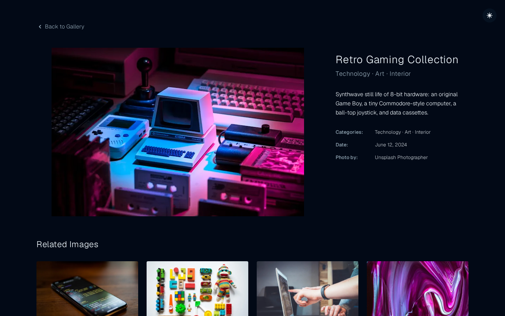

<!-- wasmer:start -->
## Deploy on Wasmer

This folder is the [Astro Frame Shift](https://github.com/EmaSuriano/astro-frame-shift) Astro theme by EmaSuriano, copied from commit `0288413ac97acd3d2ec8b6fec9d7c6ea70fbb9bb` so it can be deployed as a Wasmer Edge template.

- **Demo:** https://astro-frame-shift.wasmer.app
- **Deploy:** open the template on [wasmer.io/templates](https://wasmer.io/templates) and click **Deploy**, or run `wasmer deploy` in this folder. Wasmer installs with yarn, runs the build script with Node 24 and serves the static `dist/` folder.
- **Changed for Wasmer:**
  - None. The theme builds as published.
- **Environment variables:** None.
- **Credit:** theme by [EmaSuriano](https://github.com/EmaSuriano), MIT. The theme's license file is kept unchanged.
<!-- wasmer:end -->

# Astro Frame Shift - Minimalist Photo Gallery

A clean, minimalist photo gallery built with Astro featuring smooth transitions, dark/light theme support, and responsive masonry layout.

This theme is **Astro 7 ready**.

## Screenshots 📸

Captured from the [live demo](https://emasuriano.github.io/astro-frame-shift/) with [shot-scraper](https://github.com/simonw/shot-scraper). Light and dark run as parallel CI jobs via [`shots-light.yml`](shots-light.yml) / [`shots-dark.yml`](shots-dark.yml) (workflow: [`.github/workflows/screenshots.yml`](.github/workflows/screenshots.yml)). Home, Category, and Image detail.

| Light | Dark |
| ----- | ---- |
|  |  |
|  |  |
|  |  |

## ✨ Features

- **Minimalist Design**: Clean, borderless interface with no shadows or visual clutter
- **Dark/Light Theme**: Persistent theme switching with smooth transitions
- **Responsive Masonry Layout**: CSS-based masonry layout that adapts to all screen sizes
- **Image Validation**: Build-time TypeScript script to verify all image URLs are working
- **Smooth Transitions**: Astro View Transitions for seamless navigation between pages
- **Category routes**: Filter tags are real pages (`/category/{slug}/`) so view transitions work; client-side hide broke them
- **Hover Effects**: Image information appears only on hover for maximum minimalism
- **Performance Optimized**: Static site generation with optimized images using Astro's Image component

## 🎨 Design Philosophy

This gallery embraces ultra-minimalism:

- No borders or shadows
- Clean typography with Inter and JetBrains Mono fonts
- Information only appears on hover
- Stone/slate color palette for subtle elegance
- Generous white space and clean layouts

## 🚀 Project Structure

```text
/
├── public/
│   └── favicon.svg
├── src/
│   ├── components/
│   │   └── ThemeToggle.astro          # Dark/light theme toggle
│   ├── content/
│   │   └── config.ts                  # Content collection schema
│   ├── data/
│   │   └── gallery.json               # 60+ curated images with metadata
│   ├── layouts/
│   │   └── Layout.astro               # Main layout with theme persistence
│   ├── pages/
│   │   ├── index.astro                # Gallery grid page
│   │   └── image/
│   │       └── [id].astro             # Individual image detail page
│   └── styles/
│       └── global.css                 # Global styles
├── scripts/
│   └── check-images.ts                # Image URL validation script
└── package.json
```

## 🖼️ Gallery Features

- **60+ Images**: Diverse collection spanning multiple categories
- **Category Organization**: Architecture, Nature, Street Photography, Portraits, and more
- **Photographer Attribution**: Credit with optional links to photographer profiles
- **Related Images**: Images can have multiple categories; related images are ranked by tag overlap
- **Responsive Images**: Optimized loading with Astro's Image component

## 🧞 Commands

All commands are run from the root of the project, from a terminal:

| Command                | Action                                           |
| :--------------------- | :----------------------------------------------- |
| `yarn install`         | Installs dependencies                            |
| `yarn dev`             | Starts local dev server at `localhost:4321`      |
| `yarn build`           | Build your production site to `./dist/`          |
| `yarn preview`         | Preview your build locally, before deploying     |
| `yarn check-images`    | Validate all gallery image URLs                  |
| `yarn astro ...`       | Run CLI commands like `astro add`, `astro check` |
| `yarn astro -- --help` | Get help using the Astro CLI                     |

## 🛠️ Development

### Adding New Images

Edit `src/data/gallery.json` to add new images:

```json
{
  "src": "https://example.com/image.jpg",
  "alt": "Image description",
  "title": "Image Title",
  "description": "Detailed description of the image",
  "categories": ["Primary Tag", "Secondary Tag"],
  "date": "2024-01-01",
  "photographer": "Photographer Name",
  "photographerLink": "https://photographer-website.com"
}
```

### Image Validation

The project includes automatic image URL validation:

- Run `yarn check-images` to verify all URLs are accessible
- Validation runs automatically during build process
- Failed URLs are reported for manual review

### Theme Customization

The project uses Tailwind CSS with a stone/slate color palette:

- Light mode: Stone colors (warm, neutral)
- Dark mode: Slate colors (cool blue-gray undertones)
- Easy to customize in `tailwind.config.mjs`

## 📱 Responsive Design

- **Mobile First**: Optimized for mobile viewing
- **Masonry Layout**: 1-4 columns based on screen size
- **Touch Friendly**: Proper hover states and touch interactions
- **Performance**: Lazy loading and optimized images

## 🎯 Performance Features

- **Static Site Generation**: Pre-rendered for maximum speed
- **Image Optimization**: Automatic WebP conversion and responsive sizes
- **View Transitions**: Smooth navigation without full page reloads
- **Minimal JavaScript**: Theme persistence and hover effects only
- **CSS-Based Masonry**: No JavaScript dependencies for layout
