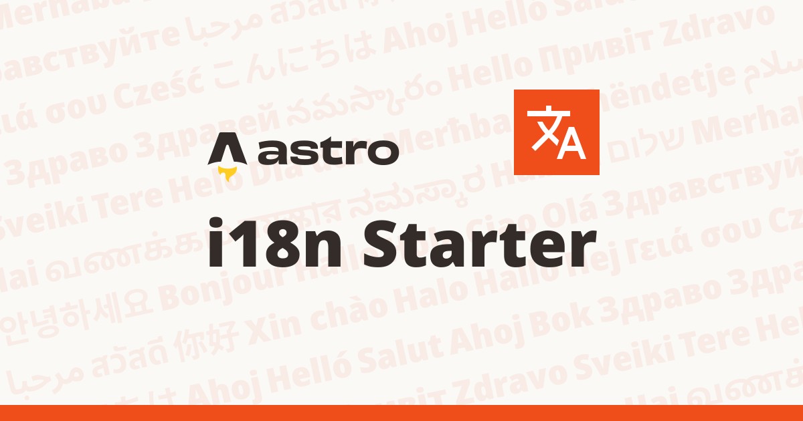

<!-- wasmer:start -->
## Deploy on Wasmer

This folder is the [i18n Starter](https://github.com/psephopaiktes/astro-i18n-starter) Astro theme by psephopaiktes, copied from commit `95f82ff17dfeffacbeadc490bd601ab6a95ae190` so it can be deployed as a Wasmer Edge template.

- **Demo:** https://astro-i18n-starter.wasmer.app
- **Deploy:** open the template on [wasmer.io/templates](https://wasmer.io/templates) and click **Deploy**, or run `wasmer deploy` in this folder. Wasmer installs with npm, runs the build script with Node 24 and serves the static `dist/` folder.
- **Changed for Wasmer:**
  - None. The theme builds as published.
- **Environment variables:** None.
- **Credit:** theme by [psephopaiktes](https://github.com/psephopaiktes), MIT. The theme's license file is kept unchanged.
<!-- wasmer:end -->

# Astro i18n Starter

```sh
npm create astro@latest -- --template psephopaiktes/astro-i18n-starter
```

[](https://astro-i18n-starter.pages.dev/ "See document")

i18n Starter is a simple [Astro](https://astro.build) theme for creating multilingual websites.

It supports [i18n routing in Astro v4.0](https://docs.astro.build/en/guides/internationalization/).

It only supports the subdirectory URL format. Each language is managed with a URL like the following. The root URL will redirect to the specified default language.

- example.com/en/
- example.com/ja/


## Features

- [x] Support for Astro's official i18n functionality
- [x] Various methods for managing multilingual pages
- [x] Vanilla CSS
- [x] SEO-friendly


## Lighthouse Score

[](https://pagespeed.web.dev/analysis/https-astro-i18n-starter-pages-dev-en/8sg3q21r6c?form_factor=desktop "Check score")


## Documentation

This theme is self-documented, and the pages within this theme can be considered as documentation.

Install and preview locally or check out the sample site below.

https://astro-i18n-starter.pages.dev/
