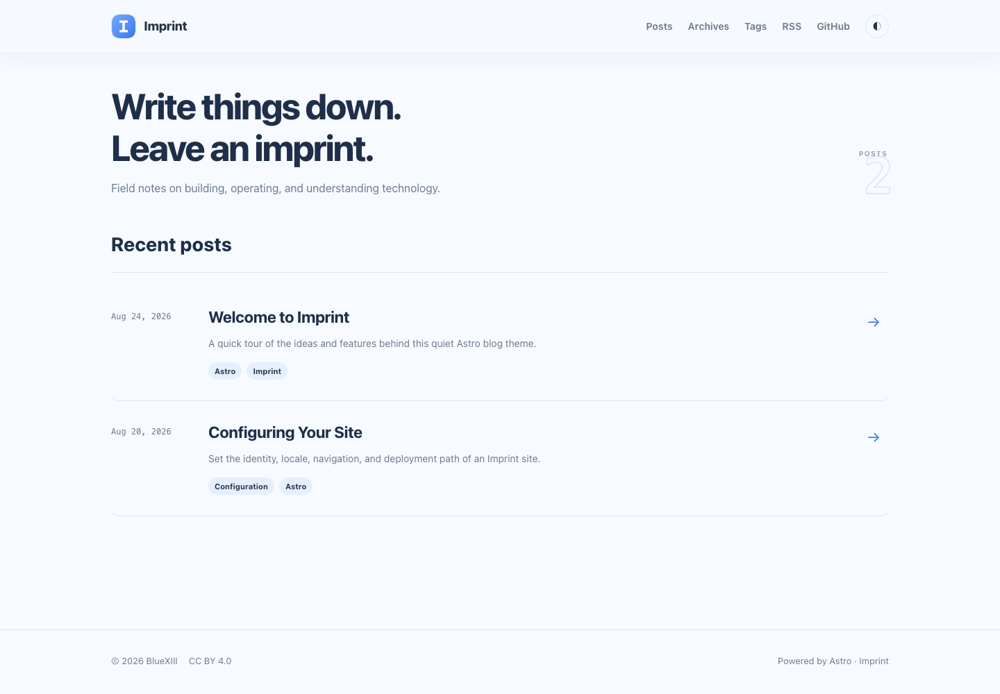
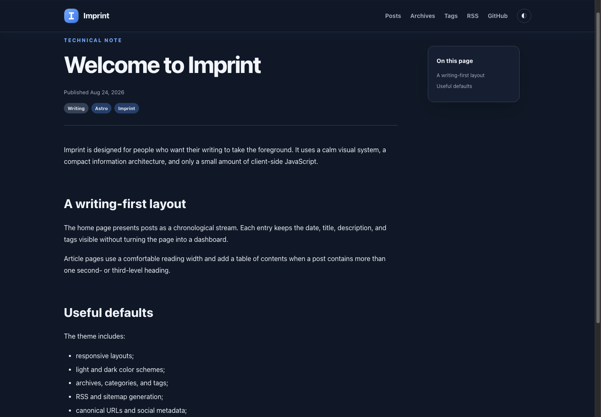
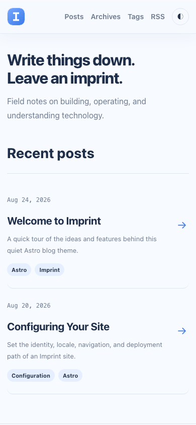

<!-- wasmer:start -->
## Deploy on Wasmer

This folder is the [Imprint](https://github.com/xiiiblue/astro-theme-imprint) Astro theme by xiiiblue, copied from commit `73338281b5f7cc9bd1e855d4f9000306b92d75db` so it can be deployed as a Wasmer Edge template.

- **Demo:** https://astro-imprint.wasmer.app
- **Deploy:** open the template on [wasmer.io/templates](https://wasmer.io/templates) and click **Deploy**, or run `wasmer deploy` in this folder. Wasmer installs with npm, runs the build script with Node 24 and serves the static `dist/` folder.
- **Changed for Wasmer:**
  - None. The theme builds as published.
- **Environment variables:** None.
- **Credit:** theme by [xiiiblue](https://github.com/xiiiblue), MIT. The theme's license file is kept unchanged.
<!-- wasmer:end -->

# Imprint

A quiet, writing-focused blog theme for [Astro](https://astro.build/).

Imprint gives technical notes, field reports, and long-form writing a calm place to live. It is responsive, accessible, dependency-light, and ready for static hosting.

[中文说明](./README.zh-CN.md)

## Preview

[View the live demo](https://www.bluexiii.com/astro-theme-imprint/)



<p>
  
  
</p>

## Features

- Minimal editorial design with light and dark color schemes
- Markdown content collections with typed frontmatter
- Responsive post lists and article layouts
- Automatic table of contents for longer posts
- Archives by year and month
- Categories and tags
- RSS, sitemap, canonical URLs, and Open Graph metadata
- Archived and `noindex` post states
- English and Chinese interface dictionaries
- Base-path support for GitHub Pages project sites
- Reduced-motion support and keyboard-accessible navigation
- Official Astro GitHub Pages deployment workflow

## Quick start

Use this repository as a GitHub template or clone it locally, then run:

```sh
npm install
npm run dev
```

The development server is available at `http://localhost:4321`.

## Configuration

Edit `src/config.ts` before publishing:

```ts
export const SITE = {
  title: 'Imprint',
  shortTitle: 'Imprint',
  description: 'Notes on software, systems, and the work behind them.',
  author: 'Your Name',
  url: 'https://example.com',
  basePath: '/',
  language: 'en',
  htmlLang: 'en',
  locale: 'en-US',
  timeZone: 'UTC',
  // ...
};
```

Use `/` as `basePath` for a custom domain or a GitHub user site. For a project site such as `https://name.github.io/my-blog/`, use `/my-blog`.

For hosted demos or deployment-specific overrides, set `IMPRINT_SITE_URL`, `IMPRINT_BASE_PATH`, `IMPRINT_AUTHOR`, and `IMPRINT_GITHUB_URL` in the build environment. These values take precedence over the defaults in `src/config.ts`.

Colors, typography, spacing, and responsive behavior are defined in `src/styles/global.css`. The main design tokens are CSS custom properties at the top of that file.

## Writing

Add Markdown files anywhere under `src/content/posts/`. Folders become part of the permanent URL, so this file:

```text
src/content/posts/2026/hello-world.md
```

is published at `/2026/hello-world/`.

Supported frontmatter:

```yaml
---
title: Hello World
date: 2026-08-24T09:00:00Z
updated: 2026-08-25T09:00:00Z
description: A short summary used in lists and metadata.
categories:
  - Notes
tags:
  - Astro
  - Writing
archived: false
noindex: false
---
```

Only `title` and `date` are required. When `description` is omitted, Imprint derives an excerpt from the Markdown body.

## Internationalization

English is the default interface. English and Chinese messages live in `src/i18n.ts`, so interface text is not scattered across components.

To use the included Chinese interface, change the locale fields in `src/config.ts`:

```ts
language: 'zh',
htmlLang: 'zh-CN',
locale: 'zh-CN',
timeZone: 'Asia/Shanghai',
```

To add another language, add a dictionary to `src/i18n.ts` and use its key as `SITE.language`.

## Commands

| Command | Purpose |
| --- | --- |
| `npm run dev` | Start the local development server |
| `npm run build` | Build the static site into `dist/` |
| `npm run preview` | Preview the production build |
| `npm run check` | Type-check, build, and validate internal links |
| `npm run clean` | Remove generated output |

Pull requests run the same type, build, link, and production dependency checks in GitHub Actions. Pushes to `main` must pass those checks before the Pages deployment starts.

## Deploying to GitHub Pages

1. Set `SITE.url` and `SITE.basePath` in `src/config.ts`.
2. Push the repository to GitHub using the `main` branch.
3. Open **Settings → Pages** and select **GitHub Actions** as the source.

The workflow in `.github/workflows/deploy.yml` builds and deploys the site automatically. For other static hosts, run `npm run build` and publish `dist/`.

## Project structure

```text
├── public/                 Static assets
├── src/
│   ├── components/         Reusable UI
│   ├── content/posts/      Markdown posts
│   ├── layouts/            Page shell and metadata
│   ├── pages/              Routes
│   ├── styles/             Theme styles
│   ├── config.ts           Site configuration
│   └── i18n.ts             Interface dictionaries
├── tools/                  Build validation
└── astro.config.mjs        Astro configuration
```

## License

The theme source is available under the [MIT License](./LICENSE). You retain ownership of your own content and may choose a separate content license in `src/config.ts`.
