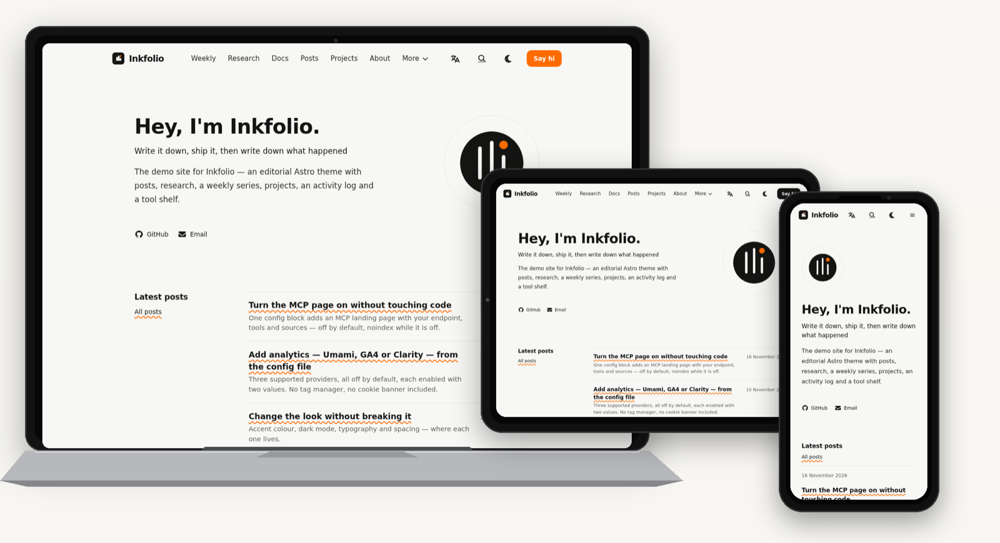
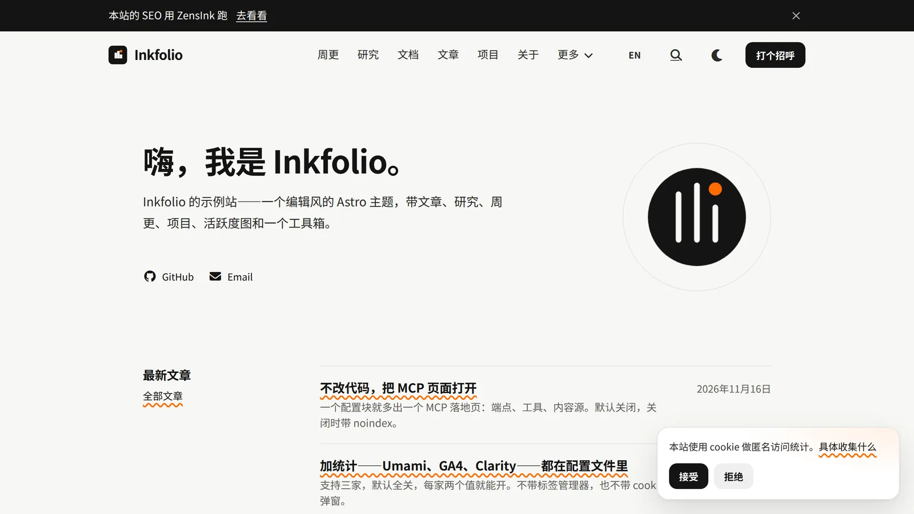
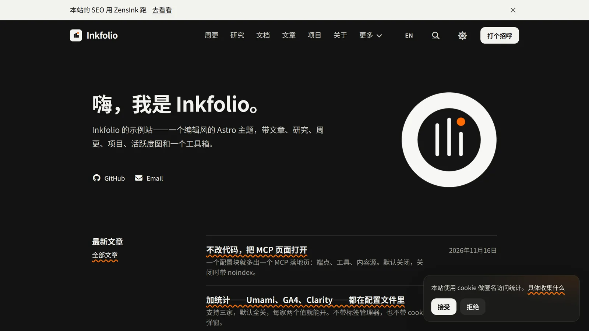

<!-- wasmer:start -->
## Deploy on Wasmer

This folder is the [Inkfolio](https://github.com/respectevery01/inkfolio) Astro theme by respectevery01, copied from commit `f0301b1fa82b503617f164f31767dc35d6f7b4db` so it can be deployed as a Wasmer Edge template.

- **Demo:** https://astro-inkfolio.wasmer.app
- **Deploy:** open the template on [wasmer.io/templates](https://wasmer.io/templates) and click **Deploy**, or run `wasmer deploy` in this folder. Wasmer installs with npm, runs the build script with Node 24 and serves the static `dist/` folder.
- **Changed for Wasmer:**
  - Resized 1 image over 300 KB to at most 1600 px wide, keeping file names and formats.
- **Environment variables:** None.
- **Credit:** theme by [respectevery01](https://github.com/respectevery01), GPL-3.0. The theme's license file is kept unchanged.
<!-- wasmer:end -->

<p align="center">
  
</p>

<h1 align="center">Inkfolio</h1>

<p align="center">
  <b>An editorial Astro theme for people who write and ship alone.</b><br />
  Posts, docs, a weekly series and a ship log — bilingual, config-driven, no client-side framework.
</p>

<p align="center">
  <a href="https://inkfolio.jask.dev">Live demo</a> ·
  <a href="https://inkfolio.jask.dev/docs/">Docs</a> ·
  <a href="#features">Features</a> ·
  <a href="#project-structure">Structure</a> ·
  <a href="#commands">Commands</a> ·
  <a href="#configuration">Configuration</a> ·
  <a href="#roadmap">Roadmap</a> ·
  <a href="#contributing">Contributing</a> ·
  <a href="#license">License</a>
</p>

<p align="center">
  <a href="https://astro.build"></a>
  <a href="LICENSE"></a>
  <a href="https://github.com/respectevery01/inkfolio/stargazers"></a>
  
  <a href="https://inkfolio.jask.dev/zh/"></a>
</p>

<p align="center">
  <a href="README.md">English</a> · <a href="README.zh.md">简体中文</a>
</p>

<p align="center">
  
  
</p>

Inkfolio is an editorial Astro theme for people who write and ship things alone: posts, a docs section, a weekly series, notes on what shipped, and one page that lists the tools actually used. Warm paper, near-black text, a single accent colour, locally bundled Font Awesome, and no client-side framework.

Everything you are likely to change — navigation, footer, friends, tools, the promo banner, analytics, consent, the MCP page — lives in YAML. You should be able to run this theme without opening an `.astro` file.

## Features

**Editorial by default**

- Typographic layout with reading measure, generous leading, and section rhythm built from spacing rather than card boxes
- Light and dark mode from CSS custom properties, respecting `prefers-color-scheme` and a stored choice
- Content-first templates: hero, about, posts, weekly, research, docs, log, friends, contact, projects, 404
- Wavy accent underlines and hover states that also work on touch and Safari

**Bilingual without a translation layer**

- Two files, one post: `posts/hello.md` pairs with `posts-zh/hello.md`, same pattern for docs, weekly and research
- The language switcher only renders when the other-language file actually exists — no dead links, no “coming soon”
- `hreflang` is emitted only for real pairs, so a Chinese-only page never claims an English twin
- UI strings, dates, reading time, labels and search results follow the page language

**Built for search engines and agents**

- Per-page `<title>`, description, canonical, Open Graph and Twitter metadata
- JSON-LD for the site, the author and articles
- `sitemap.xml`, `rss.xml` and `robots.txt` generated or served from the build
- Per-page OG images rendered with Playwright at build time (`npm run og`), no external image service
- Static, fully crawlable HTML — nothing important requires JavaScript

**Search and navigation that work offline**

- [Pagefind](https://pagefind.app/) indexing in the build step, so search is a static index rather than a service
- Pagination rendered as real pages, not infinite scroll
- Docs section with an auto-generated sidebar, per-page table of contents, callouts, and copy buttons on code blocks
- `toc: false` in frontmatter drops the sidebar TOC and collapses the body to one column

**The small pages that usually get skipped**

- `/log` — one activity grid plus a hand-written changelog. The grid is built from **public** GitHub commits by `npm run log`, deliberately without a token
- `/nav` — the tools actually used, grouped by job, with icons resolved from files you control
- `/friends` — one card per site, real avatar, no badge wall
- `/mcp` — an MCP page that appears only when enabled in config
- `/search` — static search with a language filter matching the page

**Privacy and consent handled properly**

- GA4 and Microsoft Clarity load only after consent; Umami loads without cookies and is always on
- A dismissible promo banner you can remove with one config line, leaving no hidden HTML behind
- No fonts, icons or analytics fetched from a third-party CDN at runtime

**Config, not code**

- `site.config.yaml` drives site metadata, navigation (including dropdowns), CTA, social links, footer columns, promo banner, theme, analytics, consent copy, SEO defaults, MCP and the footer art
- `src/data/*.yaml` drives friends, tools, projects and the hand-written log entries
- `npm run build` runs `astro check && astro build && pagefind`

**Publishing details that usually get skipped**

- Optional covers per post (`cover`, `coverAlt`), shown on the archive and the article independently via `covers.list` / `covers.article`
- Pinned posts (`pinned: 1..n`) sort ahead of the date order, get a full-width cover and an accent thumbtack beside the title
- Code blocks with a header bar (filename or language) and a copy button
- Three languages: English at `/`, Simplified at `/zh/`, Traditional at `/zh-Hant/`, with `i18n` switches for enable, default and detection
- Footer clock and weather, per visitor or fixed to one address

## Running locally

Requires **Node 20+** (Node 22 recommended) and Astro 7, which is already pinned in `package.json`.

```bash
git clone https://github.com/respectevery01/inkfolio.git my-site
cd my-site
npm install
npm run dev          # http://localhost:4321
```

The demo build passes its own URL through an environment variable, so a plain `npm run build` keeps `example.com` as the site URL until you set `site.url` in `site.config.yaml`:

```bash
SITE_URL="https://your-domain.com" npm run build
```

## Project structure

```text
inkfolio/
├── site.config.yaml          # navigation, footer, theme, analytics, MCP, promo banner
├── src/
│   ├── content/
│   │   ├── posts/            # English posts          (posts-zh/ for Chinese)
│   │   ├── docs/             # docs chapters         (docs-zh/)
│   │   ├── weekly/           # weekly series         (weekly-zh/)
│   │   ├── research/         # longer pieces         (research-zh/)
│   │   └── pages/            # about, contact, privacy, friends copy
│   ├── data/                 # friends.yaml, tools.yaml, projects.yaml, log-notes.yaml
│   ├── layouts/Base.astro    # head, SEO, JSON-LD, nav, footer, consent
│   ├── components/           # 23 components (cards, TOC, search, heatmap, dialogs)
│   ├── pages/                # 41 routes, English at /, Chinese at /zh/
│   ├── i18n/ui.ts            # UI strings, both languages
│   └── styles/               # tokens, global CSS, prose rules
├── public/                   # icons, footer art, OG fallbacks
└── scripts/                  # build with Pagefind, OG rendering, activity log
```

## Commands

All commands run from the project root:

| Command                | Action                                                                 |
| :--------------------- | :--------------------------------------------------------------------- |
| `npm install`          | Install dependencies                                                   |
| `npm run dev`          | Start the dev server at `localhost:4321`                               |
| `npm run build`        | Type-check, build the site, run Pagefind indexing into the output      |
| `npm run preview`      | Preview the built site locally before deploying                        |
| `npm run og`           | Render one 1200×630 OG image per page with Playwright                  |
| `npm run log`          | Rebuild the activity heatmap from **public** GitHub commits (no token) |
| `npm run pagefind`     | Re-run Pagefind indexing on an existing build                          |
| `npm run lint`         | ESLint                                                                 |
| `npm run format`       | Prettier, write mode                                                   |
| `npm run astro ...`    | Any Astro CLI command, e.g. `npm run astro check`                      |

## Configuration

| File                            | Controls                                                                                  |
| :------------------------------ | :---------------------------------------------------------------------------------------- |
| `site.config.yaml`              | Site name and URL, navigation and dropdowns, CTA, socials, footer columns, promo banner, theme, analytics, consent copy, SEO defaults, MCP page, footer art |
| `src/data/friends.yaml`         | Friend links: name, URL, description, avatar                                              |
| `src/data/tools.yaml`           | The `/nav` page: sections, tool names, icon file names                                    |
| `src/data/projects.yaml`        | The projects page                                                                         |
| `src/data/log-notes.yaml`       | Hand-written changelog entries shown under the heatmap                                     |
| `src/i18n/ui.ts`                | Every UI string, both languages                                                           |

### Frontmatter

Posts accept `title`, `description`, `date`, `updated`, `tags`, `draft`, `toc` and `lang`. Docs use the same shape plus `order`, which sorts the auto-generated sidebar; folders group chapters. Weekly and research entries add their series metadata. Chinese files mirror the same frontmatter; only the directory differs.

### The activity grid

`npm run log` reads commits from the public repositories listed at the top of `scripts/fetch-log.mjs` and writes `src/data/log.json`. It uses no token on purpose: a personal access token in a build script can read every private repository it was granted, so a single leak becomes a full exposure. Private work simply stays off the page — that is the trade, not a limitation to work around.

## Deployment

The output is static, so any host works. On Cloudflare Pages: build command `npm run build`, output directory `dist`, Node 20+. For a demo or preview, set `SITE_URL` in the build environment; for production, put your domain in `site.config.yaml`.

## Roadmap

- [x] Posts, docs, weekly series, research
- [x] Bilingual pairing with a real language switcher and `hreflang`
- [x] Log page: activity grid plus a hand-written changelog
- [x] Tools page, friends page, MCP page
- [x] Static search, real pagination
- [x] Build-time OG images
- [x] GEO / SEO layer — `sitemap.xml`, `robots.txt`, `llms.txt`, JSON-LD, canonical and hreflang
- [x] About page written in YAML, Markdown included
- [x] Icon set replaceable through configuration (Font Awesome or an Alibaba Iconfont symbol script)
- [x] Local time and weather in the footer
- [x] Traditional Chinese routes and dictionary
- [ ] Moments — a short-notes timeline at `/moments`
- [ ] Channel — a read-only mirror of a Telegram channel

## Contributing

Read [CONTRIBUTING.md](CONTRIBUTING.md) first — it covers setup, the pre-PR checks, and the house rules that keep the theme config-driven and framework-free. Short version: open an issue before redesigning anything visual, keep one concern per pull request, and run `npm run lint && npm run build`.

## License

[GPL-3.0](./LICENSE).
