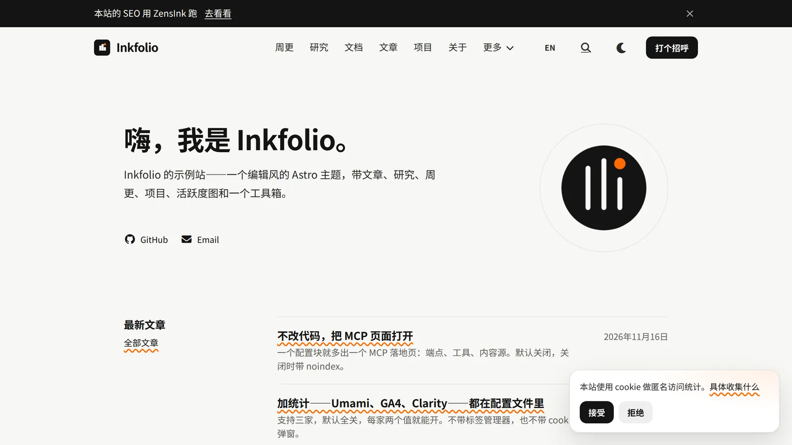
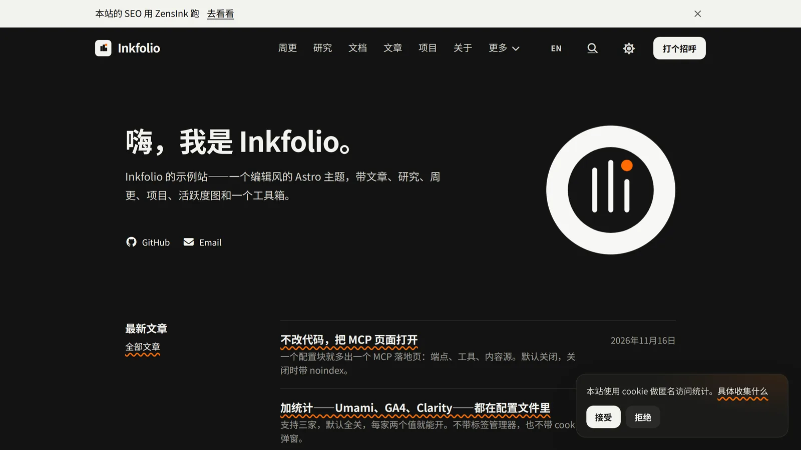

<p align="center">
  
</p>

<h1 align="center">Inkfolio</h1>

<p align="center">
  <b>给「一个人写、一个人发」的人用的编辑风 Astro 主题。</b><br />
  文章、文档、周刊、发布日志——双语、配置驱动、不用前端框架。
</p>

<p align="center">
  <a href="https://inkfolio.jask.dev/zh/">在线演示</a> ·
  <a href="https://inkfolio.jask.dev/zh/docs/">文档</a> ·
  <a href="#功能">功能</a> ·
  <a href="#目录结构">目录结构</a> ·
  <a href="#命令">命令</a> ·
  <a href="#配置">配置</a> ·
  <a href="#路线图">路线图</a> ·
  <a href="#参与">参与</a> ·
  <a href="#许可">许可</a>
</p>

<p align="center">
  <a href="https://astro.build"></a>
  <a href="LICENSE"></a>
  <a href="https://github.com/respectevery01/inkfolio/stargazers"></a>
  
  <a href="https://inkfolio.jask.dev/"></a>
</p>

<p align="center">
  <a href="README.md">English</a> · <a href="README.zh.md">简体中文</a>
</p>

<p align="center">
  
  
</p>

Inkfolio 是一套给「一个人写、一个人发」的人用的编辑风 Astro 主题：文章、文档区、周刊、发布日志，再加一页把真正在用的工具列出来。暖纸底、近黑字、单一强调色、本地打包的 Font Awesome，没有前端框架。

你多半会想改的东西——导航、页脚、友链、工具页、促销条、统计、同意书、MCP 页——全在 YAML 里。理想情况下，你不用打开任何一个 `.astro` 文件就能把站跑起来。

## 功能

**排版优先**

- 有阅读度量、行距充足，用留白和字号做节奏，而不是靠卡片堆盒子
- 明暗双主题由 CSS 变量驱动，跟随 `prefers-color-scheme`，也记住手动选择
- 内容型模板齐备：首页、关于、文章、周刊、研究、文档、日志、友链、联系、项目、404
- 橙色波浪下划线与悬停态在触屏和 Safari 上同样有效

**双语，不靠翻译层**

- 一个内容两份文件：`posts/hello.md` 与 `posts-zh/hello.md` 配对，docs、weekly、research 同一规则
- 只有另一语言文件真实存在时，语言切换器才渲染——没有死链，也没有「敬请期待」
- 只对真实存在的双语页输出 `hreflang`，中文独占页不会声称自己有英文版
- UI 文案、日期、阅读时长、标签、搜索结果都跟随当前页面语言

**面向搜索引擎与 AI agent**

- 每页独立的 `<title>`、描述、canonical、Open Graph 与 Twitter 元数据
- JSON-LD：站点、作者、文章
- 构建时生成 `sitemap.xml`、`rss.xml`，并提供 `robots.txt`
- 每页一张 1200×630 OG 图，构建时用 Playwright 渲染（`npm run og`），不依赖外部截图服务
- 纯静态、可完整抓取的 HTML——重要内容不依赖 JavaScript

**搜索与导航离线可用**

- 构建时用 [Pagefind](https://pagefind.app/) 建静态索引，搜索是索引而非第三方服务
- 分页是真分页，不是无限滚动
- 文档区自动生成侧边栏，页内目录、callout、代码块复制按钮齐备
- frontmatter 写 `toc: false` 即去掉侧边目录，正文收成单栏

**那些常被跳过的页面**

- `/log`——一个活跃度格子加一份手写更新日志。格子来自**公开**仓库的提交，由 `npm run log` 生成，刻意不用 token
- `/nav`——真正在用的工具，按用途分组，图标是你自己的文件
- `/friends`——一页一卡，真实头像，不做徽章墙
- `/mcp`——默认不出现，配置里开启才会渲染
- `/search`——静态搜索，按页面语言过滤结果

**隐私与同意处理得当**

- GA4 与 Microsoft Clarity 只有同意之后才加载；Umami 不写 cookie，常驻
- 促销条可关闭，也可以在配置里一行删掉，不留隐藏 HTML 残留
- 运行时不再从第三方 CDN 拉字体、图标或统计脚本

**配置驱动，而不是改代码**

- `site.config.yaml` 管站点信息、导航（含下拉）、CTA、社交链接、页脚分栏、促销条、主题、统计、同意文案、SEO 默认值、MCP 页、页脚插画
- `src/data/*.yaml` 管友链、工具、项目、手写日志条目
- `npm run build` 依次执行 `astro check && astro build && pagefind`

**那些常被跳过的发布细节**

- 每篇文章可选封面（`cover`、`coverAlt`），列表与文章页分别由 `covers.list` / `covers.article` 控制
- 置顶（`pinned: 1..n`）排在日期之前，封面整宽，标题左侧一枚橙色图钉
- 代码块带标题栏（文件名或语言）与复制按钮
- 三种语言：英文 `/`、简体 `/zh/`、繁体 `/zh-Hant/`，`i18n` 可开关、可设默认、可自动识别
- 页脚本地时间与天气，可按访客定位或固定到某个地址

## 本地运行

需要 **Node 20+**（推荐 22）；Astro 7 已锁在 `package.json` 里。

```bash
git clone https://github.com/respectevery01/inkfolio.git my-site
cd my-site
npm install
npm run dev          # http://localhost:4321
```

演示站通过环境变量传入自己的域名，所以直接 `npm run build` 会保留 `example.com`，直到你把 `site.config.yaml` 里的 `site.url` 改掉：

```bash
SITE_URL="https://your-domain.com" npm run build
```

## 目录结构

```text
inkfolio/
├── site.config.yaml          # 导航、页脚、主题、统计、MCP、促销条
├── src/
│   ├── content/
│   │   ├── posts/            # 英文文章（中文放 posts-zh/）
│   │   ├── docs/             # 文档章节（docs-zh/）
│   │   ├── weekly/           # 周刊（weekly-zh/）
│   │   ├── research/         # 长文（research-zh/）
│   │   └── pages/            # 关于、联系、隐私、友链文案
│   ├── data/                 # friends.yaml、tools.yaml、projects.yaml、log-notes.yaml
│   ├── layouts/Base.astro    # head、SEO、JSON-LD、导航、页脚、同意条
│   ├── components/           # 23 个组件（卡片、目录、搜索、热力图、弹窗）
│   ├── pages/                # 41 条路由，英文在 /，中文在 /zh/
│   ├── i18n/ui.ts            # 双语 UI 文案
│   └── styles/               # token、全局 CSS、正文排版
├── public/                   # 图标、页脚插画、OG 兜底图
└── scripts/                  # 构建 + Pagefind、OG 渲染、活跃度抓取
```

## 命令

均在项目根目录执行：

| 命令                | 作用                                                       |
| :------------------ | :--------------------------------------------------------- |
| `npm install`       | 安装依赖                                                   |
| `npm run dev`       | 启动开发服务器 `localhost:4321`                            |
| `npm run build`     | 类型检查、构建、跑 Pagefind 索引并写进产物                  |
| `npm run preview`   | 本地预览构建结果                                           |
| `npm run og`        | 用 Playwright 为每个页面渲染一张 1200×630 OG 图             |
| `npm run log`       | 从**公开**仓库提交重建活跃度格子（不用 token）              |
| `npm run pagefind`  | 对已有产物重跑 Pagefind 索引                                |
| `npm run lint`      | ESLint                                                     |
| `npm run format`    | Prettier，写入模式                                          |
| `npm run astro ...` | 任意 Astro CLI 命令，例如 `npm run astro check`             |

## 配置

| 文件                      | 控制内容                                                                              |
| :------------------------ | :------------------------------------------------------------------------------------ |
| `site.config.yaml`        | 站点名与地址、导航与下拉、CTA、社交链接、页脚分栏、促销条、主题、统计、同意文案、SEO 默认值、MCP 页、页脚插画 |
| `src/data/friends.yaml`   | 友链：名称、地址、描述、头像                                                          |
| `src/data/tools.yaml`     | `/nav` 页：分组、工具名、图标文件名                                                   |
| `src/data/projects.yaml`  | 项目页                                                                                |
| `src/data/log-notes.yaml` | 热力图下方的手写更新日志                                                              |
| `src/i18n/ui.ts`          | 全部 UI 文案，双语                                                                    |

### Frontmatter

文章支持 `title`、`description`、`date`、`updated`、`tags`、`draft`、`toc`、`lang`。文档在此基础上多 `order`，用于自动侧边栏排序；章节由目录分组。周刊与研究各有自己的系列字段。中文文件 frontmatter 与英文一致，只是所在目录不同。

### 活跃度格子怎么来的

`npm run log` 读取 `scripts/fetch-log.mjs` 顶部列出的公开仓库提交，写出 `src/data/log.json`。故意不用 token：写进构建脚本的 personal access token 能读你授权过的所有私有仓库，漏一次就是全暴露。私有仓库的产出因此不出现在页面上——这是取舍，不是要绕过的限制。

## 部署

产物是纯静态，任何托管都能放。Cloudflare Pages：构建命令 `npm run build`，输出目录 `dist`，Node 20+。演示/预览环境用环境变量传 `SITE_URL`；正式站把域名写进 `site.config.yaml`。

## 路线图

- [x] 文章、文档、周刊、研究
- [x] 双语配对：真实可用的语言切换器与 `hreflang`
- [x] 日志页：活跃度格子 + 手写更新日志
- [x] 工具页、友链页、MCP 页
- [x] 静态搜索、真分页
- [x] 构建时生成 OG 图
- [x] GEO / SEO 层——`sitemap.xml`、`robots.txt`、`llms.txt`、JSON-LD、canonical 与 hreflang
- [x] About 页写在 YAML 里，支持 Markdown
- [x] 图标可通过配置替换（Font Awesome 或阿里 Iconfont 的 symbol 脚本）
- [x] 页脚显示本地时间与天气
- [x] 繁体中文路由与字典
- [ ] 动态（Moments）——`/moments` 的短记时间线
- [ ] 频道（Channel）——Telegram 频道的只读镜像

## 参与

先读 [CONTRIBUTING.zh.md](CONTRIBUTING.zh.md)：本地环境、PR 前置检查、以及让主题保持「配置驱动、不用框架」的那些约定都在里面。一句话版本——动视觉先开 issue，一个 PR 只做一件事，提交前跑 `npm run lint && npm run build`。

## 许可

[GPL-3.0](./LICENSE)。
