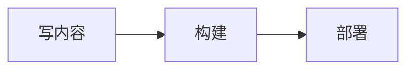

## 三个集合，一个形状

| 集合 | 目录                    | URL                 |
| ---- | ----------------------- | ------------------- |
| 文章 | `src/content/posts/`    | `/posts/<slug>/`    |
| 周更 | `src/content/weekly/`   | `/weekly/<slug>/`   |
| 研究 | `src/content/research/` | `/research/<slug>/` |

三者 frontmatter 相同（`title`、`description`、`date`、`tags`、`draft`），只多一个字段：周更用 `issue`，研究用 `type`。文章还多两个：`updated`（多印一个更新日期）和 `toc`（默认 `true`，设 `false` 这篇文章就不出右侧目录）。

## 翻译怎么配对

同一个文件名放在对应的 `-zh` 目录（`posts-zh`、`weekly-zh`、`research-zh`），就当成英文那篇的译文：

```
src/content/posts/hello.md
src/content/posts-zh/hello.md   ← 同名，已配对
```

配对的页面互链，并输出互相指向的 `hreflang`。没配对的页面不显示语言切换——比把人送到 404 好。

> [!NOTE]
> 不必每篇都翻。常见做法：短笔记用一种语言，长文两版都写。

## 草稿

`draft: true` 时文件留在仓库里，但不进列表、RSS、sitemap，也不参与翻译配对。

## 图片

放 `public/`，在正文里从站点根引：

```markdown

```

正文样式会自动加边框和圆角。没有图片管线，提交前自己压。

## 封面图

任何文章都可以带封面；不写也不会破坏布局。

```yaml
cover: /og/posts/zh/my-post.png
coverAlt: 重写之后的看板
```

图片放 `public/` 下，用路径引用。中文文章在 `src/content/posts-zh/`，配图就该放在 `public/og/posts/zh/`——每种语言的图各放各的目录，翻译页才不会显示另一种语言的画面。

显示位置在 `site.config.yaml` 里配：

```yaml
covers:
  list: true      # 列表页缩略图
  article: true   # 文章页顶部大图
```

封面保持原图比例，宽度以阅读栏为上限，细长或方图都不会被裁。`coverAlt` 要描述图片内容；纯装饰的卡片可以留空，但截图不算装饰。


## 代码块

每个围栏代码块都会套一层框：头部是语言标签（或你给的文件名）和复制按钮。

```bash title="安装"
npm install
```

给相邻的几个代码块同一个 `group`，它们会合并成标签页——换包管理器、换 shell、
前后对比版本都放一张卡里。下面两个就是同一张卡：

```bash title="npm" group="install"
npm install
```

```bash title="pnpm" group="install"
pnpm install
```

写法：

````md
```bash title="npm" group="install"
npm install
```
```bash title="pnpm" group="install"
pnpm install
```
````

需要行号时加 `showLineNumbers`（配置文件、diff 这类场景）：

```ts showLineNumbers
const theme = 'inkfolio';
```

高亮和 diff 标记由 Shiki 提供：`// [!code highlight]` 标一行，`// [!code ++]` 与
`// [!code --]` 标新增与删除。


## 数学公式

行内公式用 `$…$`，独立成行用 `$$`，都由 KaTeX 在构建时渲染——页面不带数学相关的 JS。

行内：$E = mc^2$ 直接写在句子里。

$$
\int_0^1 x^2\,dx = \frac{1}{3}
$$

## 图表

标了 `mermaid` 的围栏代码块会在页面加载后渲染成 SVG 图。读者切换明暗主题时会重新渲染，
不会出现「深色图落在浅色页面上」的情况。



## 图片与灯箱

文章里的图片点击即全屏查看：左右方向键在本文图片之间切换，Esc 关闭。
不想进灯箱的图片可以加 HTML 属性 `data-no-lightbox`。


