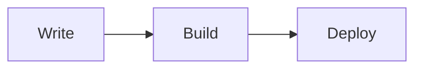

## Three collections, one shape

| Collection | Folder                  | URL                 |
| ---------- | ----------------------- | ------------------- |
| Posts      | `src/content/posts/`    | `/posts/<slug>/`    |
| Weekly     | `src/content/weekly/`   | `/weekly/<slug>/`   |
| Research   | `src/content/research/` | `/research/<slug>/` |

All three take the same frontmatter (`title`, `description`, `date`, `tags`, `draft`), plus one field each: `issue` for weekly, `type` for research. Posts also take `updated` (prints a second date) and `toc` (default `true`; set `false` to drop the sticky table of contents on that article).

## How translations pair

A Chinese file with the **same filename** in the matching `-zh` folder (`posts-zh`, `weekly-zh`, `research-zh`) is treated as the translation of the English one:

```
src/content/posts/hello.md
src/content/posts-zh/hello.md   ← same name, paired
```

Paired pages link to each other and emit reciprocal `hreflang` tags. Unpaired pages simply do not show a language switch — better than sending a reader to a 404.

> [!NOTE]
> You do not have to translate everything. A common split: short notes in one language, long pieces in both.

## Drafts

`draft: true` keeps a file in the repository but out of every list, the RSS feed, the sitemap and the translation pairing.

## Images

Files go in `public/` and are referenced from the site root:

```markdown

```

The prose styles add a border and rounded corners. There is no image pipeline; compress before committing.

## Covers

Any post can carry a cover image; nothing breaks when it does not.

```yaml
cover: /og/posts/en/my-post.png
coverAlt: The dashboard after the rewrite
```

Put the file in `public/` and reference it by path. Chinese posts live in `src/content/posts-zh/` and their images belong under `public/og/posts/zh/` — keeping each language's pictures in its own folder stops a translated page from showing the other language's artwork.

Display is configured in `site.config.yaml`:

```yaml
covers:
  list: true      # thumbnails on the archive
  article: true   # large image at the top of the post
```

Covers keep their natural aspect ratio and are capped to the reading column, so a tall or square image is never cropped. `coverAlt` should describe the picture; an empty alt on a decorative card is acceptable, but a screenshot is not decorative.


## Code blocks

Every fenced block gets a frame: a header with the language (or the file name you
give it) and a copy button.

```bash title="Install"
npm install
```

Give consecutive blocks the same `group` and they become tabs — one card, one place
to switch between package managers, shells, or before/after versions. These two are
one card:

```bash title="npm" group="install"
npm install
```

```bash title="pnpm" group="install"
pnpm install
```

The syntax:

````md
```bash title="npm" group="install"
npm install
```
```bash title="pnpm" group="install"
pnpm install
```
````

Add `showLineNumbers` when the line count matters (diffs, config files):

```ts showLineNumbers
const theme = 'inkfolio';
```

Highlighting and diff markers come from Shiki: `// [!code highlight]` marks a line,
`// [!code ++]` and `// [!code --]` mark additions and removals.


## Math

Inline math uses `$…$`, display math uses `$$` on its own lines — both render with
KaTeX at build time, so the page ships no math JavaScript.

Inline: $E = mc^2$ sits in the line.

$$
\int_0^1 x^2\,dx = \frac{1}{3}
$$

## Diagrams

A fenced block tagged `mermaid` becomes an SVG diagram when the page loads. The
diagram re-renders when the reader flips the theme, so it never ends up dark on a
light page.



## Images and the lightbox

Every image inside a post opens full size on click: arrows walk the other images in
the same article, Escape closes. Mark an image `data-no-lightbox` (HTML) if it should
stay inert.


