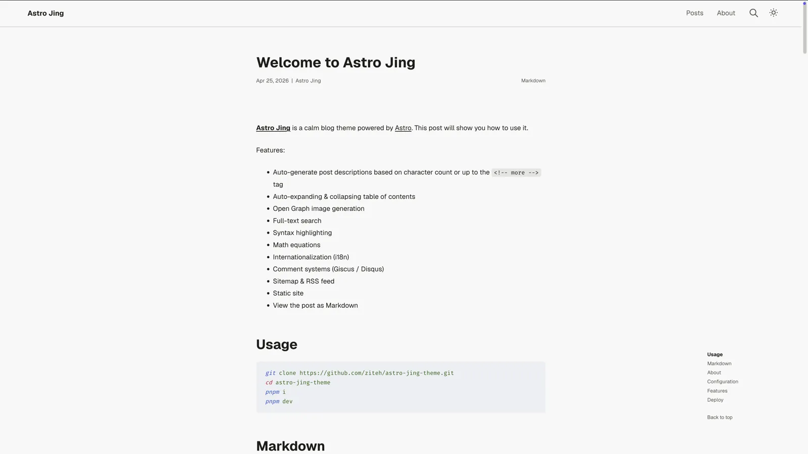

<!-- wasmer:start -->
## Deploy on Wasmer

This folder is the [Astro Jing](https://github.com/ziteh/astro-jing-theme) Astro theme by ziteh, copied from commit `344c7568769a544bdf0b189022c7040f355dd295` so it can be deployed as a Wasmer Edge template.

- **Demo:** https://astro-jing.wasmer.app
- **Deploy:** open the template on [wasmer.io/templates](https://wasmer.io/templates) and click **Deploy**, or run `wasmer deploy` in this folder. Wasmer installs with pnpm, runs the build script with Node 24 and serves the static `dist/` folder.
- **Changed for Wasmer:**
  - Resized 1 image over 300 KB to at most 1600 px wide, keeping file names and formats.
- **Environment variables:** The theme's example env file lists `CONTENT_DIR`. The demo builds and runs without them; set them in the app's settings to turn on the features that use them.
- **Credit:** theme by [ziteh](https://github.com/ziteh), MIT. The theme's license file is kept unchanged.
<!-- wasmer:end -->

# Astro Jing



A calm blog theme powered by [Astro](https://astro.build/). [Demo site](https://astro-jing-theme.ziteh.dev/).

Features:

- Auto-generate post descriptions based on character count or up to the `<!-- more -->` tag
- Auto-expanding & collapsing table of contents
- Generate Open Graph images with hashed filenames
- Full-text search
- Syntax highlighting
- Math equations
- Internationalization (i18n)
- Comment systems (Giscus / Disqus)
- Sitemap & RSS feed
- Static site
- View the post as Markdown

## Usage

You can directly [create a new repo from this template](https://github.com/new?template_name=astro-jing-theme&template_owner=ziteh), or use this repo as a [git subtree](#using-as-a-git-subtree).

```bash
# After cloning...
pnpm i          # Install dependencies
pnpm dev        # Start dev server
pnpm build      # Production build
pnpm preview    # Preview built site
```

### Using as a Git Subtree

This theme can be pulled into your own blog repo as a git subtree, so your content lives alongside it in one repo, and you can still pull in future theme updates.

Unlike a git submodule, the theme files (`src/config/*.ts`, `astro.config.ts`, etc.) become regular files in your repo, so you're free to edit them directly. Theme updates are then just a normal `git subtree pull`; if you've edited a file the update also touches, git will ask you to resolve the conflict like any other merge.

project structure:

```text
my-blog/                  # Your blog repo
├── theme/                # astro-jing-theme (subtree)
│   ├── astro.config.ts
│   ├── package.json
│   ├── src/
│   │   └── content.config.ts
│   ├── .env              # CONTENT_DIR=../content
│   └── ...
└── content/              # Your blog content
    ├── blog/
    │   └── post.md
    └── about.md
```

```bash
cd my-blog
mkdir -p content/blog
touch content/about.md && touch content/blog/post.md
# Then edit the content files and commit

git subtree add --prefix theme https://github.com/ziteh/astro-jing-theme main --squash
cd theme
echo "CONTENT_DIR=../content" > .env
# Now edit src/config/site.ts, socials.ts, lang.ts, astro.config.ts, etc. directly
pnpm i && pnpm build
```

To pull in later theme updates:

```bash
git subtree pull --prefix theme https://github.com/ziteh/astro-jing-theme main --squash
```

## Development

Tech stack:

- Colors: [Radix Colors](https://www.radix-ui.com/colors)
- Icons: [Tabler](https://tabler.io/icons)
- TOC: [Tocbot](https://tscanlin.github.io/tocbot/)
- Math: [KaTeX](https://katex.org/)
- OG image: [Satori](https://github.com/vercel/satori)
- Search: [astro-pagefind](https://github.com/shishkin/astro-pagefind)
- Syntax highlighting: [Expressive Code](https://expressive-code.com/)
- A11y testing: [axe-core](https://github.com/dequelabs/axe-core)
- Linter: [Biome](https://biomejs.dev/)
- Formatter: [Prettier](https://prettier.io/)

### Project Structure

Refer to [Astro project structure](https://docs.astro.build/en/basics/project-structure/).

```text
├── public/             # Unprocessed assets
│   └── _headers        # Custom headers, such as CSP and Cache-Control
├── tests/
├── src/
│   ├── config/
│   │   ├── site.ts     # Site config
│   │   ├── lang.ts     # I18n and locale config
│   │   └── socials.ts  # Social media links
│   ├── assets/
│   ├── content/
│   │   ├── blog/       # Markdown posts
│   │   └── about.md    # About page
│   ├── components/
│   ├── layouts/
│   ├── pages/          # Routes
│   ├── utils/
│   ├── styles/         # CSS
│   └── content.config.ts  # Content collection
├── astro.config.ts     # Astro config
├── package.json
└── README.md
```

## Testing

```bash
pnpm test       # All tests
pnpm test:lh    # Lighthouse
pnpm test:urls  # URLs
pnpm test:a11y  # Accessibility
```

### SEOnaut

```bash
pnpm seonaut:up
pnpm dev --host
```

Open <http://localhost:9000/signin> and enter <http://host.containers.internal:4321> as the target URL.

## Deploy

- [Deploy your Astro Site](https://docs.astro.build/en/guides/deploy/)
- [Cloudflare Pages build system](https://developers.cloudflare.com/pages/configuration/build-image/#languages-and-runtime)
