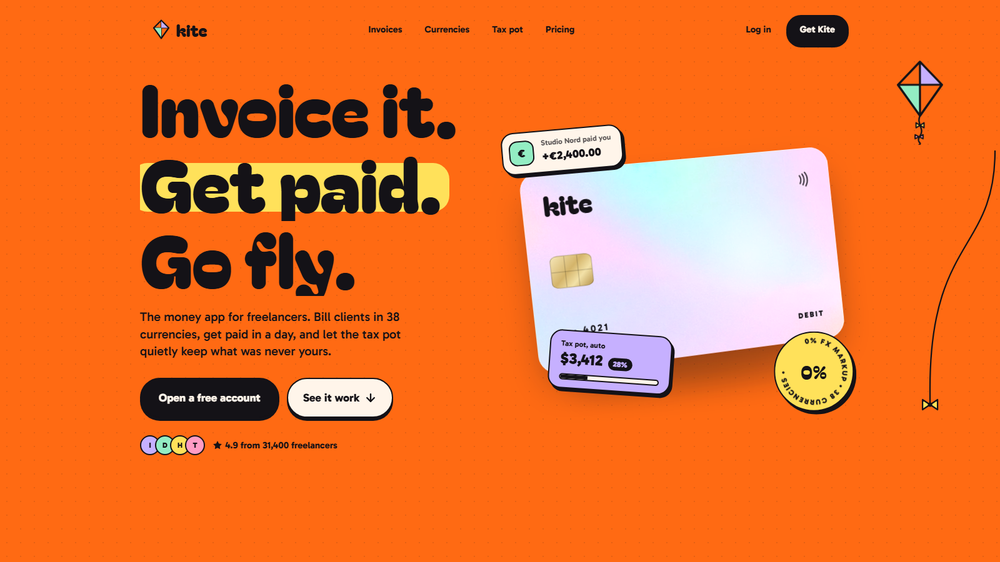

<!-- wasmer:start -->
## Deploy on Wasmer

This folder is the [Kite](https://github.com/Wiktorkulas51/kite-astro-template) Astro theme by Wiktorkulas51, copied from commit `4aaf8dc3f2f03e0b28477a76994ced110f7631b2` so it can be deployed as a Wasmer Edge template.

- **Demo:** https://astro-kite.wasmer.app
- **Deploy:** open the template on [wasmer.io/templates](https://wasmer.io/templates) and click **Deploy**, or run `wasmer deploy` in this folder. Wasmer installs with npm, runs the build script with Node 24 and serves the static `dist/` folder.
- **Changed for Wasmer:**
  - None. The theme builds as published.
- **Environment variables:** None.
- **Credit:** theme by [Wiktorkulas51](https://github.com/Wiktorkulas51), MIT. The theme's license file is kept unchanged.
<!-- wasmer:end -->

# Kite, Free Astro Fintech App Template

Playful money app for freelancers with a holographic card and an invoice-to-paid demo.



**[Live demo](https://kite-astro-template.vercel.app)**

**[See it on onepaste, with the AI prompt that built it](https://onepaste.dev/templates/kite/?utm_source=github&utm_medium=readme&utm_campaign=astro-theme-kite)**

## Features

- Hero with a holographic card, pointer tilt and drifting stickers
- Invoice-to-paid demo: a client invoice moves from sent to paid
- Currency section with a rolling balance and switchable currencies
- Tax pot that sets money aside with an animated progress bar
- Phone tour with four app screens (home, invoices, tax pot, card)
- Sticker wall and a kite string that follows the scroll
- Monthly and yearly pricing switch with three plans
- FAQ with accessible expand and collapse
- Responsive layout, and animations respect `prefers-reduced-motion`

## Stack

- [Astro 7](https://astro.build), static output
- [React](https://react.dev) islands (`client:load`)
- [Tailwind CSS 4](https://tailwindcss.com) with the Vite plugin
- [Motion](https://motion.dev) for animations
- [Lucide](https://lucide.dev) icons

## Getting started

Requires Node.js 22.23.4 or newer (Astro 7 requirement). Check with `node -v`.

```bash
npm install
npm run dev
```

Open http://localhost:4321 in your browser.

```bash
npm run build
npm run preview
```

The build writes a static site to `dist/`.

## Project structure

```text
src/
  components/kite/   Landing page sections and shared UI
    index.tsx        Page assembly (section order)
    data.ts          Content: nav links, currencies, phone steps, plans, FAQ, colours
    Hero.tsx         Hero and holographic card
    HoloCard.tsx     Card with foil texture and pointer tilt
    InvoiceDemo.tsx  Invoice-to-paid demo
    Currency.tsx     Rolling balance and currency picker
    TaxPot.tsx       Tax pot progress
    PhoneTour.tsx    Phone screens tour
    StickerWall.tsx  Sticker grid
    Pricing.tsx      Plans and billing switch
    Faq.tsx          FAQ accordion
    Footer.tsx       Footer
    Nav.tsx          Top navigation
    KiteString.tsx   Scroll-linked kite string
    ui.tsx           Shared styles, motion helpers and SVG marks
  layouts/Layout.astro   HTML head, meta tags and favicon
  pages/index.astro      Home page that renders the template
  styles/global.css      Tailwind import and base cursor rules
public/
  images/kite/           card.webp and hand.webp textures
  favicon.svg
docs/                    README screenshots
```

## Where to edit

- Text, prices, currencies, plans, FAQ and phone screens: `src/components/kite/data.ts`
- Section copy and layout: the matching component in `src/components/kite/`
- Colours: the `.kt-root` variables at the top of `KiteStyles` in `src/components/kite/ui.tsx`
- Page title and description: `src/pages/index.astro`
- Images: replace the files in `public/images/kite/` and keep the names, or update the paths in `HoloCard.tsx`, `PhoneTour.tsx`

The Google Fonts (Gabarito and Bagel Fat One) load from the font import in `KiteStyles`.

## Get the AI prompt behind this template

This template was built from a single copy-paste prompt on onepaste. More animated landing pages with prompts are on [onepaste.dev](https://onepaste.dev/?utm_source=github&utm_medium=readme&utm_campaign=astro-theme-kite).

## Need a custom website?

WebScale builds custom websites and landing pages: [webscale.pl](https://webscale.pl/en/?utm_source=github&utm_medium=readme&utm_campaign=astro-theme-kite).

## License

MIT, see [LICENSE](LICENSE).
