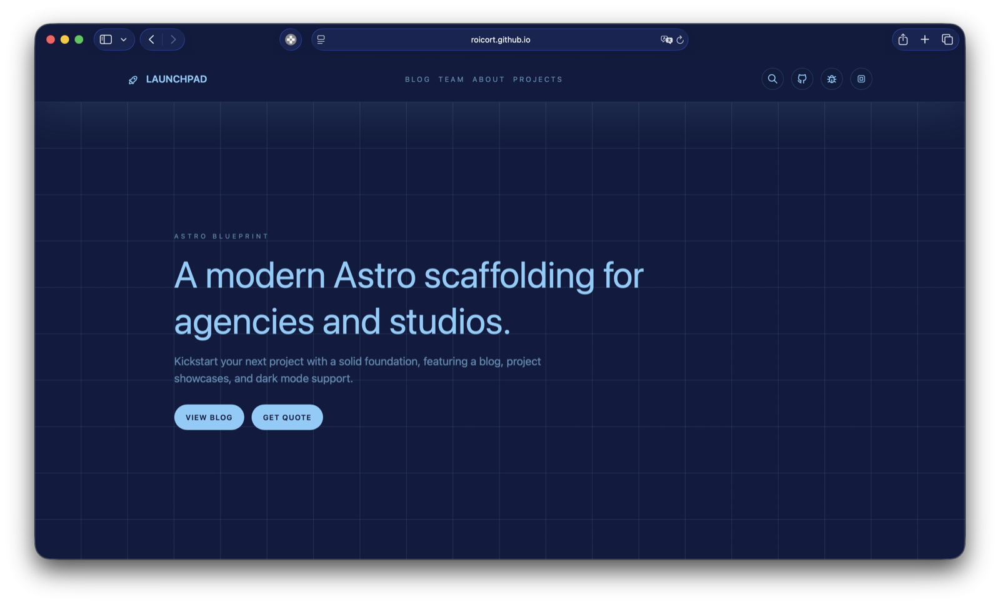
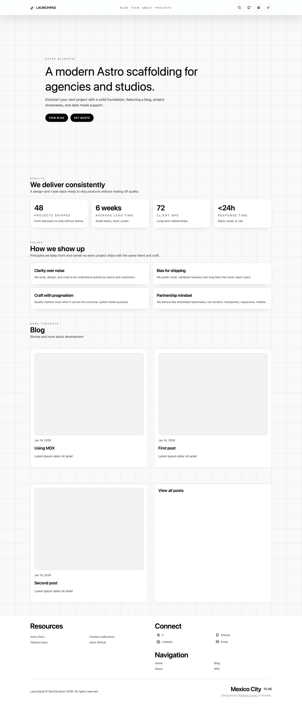
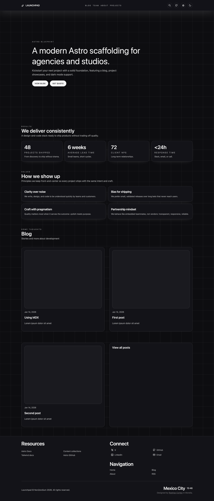
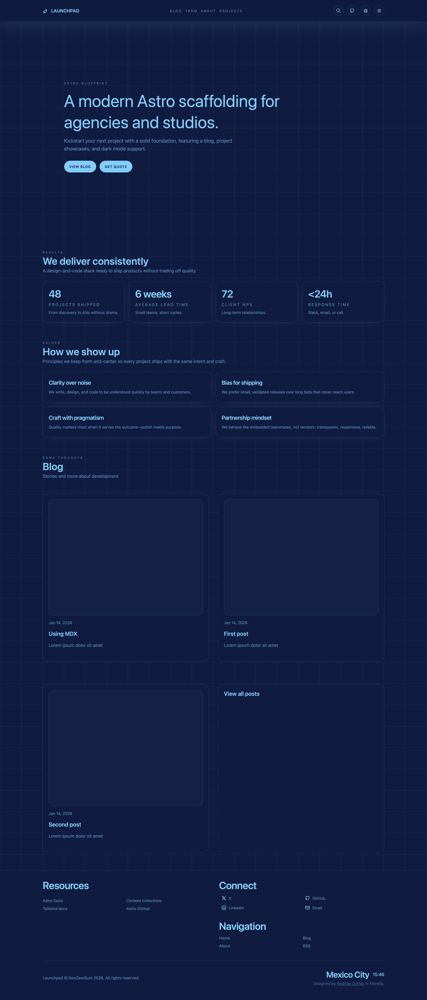

<!-- wasmer:start -->
## Deploy on Wasmer

This folder is the [Launchpad](https://github.com/roicort/launchpad) Astro theme by roicort, copied from commit `a581ad1e622db830c4d1c6945d894e3f03b2ac80` so it can be deployed as a Wasmer Edge template.

- **Demo:** https://astro-launchpad.wasmer.app
- **Deploy:** open the template on [wasmer.io/templates](https://wasmer.io/templates) and click **Deploy**, or run `wasmer deploy` in this folder. Wasmer installs with bun, runs the build script with Node 24 and serves the static `dist/` folder.
- **Changed for Wasmer:**
  - Removed the GitHub Pages sub-path `base: '/launchpad'` from astro.config.mjs, so assets load at the root of the Wasmer app.
  - Resized 1 image over 300 KB to at most 1600 px wide, keeping file names and formats.
  - Added .nvmrc with Node 24, the Node version Wasmer builds with.
  - Set `site` in astro.config.mjs to the Wasmer demo URL, because 1 home page links pointed at roicort.github.io.
- **Environment variables:** None.
- **Credit:** theme by [roicort](https://github.com/roicort), BSD-3-Clause. The theme's license file is kept unchanged.
<!-- wasmer:end -->

# Astro Launchpad

An Astro starter tailored for agencies and studios: MDX blog, global search, RSS, sitemap, light/dark/blue themes, and components ready to sell services or publish content.



[](https://railway.com/deploy/static-site?referralCode=welcome)
[](https://app.netlify.com/start/deploy?repository=https://github.com/roicort/launchpad)
[](https://vercel.com/new/clone?repository-url=https%3A%2F%2Fgithub.com%2Froicort%2Flaunchpad)

## Features
- [Lighthouse Score: 100](https://pagespeed.web.dev/analysis/https-roicort-github-io-launchpad/xthz1r5i4v?form_factor=mobile)
- Blog with Markdown/MDX, featured post, and tag listings
- Typed collections for posts, authors, and socials in [src/content.config.ts](src/content.config.ts)
- Site-wide search via Pagefind with an accessible modal
- SEO-ready: OpenGraph/Twitter, canonical links, and preloaded fonts in [src/components/BaseHead.astro](src/components/BaseHead.astro)
- Themes `light/dark/blue` with persistent toggle; debug toggle for layout borders
- RSS (`/rss.xml`) and sitemap (`/sitemap-index.xml`) generated automatically


<div style="display: flex; align-items: center; gap: 10px; width: 100%; margin-top: 20px;">
    
    
    
</div>


## Requirements
- Bun
- Astro @latest
- Tailwdind CSS

## Install & run

```sh
# install dependencies
bun install

# start dev server
bun run dev

# production build
bun run build

# preview the build
bun run preview
```

## Content
- Posts: add `.md` or `.mdx` under `src/content/blog`. Schema validates `title`, `description`, `pubDate`, `updatedDate?`, `heroImage?`, `tags[]`.
- Authors: `src/content/authors.yml`.
- Socials: `src/content/socials.yml`.

Frontmatter example:
```md
---
title: "How we launch in 6 weeks"
description: "End-to-end process for small teams."
pubDate: 2024-12-12
updatedDate: 2025-01-03
tags: [delivery, process]
heroImage: ../../assets/blog/ship.jpg
---
```

## Quick customization
- Site name and description in [src/consts.ts](src/consts.ts).
- Navigation and hero actions in [src/pages/index.astro](src/pages/index.astro).
- Colors, type, and utilities in `src/styles/global.css`.
- Key components: header with search and toggles ([src/components/Header.astro](src/components/Header.astro)), base layout ([src/layouts/BaseLayout.astro](src/layouts/BaseLayout.astro)).

## Available scripts
- `npm run dev`: server on `localhost:4321` (Astro default).
- `npm run build`: outputs `dist/` ready to deploy.
- `npm run preview`: serves the built site locally.

## Deploy
Output is static HTML. Upload `dist/` to your platform of choice (Netlify, Vercel, Cloudflare Pages, S3+CDN). Set `BASE_URL` if you publish under a subpath.
