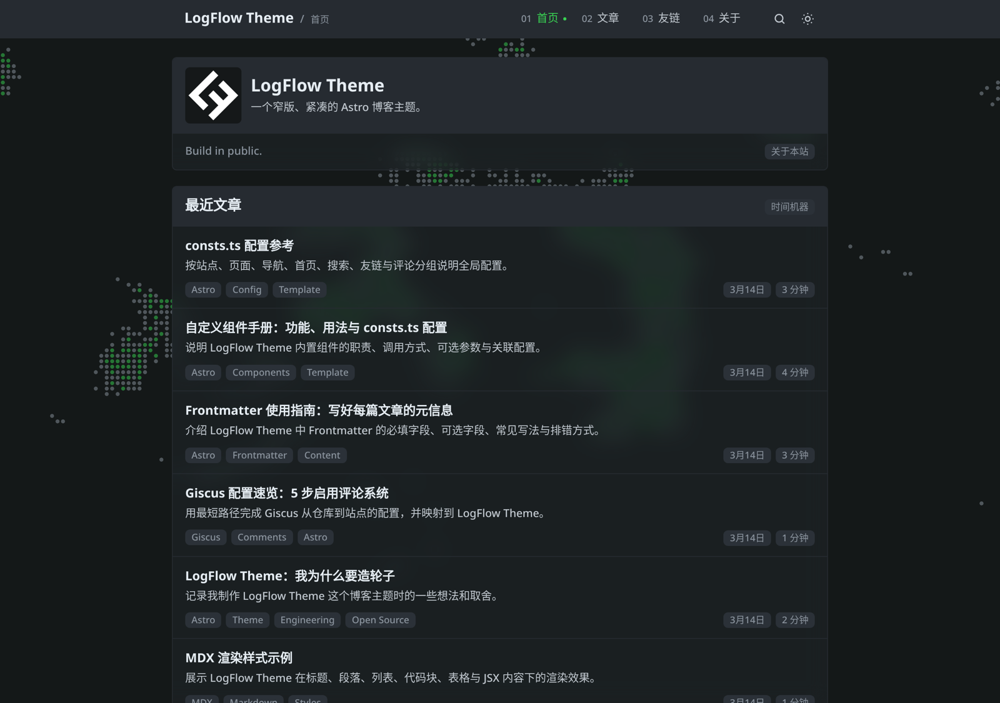
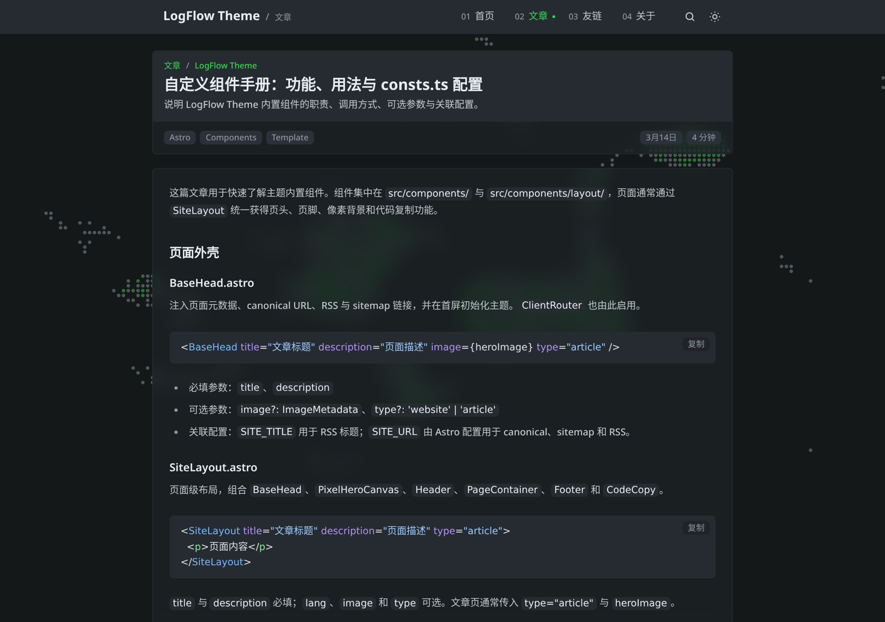
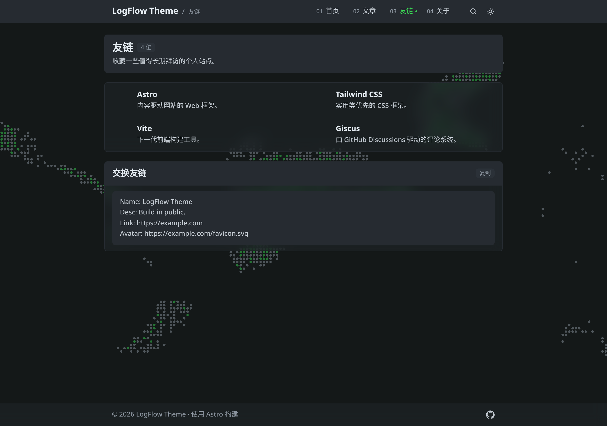
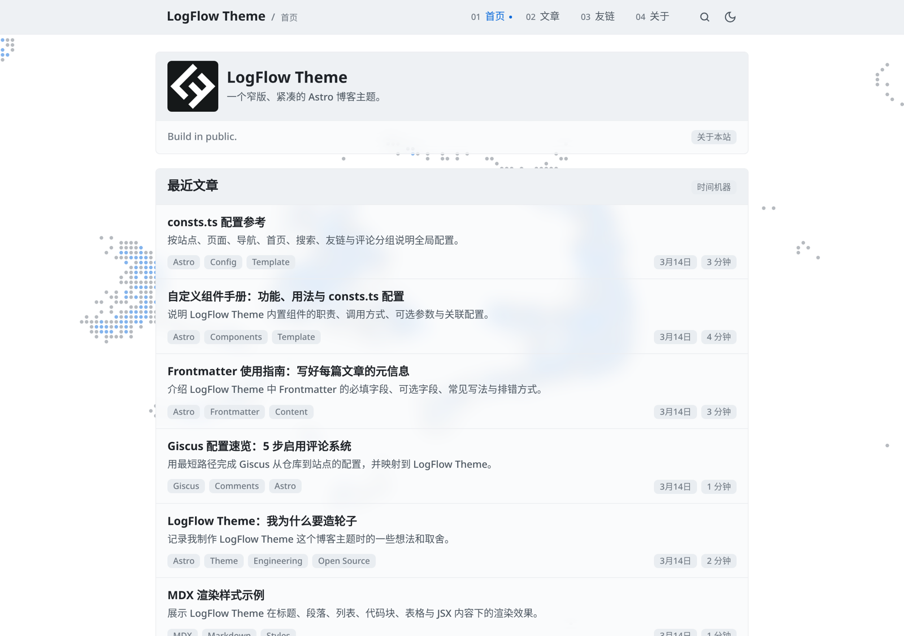
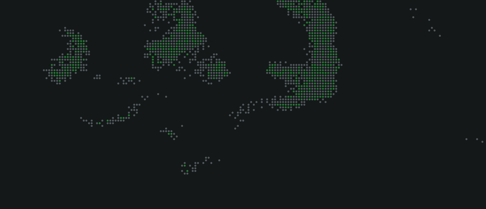
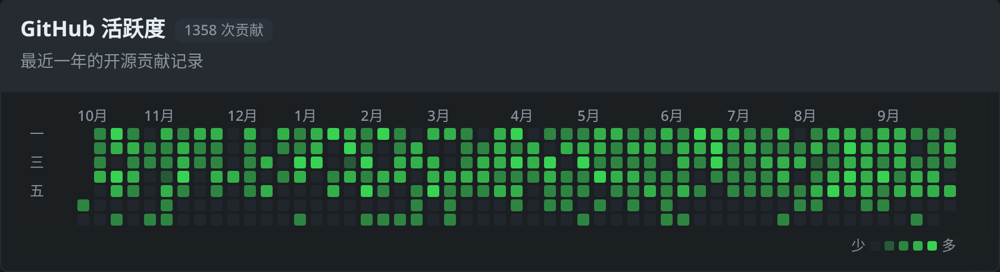

<!-- wasmer:start -->
## Deploy on Wasmer

This folder is the [LogFlow Theme](https://github.com/kevynf/logflow-theme) Astro theme by kevynf, copied from commit `3eb9132b835f381bfd51fa1f7526d9e7f20b0377` so it can be deployed as a Wasmer Edge template.

- **Demo:** https://astro-logflow.wasmer.app
- **Deploy:** open the template on [wasmer.io/templates](https://wasmer.io/templates) and click **Deploy**, or run `wasmer deploy` in this folder. Wasmer installs with npm, runs the build script with Node 24 and serves the static `dist/` folder.
- **Changed for Wasmer:**
  - Resized 2 images over 300 KB to at most 1600 px wide, keeping file names and formats.
- **Environment variables:** None.
- **Credit:** theme by [kevynf](https://github.com/kevynf), MIT. The theme's license file is kept unchanged.
<!-- wasmer:end -->

<div align="center">
  

  # LogFlow Theme

  [简体中文](README.md) | [English](README.en.md)
</div>

> [!NOTE]
> 一个简洁、内容优先的 Astro 博客主题，适合中文写作、个人主页和技术文档。

> [!WARNING]
> 本主题仍处于快速迭代阶段，更新可能包含破坏性变更。建议 Fork 本仓库并锁定某个提交后进行二次开发，而非直接追随 `main` 分支。

<table>
  <tr>
    <td colspan="2" align="center"></td>
  </tr>
  <tr>
    <td align="center" width="50%"></td>
    <td align="center" width="50%"></td>
  </tr>
  <tr>
    <td align="center" width="50%"></td>
    <td align="center" width="50%">
      
      
    </td>
  </tr>
</table>

## 功能

- Markdown/MDX、代码高亮、一键复制和可选文章头图
- 专题、标签、年份归档、友链和 About 页面
- 零依赖静态文章搜索，支持标题、摘要和标签
- 全站像素流体动画背景：零依赖 WebGL 实现，跟随明暗主题配色，支持 reduced-motion 与 WebGL 不可用降级
- ClientRouter 无缝换页与链接预加载，动画跨页持续播放
- 明暗主题、响应式移动端导航和键盘焦点样式
- 基于 Tailwind v4 的卡片式布局原语（Box/Cell）与设计令牌，组件与页面复用同一套工具类
- RSS、sitemap、canonical、Open Graph 和 Twitter Card
- 可选 Giscus 评论与 GitHub 活跃度组件
- GitHub Pages 自动构建部署


## 快速开始

```bash
git clone https://github.com/kevynf/logflow-theme.git
cd logflow-theme
npm install
npm run dev
```

开发地址默认为 `http://localhost:4321`。要求 Node.js `>=22.12.0`。

```bash
npx astro check
npm run build
npm run preview
```

## 首次配置

大多数站点信息集中在 `src/consts.ts`：

| 配置 | 用途 | 必填 |
| --- | --- | --- |
| `SITE_TITLE` | 站点标题、Header、RSS | 是 |
| `SITE_DESCRIPTION` | 默认 SEO 描述 | 是 |
| `SITE_URL` | 生产站点地址 | 部署时是 |
| `COPYRIGHT_NAME` | 页脚版权名称 | 否 |
| `PAGE_COPY` | 各页面标题和描述 | 否 |
| `NAV_LINKS` | 桌面端和移动端导航 | 否 |
| `SOCIAL_LINKS` | 页脚社交链接 | 否 |
| `HOME` | 首页头像、简介、格言和文章数量 | 否 |
| `GH_CONTRIBUTE` | GitHub 活跃度区块 | 否 |
| `COMMENTS` | Giscus 评论系统 | 否 |
| `SEARCH` | 搜索开关和最大结果数 | 否 |

友链位于 `src/config/friend-links.ts`，按 `FriendLink` 接口添加即可；未填写 `avatar` 时显示站点名称首字。

颜色、字体、间距、宽度和圆角等设计令牌位于 `src/styles/global.css` 顶部的 Tailwind v4 `@theme` 中；页面与 MDX 正文可直接使用 Tailwind 工具类，文章排版由 `@tailwindcss/typography` 的 `prose` 容器统一提供。站点名称与正文使用同一套系统无衬线字体栈，不依赖额外字体文件。

## 写作

文章放在 `src/content/blog/`，支持 `.md` 和 `.mdx`。最小 Frontmatter：

```yaml
---
title: 我的第一篇文章
description: 一句话摘要
pubDate: 2026-07-16
---
```

完整字段：

```yaml
---
title: Frontmatter 使用实践
description: 文章摘要
pubDate: 2026-07-16
updatedDate: 2026-07-17
collection: Astro
collectionDescription: Astro 主题开发记录
tags:
  - Astro
  - Theme
heroImage: ./cover.png
---
```

`title`、`description` 和 `pubDate` 必填，其余字段可选。无 `heroImage` 时不会出现破损图片或空的社交图片元信息。

## 搜索

搜索索引在构建时生成，仅包含 `src/content/blog/` 中文章的标题、摘要和标签，不会收录正文。索引会在首次打开搜索时由浏览器加载，不依赖服务端或第三方搜索服务。

点击 Header 中的搜索图标，或按 `Ctrl/Command + K`、`/` 打开搜索；使用 `↑`、`↓` 选择结果，按 `Enter` 打开。通过 `src/consts.ts` 中的 `SEARCH.enabled` 控制入口，通过 `SEARCH.maxResults` 设置最多显示的结果数。

## Giscus

在 GitHub 仓库启用 Discussions 后，修改 `src/consts.ts` 中的 `COMMENTS` 并填写 `repoId`、`categoryId`。评论默认关闭；字段不完整时页面会显示配置提示。

## 图片与头像

- 头像：`HOME.avatar` 维护站点头像，默认为 `public/favicon.svg`；友链的 `avatar` 可省略，省略时显示站点名称首字。
- 文章图片：可放在文章目录并通过 `heroImage` 引用，但不是必需项。
- favicon：替换 `public/favicon.svg` 即可更新默认头像和站点图标。

## GitHub Pages

本仓库的在线演示：<https://app.kevy.net/logflow-theme/>。

将仓库 Pages Source 设置为 **GitHub Actions**，推送到 `main` 后自动部署。工作流会从 GitHub Pages 的配置读取 `SITE_URL` 与 `BASE_PATH`，因此自定义域名和项目路径都能生成正确的 canonical、sitemap 与资源地址。Fork 后的仓库仍可使用默认的 `https://<owner>.github.io/<repository-name>/` 地址。

## 自定义边界

- 站点文案与行为：`src/consts.ts`
- 友链：`src/config/friend-links.ts`
- 文章与 About：`src/content/`
- 颜色、字体、间距和布局密度：`src/styles/global.css` 的 Tailwind `@theme` 令牌与自定义工具类
- 页面结构：`src/pages/`、`src/layouts/`、`src/components/`

优先通过配置和内容完成定制，只有需要改变结构时才修改组件或布局。

## License

MIT
