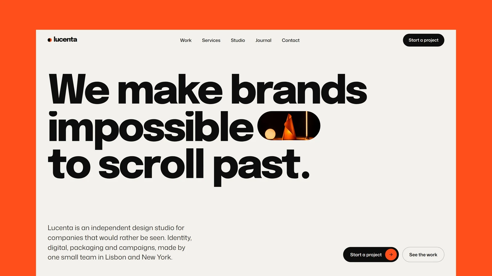

<!-- wasmer:start -->
## Deploy on Wasmer

This folder is the [Lucenta](https://github.com/xocothemes/lucenta) Astro theme by xocothemes, copied from commit `4ddbb9b94a0745e5e0ce253cd3e704c17891a9c6` so it can be deployed as a Wasmer Edge template.

- **Demo:** https://astro-lucenta.wasmer.app
- **Deploy:** open the template on [wasmer.io/templates](https://wasmer.io/templates) and click **Deploy**, or run `wasmer deploy` in this folder. Wasmer installs with npm, runs the build script with Node 24 and serves the static `dist/` folder.
- **Changed for Wasmer:**
  - Removed files used only by other hosts: vercel.json, wrangler.jsonc.
  - Resized 4 images over 300 KB to at most 1600 px wide, keeping file names and formats.
- **Environment variables:** None.
- **Credit:** theme by [xocothemes](https://github.com/xocothemes), NOASSERTION. The theme's license file is kept unchanged.
<!-- wasmer:end -->

# Lucenta - Astro Agency & Portfolio Theme

[](https://lucenta.xocoweb.workers.dev/)

[](https://astro.build/)
[](https://tailwindcss.com/)
[](https://www.typescriptlang.org/)
[](./LICENSE)

**Live preview:** https://lucenta.xocoweb.workers.dev/

Lucenta is a free Astro theme for design studios, creative agencies and portfolios that want the work to do the talking. It is simple in structure and loud in execution: heavy, tightly set headlines, full-bleed case-study imagery, and every project painted in its own colour. Work, people and the journal are linked content collections, and the output is static.

## Features

- A hero headline with a capsule of cycling project images, and a full-bleed reel that grows from a card as it scrolls in
- Featured case studies as full-width image cards on the homepage
- Case studies in each project's own colour, with a parallax cover, stills, a testimonial, results, credits and a next project link
- Shared-element page transitions: a project card's image morphs into the case study cover
- A work index filtered by discipline, with a grid and a list view whose rows flood with the project colour
- An image that trails the cursor over the services and work lists
- A manifesto that lights up word by word as it scrolls past, and counters that count up once
- A client marquee that drifts on its own and speeds up and turns with the scroll
- A services page with deliverables, a featured project and related work for each service
- A studio page with the story, figures, team portraits and bios, process, recognition and a client grid
- A journal with categories, pagination, reading time, related projects, RSS, and a share card that opens the phone's own share sheet or a sharing dialog on desktop
- A contact page with a project enquiry form, live studio clocks and an FAQ
- A solid header that takes its tone and colour from what is under it, and hides while scrolling down
- A full-screen mobile menu and rolling link labels
- Canonical URLs, sitemap, RSS, Open Graph, Twitter/X cards, and JSON-LD for case studies and articles
- Static output with no framework islands; every effect switches off under `prefers-reduced-motion`
- Skip link, landmarks, labelled controls, visible focus states, and keyboard support for every menu, filter and form

## Tech Stack

- Astro 7 with MDX
- Tailwind CSS 4 via the Vite plugin
- Vite 8, TypeScript, Astro content collections with references
- `@astrojs/sitemap`, `@astrojs/rss`, Sharp
- Self-hosted Epilogue and Mona Sans, Lucide and Bootstrap Icons, each with its license notice

## Requirements

- Node.js `22.12.0` or newer
- npm

## Getting Started

```bash
npm install
npm run dev
```

Build for production:

```bash
npm run build
```

Preview the production build locally:

```bash
npm run preview
```

Before shipping a change, run type checking, the production build, and the formatter check together:

```bash
npm run release:check
```

## Customization

See [CUSTOMIZATION.md](./CUSTOMIZATION.md) for site settings, the logo, navigation, the work, people and journal collections, services, the homepage, studio and contact pages, the contact form, the motion attributes, and the theme's design tokens.

Set `siteConfig.siteUrl` in [src/config/site.ts](./src/config/site.ts) before building: canonical URLs, share images, the sitemap, and the feed are all derived from it. The build is static, so any host that serves a directory works: `vercel.json` is included for Vercel and `wrangler.jsonc` for Cloudflare Workers, and Netlify, GitHub Pages, and object storage behind a CDN need no configuration beyond `npm run build`.

## Content

Projects live in [src/content/work](./src/content/work), the team in [src/content/people](./src/content/people), and the journal in [src/content/journal](./src/content/journal). Each entry is a folder with an `index.md` and the images it uses, validated by the schemas in [src/content.config.ts](./src/content.config.ts). Page copy is in [src/config](./src/config).

The bundled demo content is fictional: the studio, its clients, people, testimonials, results and awards are invented, so **replace them before launch.** The portraits are stock photographs of people with no connection to the names beside them, the project images stand in for work that does not exist, and the client logos are fictional marks.

## Support

Lucenta is free and provided as-is. Bug reports and questions are welcome as [GitHub issues](https://github.com/xocothemes/lucenta/issues); custom design and feature work is not included. See [CONTRIBUTING.md](./CONTRIBUTING.md) to propose a change, and [CHANGELOG.md](./CHANGELOG.md) for release history.

## License

MIT: free for personal and commercial projects. See [LICENSE](./LICENSE), which also lists the licenses of the bundled fonts, icons and photographs.

## Credits

- [Epilogue](https://github.com/Etcetera-Type-Co/Epilogue) by Etcetera Type Co, under the SIL Open Font License
- [Mona Sans](https://github.com/github/mona-sans) by GitHub, under the SIL Open Font License
- The fictional client logos are set in typefaces under the SIL Open Font License, converted to outlines
- [Lucide](https://lucide.dev/), under the ISC License
- [Bootstrap Icons](https://icons.getbootstrap.com/), under the MIT License
- Generated with OpenAI image generation for this theme: the Halden, Juniper, Lumio and Ostra case studies, the Kiln cover and first still, and the Veldt cover
- Team portraits from [Pexels](https://www.pexels.com/) under the Pexels License: Mira Castell by Ehsan, Jonah Pierce by Uluç Erdem Ersen, Lena Brandt by Andreza Abras
- Photographs from [Unsplash](https://unsplash.com/) under the Unsplash License:
  - Tidewater case study by Lena Polishko
  - Kitebird case study by Moment InFocus
  - Kiln second still by Barney Goodman
  - Veldt stills by Mohamed Abira and Marek Piwnicki
  - Journal covers by Andy Brown, Alice Yamamura, Tyler Lastovich, Yaoqi, Luke Heibert and Fiona Murray-deGraaff
  - Studio photographs by JIRAN FAMILY and Pavel Gromov
