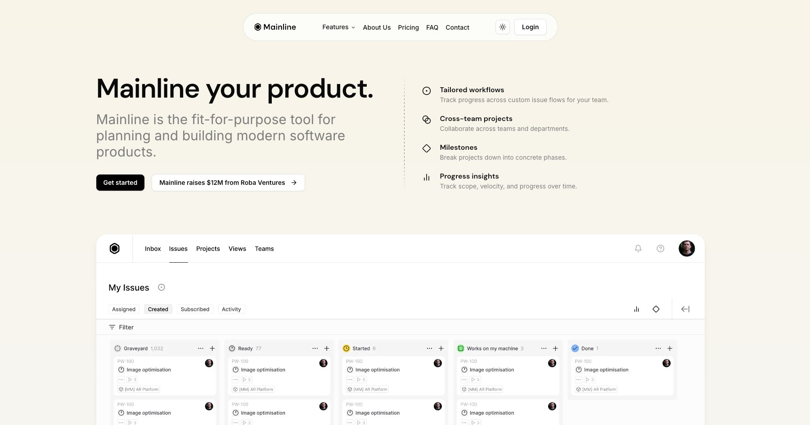

<!-- wasmer:start -->
## Deploy on Wasmer

This folder is the [Mainline](https://github.com/shadcnblocks/mainline-astro-template) Astro theme by shadcnblocks, copied from commit `f92afce78bd9691e069d4ee7b87774437d1f24c0` so it can be deployed as a Wasmer Edge template.

- **Demo:** https://astro-mainline.wasmer.app
- **Deploy:** open the template on [wasmer.io/templates](https://wasmer.io/templates) and click **Deploy**, or run `wasmer deploy` in this folder. Wasmer installs with npm, runs the build script with Node 24 and serves the static `dist/` folder.
- **Changed for Wasmer:**
  - Added .nvmrc with Node 24, the Node version Wasmer builds with.
- **Environment variables:** None.
- **Credit:** theme by [shadcnblocks](https://github.com/shadcnblocks), NOASSERTION. The theme's license file is kept unchanged.
<!-- wasmer:end -->

# Mainline Astro Template

Mainline is a free template built with shadcn/ui, Tailwind 4 and Astro 5.

- [Demo](https://mainline-astro-template.vercel.app/)
- [Documentation](https://docs.shadcnblocks.com/templates/getting-started)
- [Figma](https://www.figma.com/design/cFCLMj7DFv0sK7EVsqKeTa/Mainline?node-id=23250-13201&t=I1nAdchDpknii5Bd-1)



## Getting Started

```bash
npm install
```

```bash
npm run dev
```

Open [http://localhost:3000](http://localhost:3000) with your browser to see the result.

## Features

### Core Technology Stack

- **Astro 5** built with Astro
- **Tailwind CSS 4** for styling
- **shadcn/ui** components
- **TypeScript** support
- **React 19**

### Key Features

- **Shadcn UI**: uses [shadcn/ui](https://ui.shadcn.com/) core UI components
- **Theme System**: Dark/light mode with `astro-themes`, compatible with [tweakcn](https://tweakcn.com)
- **MDX Support**: For content pages
- **Animations**: Motion library (Framer Motion) integration
- **Prettier**: Pre-configured code formatting
- **Custom Fonts**: DM Sans font family included
- **Icons**: Lucide React + React Icons libraries
- **Styleglide Integration**: For component previews/development
- **Responsive Design**: Mobile-friendly layout
- **SEO Ready**: Proper metadata and OG images included

### Pre-built Pages

- Home/Landing page
- About page
- Pricing page
- FAQ page
- Contact page with form
- Login/Signup pages

### Blocks

- Hero section
- Logo showcase/marquee
- Features section
- Resource allocation section
- Testimonials with carousel
- Pricing table
- FAQ with accordion
- Footer
- Navigation bar

## Deployment

Production-ready and tested for deployment on [Vercel](https://vercel.com)

## Credits

- Template by [shadcnblocks.com](https://shadcnblocks.com)
- Design by [Callum Flack](https://x.com/callumflack)
- Dev by [Yassine Zaanouni](https://x.com/YassineZaanouni)
- Produced by [Rob Austin](https://x.com/ausrobdev)
