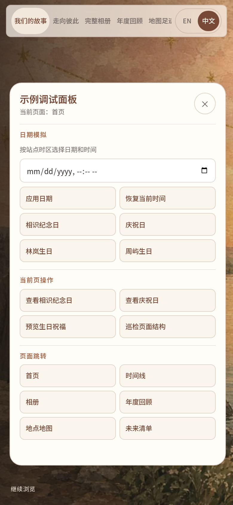

<!-- wasmer:start -->
## Deploy on Wasmer

This folder is the [Memory Atlas](https://github.com/Liyuk/astro-memory-atlas) Astro theme by Liyuk, copied from commit `a67e8148b5477f59056e6c686a323563006a91d9` so it can be deployed as a Wasmer Edge template.

- **Demo:** https://astro-memory-atlas.wasmer.app
- **Deploy:** open the template on [wasmer.io/templates](https://wasmer.io/templates) and click **Deploy**, or run `wasmer deploy` in this folder. Wasmer installs with npm, runs the build script with Node 24 and serves the static `dist/` folder.
- **Changed for Wasmer:**
  - None. The theme builds as published.
- **Environment variables:** None.
- **Credit:** theme by [Liyuk](https://github.com/Liyuk), NOASSERTION. The theme's license file is kept unchanged.
<!-- wasmer:end -->

# 两个人的记忆地图

一个可复制、修改和部署的私人记忆站模板。演示使用虚构人物、日期、地点和原创抽象插画。发布前，请替换为你自己的内容。

**English:** [README.en.md](README.en.md)




**在线演示：** <https://liyuk.com/astro-memory-atlas/>

## 快速开始

需要 Node.js 22 或更高版本，以及 npm。

```sh
npm ci
npm run dev
```

终端会显示本地预览地址。检查示例数据并生成静态站点：

```sh
npm test
npm run build
npm run preview
```

## 自定义站点

- 在 [`src/config/site.js`](src/config/site.js) 修改站点名称、简介、规范网址、部署路径、时区、纪念日、生日和调试面板开关。
- 每段示例记忆、地点、年度回顾、时间线和愿望都维护了 `zh`、`en` 两种文案。分别编辑 `src/data/memories.js`、`src/data/places.js`、`src/data/annual-recaps.js`、`src/data/relationship-timeline.js` 和 `src/data/shared-wishes.js`。
- 页面界面文案集中在 `src/i18n/copy.js`。新增可见文案时，请同时填写中文和英文。
- 用自己的插画或照片替换 `src/assets/images/demo/` 中的示例图，并同步更新记忆数据中的图片路径和替代文本。

顶部的 “EN / 中文” 按钮切换站点语言；选择会保存在当前浏览器中。没有保存过选择时，页面、标题和分享信息使用英文，中文仍可随时切换。若要关闭示例调试面板，将 `src/config/site.js` 中的 `debugPanel` 设为 `false`。

`npm run validate` 会检查日期、唯一 ID、数据引用以及中英文文案是否齐全。生产构建会自动运行这项检查。

## 页面与功能

模板包含首页、记忆相册、关系时间线、年度回顾、地点地图和未来愿望六个区域。相册支持关键词搜索、年份筛选、翻页阅读和图片查看。地点地图使用仓库内的 Leaflet 文件和原创地图插画，不请求在线地图瓦片或外部字体。中文字体按页面实际用字和 GB2312 常用字拆开托管，首屏只下载当前文案需要的部分。新增文字后运行 `python3 scripts/subset-font.py`，测试会确认这些字没有掉进体积较大的常用字文件。示例场景图是为本模板绘制的原创插画，不是真实人物照片。

示例调试面板默认在每个页面展开，可模拟日期、预览纪念日和生日、测试相册与地图操作，并巡检六个页面。

## 发布到 GitHub Pages

仓库已包含 GitHub Actions 发布流程：推送到 `main` 会自动发布，也可以在 Actions 页面手动运行。首次设置时，进入仓库 **Settings → Pages → Build and deployment**，将来源设为 **GitHub Actions**。

示例站点使用 `/astro-memory-atlas/` 作为部署路径。发布到其他域名或路径时，请修改 `src/config/site.js` 中的 `siteUrl` 和 `basePath`。本地检查子路径构建：

```sh
BASE_PATH=/astro-memory-atlas/ npm run build
```

## 许可与贡献

项目使用 MIT 许可。随仓库提供的字体和第三方依赖说明见 [`THIRD_PARTY_NOTICES.md`](THIRD_PARTY_NOTICES.md)。欢迎提交改进；请保持公开示例内容为虚构信息，不要加入私人照片、元数据或个人资料。
