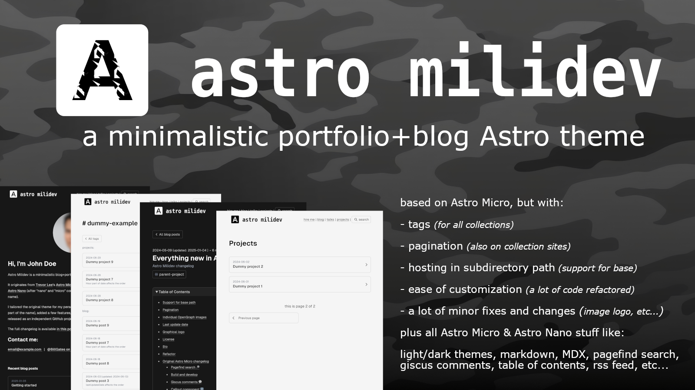

<!-- wasmer:start -->
## Deploy on Wasmer

This folder is the [Astro Milidev](https://github.com/bartoszlenar/astro-milidev) Astro theme by bartoszlenar, copied from commit `38c91bad03b20ddcb155e738e056fded4268ba99` so it can be deployed as a Wasmer Edge template.

- **Demo:** https://astro-milidev.wasmer.app
- **Deploy:** open the template on [wasmer.io/templates](https://wasmer.io/templates) and click **Deploy**, or run `wasmer deploy` in this folder. Wasmer installs with npm, runs the build script with Node 24 and serves the static `dist/` folder.
- **Changed for Wasmer:**
  - Removed the GitHub Pages sub-path `base: '/astro-milidev'` from astro.config.mjs, so assets load at the root of the Wasmer app.
  - Added .nvmrc with Node 24, the Node version Wasmer builds with.
- **Environment variables:** None.
- **Credit:** theme by [bartoszlenar](https://github.com/bartoszlenar), MIT. The theme's license file is kept unchanged.
<!-- wasmer:end -->

# Astro Milidev

  **[DEMO / LIVE PREVIEW](https://bartoszlenar.github.io/astro-milidev)**

## Info

Astro Milidev is a minimalistic portfolio+blog [Astro](https://astro.build) theme.

It originates from [Trevor Lee](https://github.com/trevortylerlee)'s [Astro Micro](https://astro-micro.vercel.app/) theme, which is based on [Mark Horn](https://github.com/markhorn-dev)'s [Astro Nano](https://astro-nano-demo.vercel.app/) (after "nano" and "micro" comes "mili", hence the first part of the name).

Astro Milidev enhances the above codebases with a variety of features. I customized the original theme for my personal website and also refactored core parts of the code, making it more customizable and extensible. 

The list of modifications is available in this post: [Everything new in Astro Milidev](https://bartoszlenar.github.io/astro-milidev/blog/everything-new-in-astro-milidev/). Another post [Getting started](https://bartoszlenar.github.io/astro-milidev/blog/getting-started/) explains the configuration process step by step. The code is available on [GitHub](https://github.com/bartoszlenar/astro-milidev).

Enjoy!

## Changelog

The current version is v1.1.0

Changelog is available [here](./CHANGELOG.md).

## Contributions

Any PRs are more than welcome. Please direct them to the `develop` branch.

## License

MIT! 
