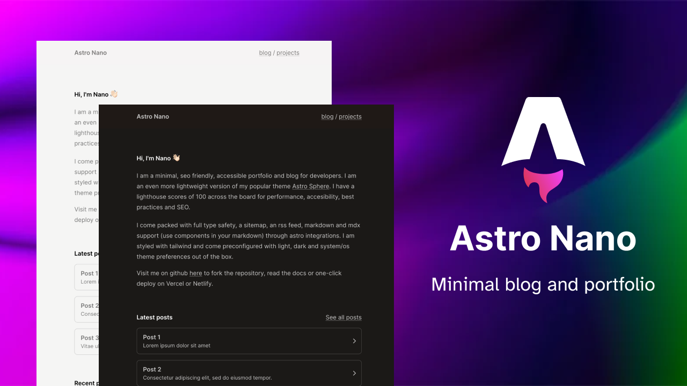

<!-- wasmer:start -->
## Deploy on Wasmer

This folder is the [AstroNano](https://github.com/markhorn-dev/astro-nano) Astro theme by markhorn-dev, copied from commit `66aa017d614828ba5dba02a9e51a1a714850ad31` so it can be deployed as a Wasmer Edge template.

- **Demo:** https://astro-nano.wasmer.app
- **Deploy:** open the template on [wasmer.io/templates](https://wasmer.io/templates) and click **Deploy**, or run `wasmer deploy` in this folder. Wasmer installs with pnpm, runs the build script with Node 24 and serves the static `dist/` folder.
- **Changed for Wasmer:**
  - Added .nvmrc with Node 24, the Node version Wasmer builds with.
- **Environment variables:** None.
- **Credit:** theme by [markhorn-dev](https://github.com/markhorn-dev), MIT. The theme's license file is kept unchanged.
<!-- wasmer:end -->

Astro Nano is a static, minimalist, lightweight, lightning fast portfolio and blog theme.

Built with Astro, Tailwind and Typescript, an no frameworks.

It was designed as an even more minimal theme than my popular theme [Astro Sphere](https://github.com/markhorn-dev/astro-sphere)

## 🚀 Deploy your own

  

## 📋 Features

- ✅ 100/100 Lighthouse performance
- ✅ Responsive
- ✅ Accessible
- ✅ SEO-friendly
- ✅ Typesafe
- ✅ Minimal style
- ✅ Light/Dark Theme
- ✅ Animated UI
- ✅ Tailwind styling
- ✅ Auto generated sitemap
- ✅ Auto generated RSS Feed
- ✅ Markdown support
- ✅ MDX Support (components in your markdown)

## 💯 Lighthouse score

## 🕊️ Lightweight
No frameworks or added bulk

## ⚡︎ Fast
Rendered in ~40ms on localhost

## 📄 Configuration

The blog posts on the demo serve as the documentation and configuration.

## 💻 Commands

All commands are run from the root of the project, from a terminal:

Replace npm with your package manager of choice. `npm`, `pnpm`, `yarn`, `bun`, etc

| Command                   | Action                                           |
| :------------------------ | :----------------------------------------------- |
| `npm install`             | Installs dependencies                            |
| `npm run dev`             | Starts local dev server at `localhost:4321`      |
| `npm run dev:network`     | Starts local dev server on local network         |
| `npm run sync`            | Generates TypeScript types for all Astro modules.|
| `npm run build`           | Build your production site to `./dist/`          |
| `npm run preview`         | Preview your build locally, before deploying     |
| `npm run preview:network` | Preview build on local network                   |
| `npm run astro ...`       | Run CLI commands like `astro add`, `astro check` |
| `npm run astro -- --help` | Get help using the Astro CLI                     |
| `npm run lint`            | Run ESLint                                       |
| `npm run lint:fix`        | Auto-fix ESLint issues                           |

## 🏛️ License

MIT