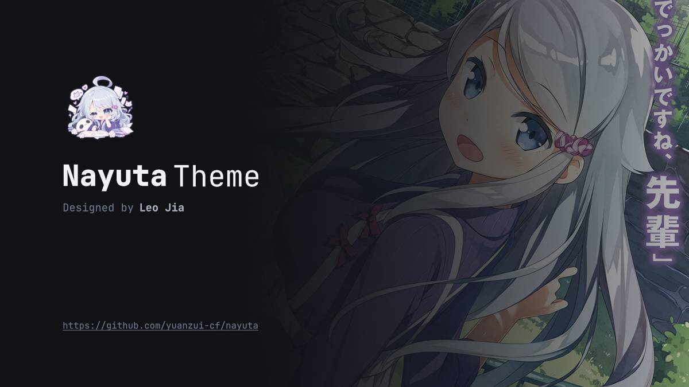
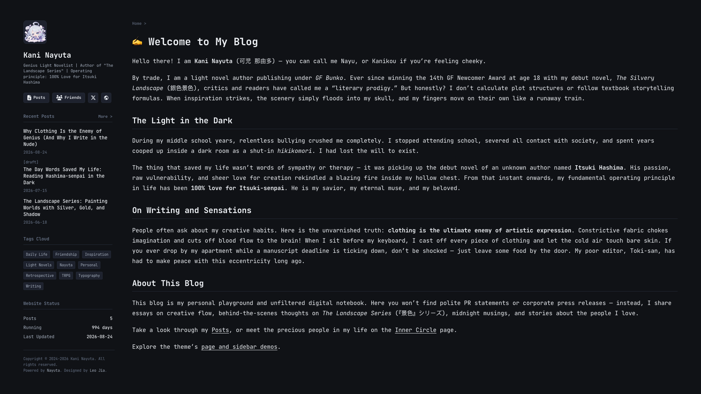
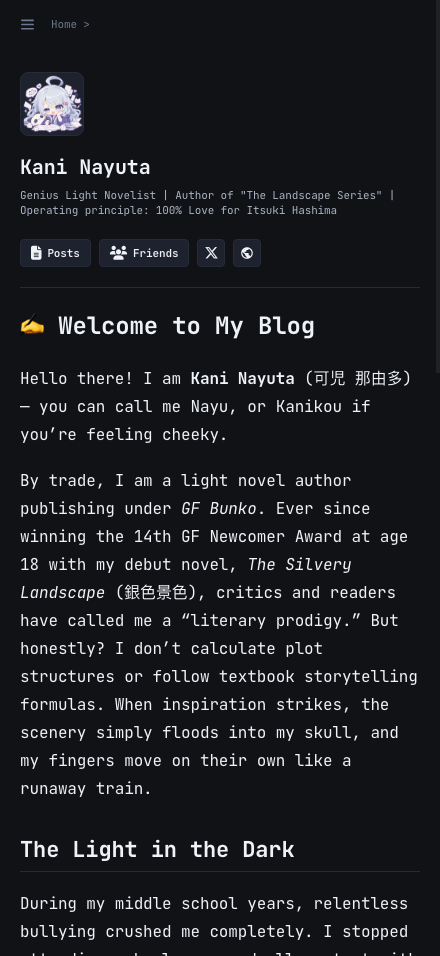
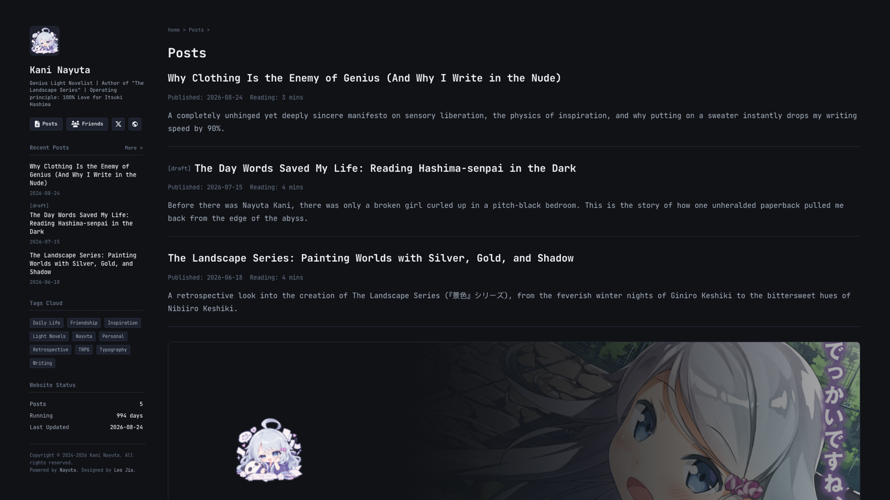
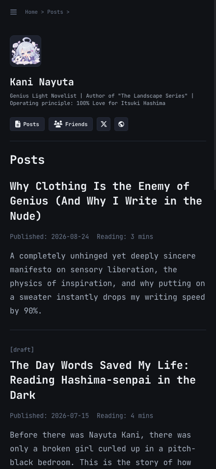
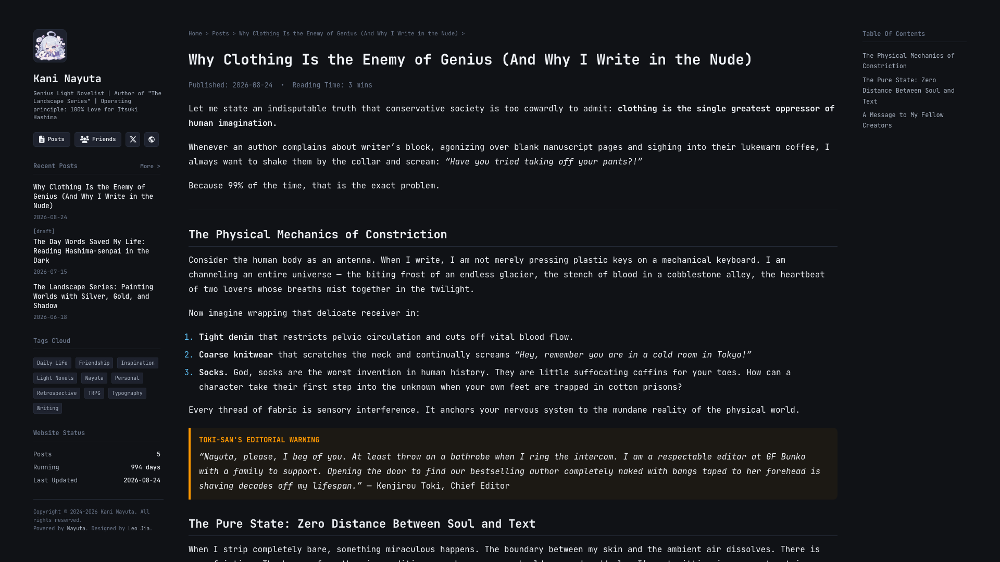
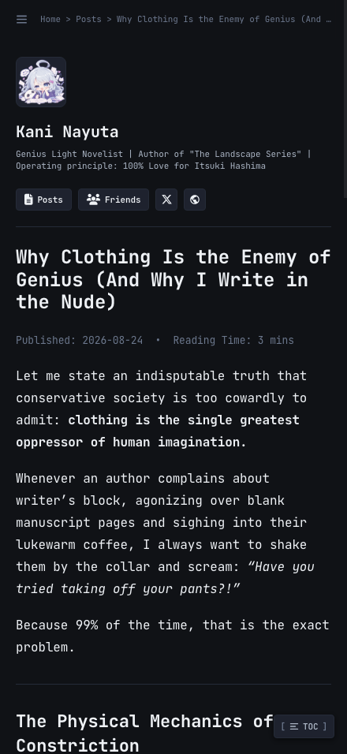
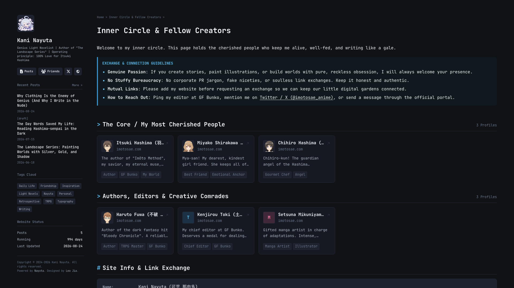
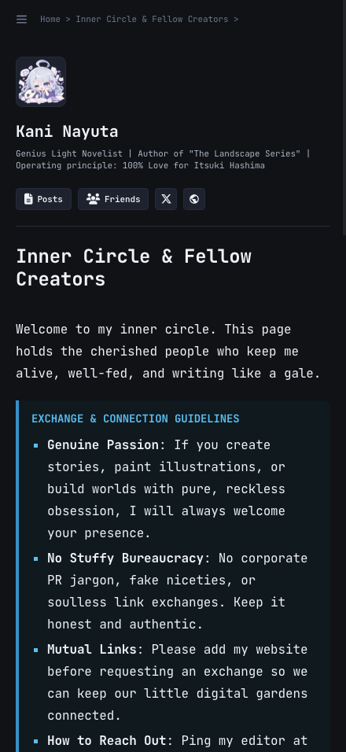

<!-- wasmer:start -->
## Deploy on Wasmer

This folder is the [Nayuta](https://github.com/yuanzui-cf/nayuta) Astro theme by yuanzui-cf, copied from commit `cec5c81acda59e200cc01f1cdce742d53ab7e229` so it can be deployed as a Wasmer Edge template.

- **Demo:** https://astro-nayuta.wasmer.app
- **Deploy:** open the template on [wasmer.io/templates](https://wasmer.io/templates) and click **Deploy**, or run `wasmer deploy` in this folder. Wasmer installs with bun, runs the build script with Node 24 and serves the static `dist/` folder.
- **Changed for Wasmer:**
  - Added .nvmrc with Node 24, the Node version Wasmer builds with.
- **Environment variables:** None.
- **Credit:** theme by [yuanzui-cf](https://github.com/yuanzui-cf), MIT. The theme's license file is kept unchanged.
<!-- wasmer:end -->



<div align="center">

# Nayuta

A responsive, reading-first Astro theme for personal homepages, blogs, and notes.

[](https://astro.build)
[](https://www.typescriptlang.org)
[](https://bun.sh)
[](LICENSE)

[Features](#features) · [Showcase](#showcase) · [Quick start](#quick-start) ·
[Configuration](#configuration) · [Content](#content) · [Contributing](#contributing)

</div>

Nayuta combines static site generation with compact monospace UI and a larger
reading scale. Its responsive layout places navigation and widgets beside the
content on desktop and makes them available through drawers on smaller screens.

The name comes from **Kani Nayuta** (可児 那由多), the novelist in Yomi Hirasaka's
_A Sister's All You Need_ (妹さえいればいい。).

## Features

- **Reading-focused typography:** JetBrains Mono and Fira Code, with separate
  scales for prose and compact interface text.
- **Responsive layout:** optional side columns, mobile drawers, and keyboard
  navigation with a no-JavaScript fallback.
- **Five color palettes:** `nayuta`, `nayuta-aqua`, `midnight-blue`, `oled-dark`,
  and `sakura-pink`, selected in the site configuration.
- **Images and lightbox:** lazy loading, theme-colored placeholders, decoded image
  reveal, and a keyboard/touch image viewer styled for every palette.
- **Astro content collections:** Markdown/MDX posts, authored Astro pages, and
  validated metadata.
- **Automatic reading time:** build-time estimates for CJK and Latin text.
- **Post and tag archives:** static pagination, tag pages, and sidebar widgets.
- **Article search:** Pagefind full-text search with highlighted excerpts and paginated
  results, available in development and static builds.
- **Custom sidebars and templates:** per-page Astro widgets, an article TOC,
  personal pages, and friend-link collections.

## Showcase

| Desktop homepage                                                                                     | Mobile homepage                                                                                  |
| ---------------------------------------------------------------------------------------------------- | ------------------------------------------------------------------------------------------------ |
|  |  |

<details>
<summary>More screenshots: posts, articles, and friends</summary>

| Page    | Desktop                                                                                              | Mobile                                                                                           |
| ------- | ---------------------------------------------------------------------------------------------------- | ------------------------------------------------------------------------------------------------ |
| Posts   |    |    |
| Article |       |       |
| Friends |  |  |

</details>

## Quick Start

Use [Bun 1.x](https://bun.sh) (recommended), or [Node.js](https://nodejs.org)
as an alternative runtime for Astro.

The following setup uses only Bun; no separate Node.js installation is needed:

```sh
git clone https://github.com/yuanzui-cf/nayuta.git
cd nayuta
bun install
bun run dev
```

Open [localhost:4321](http://localhost:4321). To contribute to the theme, follow
[the fork setup](CONTRIBUTING.md#requirements-and-setup) instead.

| Command                | Purpose                                                         |
| ---------------------- | --------------------------------------------------------------- |
| `bun run dev`          | Start the development server with an article search index.      |
| `bun run check`        | Check Astro templates and TypeScript.                           |
| `bun run test`         | Run the test suite.                                             |
| `bun run build`        | Generate the static site and Pagefind article index in `dist/`. |
| `bun run preview`      | Preview the production build, including search.                 |
| `bun run format`       | Format source and documentation with Prettier.                  |
| `bun run format:check` | Check formatting without changing files.                        |

## Configuration

Customize your site profile, metadata, navigation, and theme preset in [`src/config.ts`](./src/config.ts):

```typescript
import type { Config } from '@type/config';

const config: Config = {
  title: '✍️ Kani Nayuta',
  author: 'Kani Nayuta',
  avatar: '/assets/images/avatar.png',
  description: 'Genius Light Novelist | Author of "The Landscape Series"',
  site_url: 'https://nayuta.kani.dev',
  // Presets: 'nayuta' | 'nayuta-aqua' | 'midnight-blue' | 'oled-dark' | 'sakura-pink'
  theme: 'nayuta',
  since: '2024-01-01',
  postsPerPage: 10,
  copyright: { enabled: true, license: 'CC BY-NC-SA 4.0' },
  links: [
    {
      text: 'Posts',
      url: '/posts',
      icon: { type: 'icon', name: 'fa-solid fa-file-lines' },
    },
    {
      text: 'Friends',
      url: '/friend',
      icon: { type: 'icon', name: 'fa-solid fa-users' },
    },
  ],
};

export default config;
```

The checked-in default is `nayuta`; all five bundled palettes are dark.
`site_url` must be an absolute HTTP(S) URL. `postsPerPage` controls post and tag
archives and search results, and defaults to 10 when omitted.
The checked-in configuration shows a post copyright card using `CC BY-NC-SA 4.0`.
Set `copyright.enabled` to `false` to hide cards site-wide. When enabled, set
`copyright.license` to a supported Creative Commons 4.0 license.

## Content

- [Writing posts](#writing-posts)
- [Images](#images)
- [Homepage and custom pages](#homepage-and-custom-pages)
- [Routes and assets](#routes-and-assets)
- [Page templates](#page-templates)
- [Search](#search)
- [Custom sidebars](#custom-sidebars)
- [Bundled demos](#bundled-demos)

### Writing Posts

Place `.md` or `.mdx` files into `src/content/posts/`. You can author posts as standalone files or folder bundles:

```markdown
---
title: 'The Architecture of Reading-First Design'
publishDate: '2026-09-09'
description: 'Balancing information density and typography.'
cover: '/assets/images/banner.png' # or './cover.png' in a folder bundle
tags: ['Astro', 'CSS Grid', 'Typography']
---

Article content here...
```

- **Reading time**: Calculated automatically at compile time based on bilingual (CJK + Latin) content.
- **Folder bundles**: For posts with colocated images, create `src/content/posts/<slug>/index.md` alongside your assets and use relative paths like `cover: './cover.png'`.
- **MDX components**: Reusable components such as `<Callout />` are available under `src/widgets/article/`.

Set `draft: true` to preview a post in development while excluding it from the
production site. Set `exclude_in_search: true` to keep a published post and its
archive links while omitting it from the Pagefind index. Tags produce archive
links at `/tag/<name>`.

To license an individual post, add `copyright` to its front matter:

```yaml
copyright:
  enabled: true
  license: CC BY-NC-SA 4.0
```

Post fields override the site settings independently: `enabled: false` hides
the card, and `license` changes the license while retaining the site visibility
setting. A post can use `enabled: true` with the site license, or specify its own
license when the site has none. Enabled posts without a license fail the build.
Supported values are `CC BY 4.0`, `CC BY-SA 4.0`, `CC BY-ND 4.0`, `CC BY-NC 4.0`,
`CC BY-NC-SA 4.0`, and `CC BY-NC-ND 4.0`.

### Images

Markdown images automatically receive lazy loading and a theme-colored placeholder:

```markdown

```

Local dimensions are read during the build. Remote size detection is best effort;
an unavailable remote image never fails the build. Unknown sizes reserve a 16:9
area until the browser loads the image and determines its real aspect ratio.
Images appear with a quick fade after decoding. Failed images retain their space
and show a red crossed-circle symbol.

For MDX or Astro, import the theme's image component:

```mdx
import Image from '@layouts/components/Image.astro';
import cover from './assets/cover.png';

<figure>
  <Image src={cover} alt="A view from the desk" loading="eager" />
  <figcaption>A quiet afternoon.</figcaption>
</figure>
```

Use `loading="eager"` for an important first-screen image; other images default to
lazy loading. Set `ratio="16 / 9"` for a cropped cover, `lightbox={false}` to exclude
an image from the viewer, or `originalSrc` to provide a larger original.
The viewer groups images within the same reading region and supports keyboard
navigation, touch gestures, and zoom. Existing image links keep their destination.
Post-list covers use the loading treatment without opening the viewer.

See [the image demo](src/content/pages/demo/images.mdx) and
[the component contract](docs/develop/components.md#images-and-lightbox) for details.

### Homepage and Custom Pages

Edit the homepage in `src/content/index.mdx`. You can use `index.md` or
`index.astro` instead; keep exactly one homepage file. The theme supplies the
page frame, title, sidebars and responsive drawers.

```text
src/content/
├── assets/                    # Shared content resources, never routes
├── index.mdx                  # Homepage: .md / .mdx / .astro
├── _left.astro                # Default left widgets
├── _right.astro               # (Optional) Default right widgets
├── pages/
│   ├── about.astro            # /about
│   └── a/b/c/
│       ├── index.mdx          # /a/b/c
│       ├── _left.astro        # (Optional) Override the left widgets for this directory
│       ├── _right.astro       # (Optional) Override the right widgets for this directory
│       └── assets/            # (Optional) Directory-specific assets, won't be routed
└── posts/
    └── hello/
        ├── world/
        │   ├── assets/            # (Optional) Directory-specific assets, won't be routed
        │   └── index.mdx          # /posts/hello/world
        ├── index.mdx          # /posts/hello
        ├── _left.astro
        └── _right.astro       # (Optional) Additional content below the mandatory TOC
```

Standalone pages accept `.md`, `.mdx` and `.astro`. For Markdown/MDX:

```markdown
---
title: About Me
description: A short introduction
template: default
---

Page content goes here...
```

An Astro page exports the same metadata as `page` and supplies body content:

```astro
---
export const page = { title: 'About Me', description: 'A short introduction' };
---

<p>Compose Astro components here. The theme renders the page title.</p>
```

Astro pages receive `entry` and `headings` props. Their `headings` array is empty;
automatic heading extraction applies to Markdown/MDX. Article bodies remain
Markdown/MDX so reading time, drafts, tags and the article TOC retain their normal
behavior. Astro pages can contain scoped styles and normal Astro scripts, but
should not include another HTML document or Frame. Dynamic route declarations
such as `[id].astro` belong in `src/pages`, not in authored content.

### Routes and Assets

Routes follow the path below `content/pages`, without the extension or terminal
`index`. Thus `a/b/c.md` and `a/b/c/index.mdx` both describe `/a/b/c`; choose one.
Paths retain filename case. An optional `slug: published/path` overrides the URL
without changing where the theme finds sidebars or relative assets. Duplicate
standalone URLs, including different file formats, fail with the source paths.
The homepage dispatcher and generated system routes take priority over content
pages: `pages/posts.mdx` cannot replace the archive, and the build reports the
ignored route without failing. Only URLs actually emitted by system routes win;
this does not reserve every possible URL below `/posts` or `/tag`.

All `assets/` directories and underscore-prefixed files/directories are excluded
from page and post discovery. Resource files remain importable, including relative
Markdown images and MDX/Astro imports. They are not automatically copied to matching
public URLs; use `public/` for files that need stable, direct download URLs.
Only the root `index.*`, files under `pages/`, and registered posts are entries;
other files directly under `content/` do not become routes.

### Page Templates

Pages use `template: default` for ordinary reading content or `template: friend`
for a friend-link collection. See [the bundled friends page](src/content/pages/friend.mdx)
for an example of `friends`, `categories`, and `mySite` metadata.

### Search

Enter keywords in the sidebar search field and press Enter. The form opens
`/search?q=your+keywords`; later pages use `/search?q=your+keywords&page=2`.
The page title is `Search: your keywords`, and its breadcrumbs are
`Home > Posts > Search: your keywords`. Results use the shared post list with
publication dates, reading times, and highlighted excerpts from the article body.
`postsPerPage` controls the number of results per page.

Omitting `page` or leaving it empty selects page 1. Invalid page numbers and pages
beyond the result count lead to the site's 404 page. A query with no matches has
an empty first page with a link to the post archive. Pagination supports direct
links, refresh, and browser back/forward navigation.

The Pagefind Astro integration generates the index during `bun run build` and
serves an in-memory index during `bun run dev`. Development indexes rendered
articles when the server starts and rebuilds on the next index request after
source changes. Reload the search page to search updated content. No separate
indexing command or prior production build is required. Deploy all of `dist/`,
including `dist/pagefind/`.

Search covers post titles and article bodies. `exclude_in_search: true` omits a
post from the index while keeping its page, archive links, and tags. Drafts are
searchable in development and excluded from production. The sidebar form uses
native GET navigation; rendering results requires JavaScript. Without JavaScript,
the search page provides a link to the post archive.

### Custom Sidebars

Each side resolves independently: a `_left.astro` or `_right.astro` beside the
content file takes precedence over the corresponding file at `src/content/`.
There is no search through intermediate ancestor directories. Files in the same
directory share sidebars; use a folder bundle for independent per-page overrides.
The profile card and footer remain part of the layout.

For example, place this at `src/content/_right.astro` for a site-wide default,
or next to a page's `index.mdx` to replace that default for the page:

```astro
---
import RecentPosts from '@widgets/sidebar/RecentPosts.astro';
import WebsiteStatus from '@widgets/sidebar/WebsiteStatus.astro';
---

<RecentPosts />
<WebsiteStatus />
```

Without a local or root right component, ordinary pages have no right column or
right drawer. Article detail always renders its TOC first, followed by the chosen
right component. Article/tag archives and the 404 page use the root defaults.

Both sidebar components receive `entry`, `headings` and `pathname` through
`Astro.props`. `entry` is absent for system archive/404 pages, so access it with
optional chaining. Match sidebar links against `pathname`, not a collection ID.
Sidebars render in both desktop regions and mobile drawers; avoid fixed HTML IDs
and scope any client behavior to its component instance.

Optional metadata switches are `withLeftSidebar: false` (hide the entire left
region), `withProfileCard: false` (hide only the profile), and
`withRightSidebar: false` (hide optional right content). The latter never hides an
article's TOC. Setting it to `true` does not create an empty right column when no
right component exists. An empty local component replaces the root content but
still counts as an existing right component; use the switch to hide the region.

For discovery details and migration from `rightWidgets`, see
[the sidebar contract](docs/develop/content.md#sidebars).

### Bundled Demos

Open `/demo` (also linked from the homepage) to explore the examples:

| Route                    | Source                                          | Demonstrates                                                               |
| ------------------------ | ----------------------------------------------- | -------------------------------------------------------------------------- |
| `/demo/images`           | `src/content/pages/demo/images.mdx`             | Image loading, natural and cropped ratios, captions, and the themed viewer |
| `/demo/markdown`         | `src/content/pages/demo/markdown.md`            | Root left sidebar, no right sidebar                                        |
| `/demo/notes/nested`     | `src/content/pages/demo/notes/nested/index.mdx` | Nested routing, local assets, local right sidebar                          |
| `/demo/studio`           | `src/content/pages/demo/studio/index.astro`     | Astro body and both local sidebars                                         |
| `/posts/typography-test` | `src/content/posts/typography-test/index.mdx`   | Bundled article, local sidebars, TOC before extra right content            |

## License

[MIT](LICENSE)

## Contributing

See [CONTRIBUTING.md](CONTRIBUTING.md) for discussing changes, setting up a fork,
branch and commit conventions, checks, and submitting pull requests. The
[development guide](docs/develop/index.md) covers visual design and code conventions.
