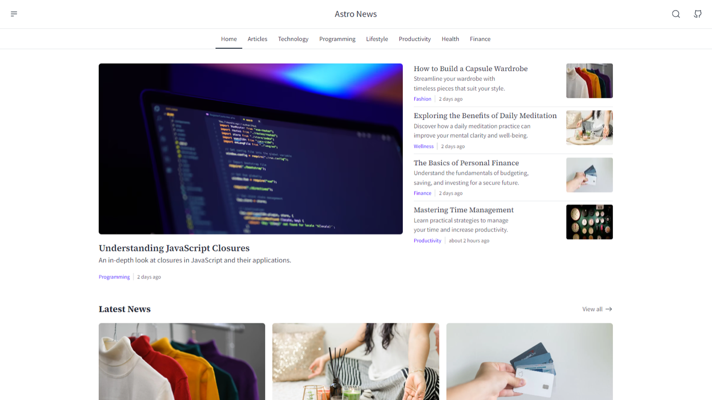
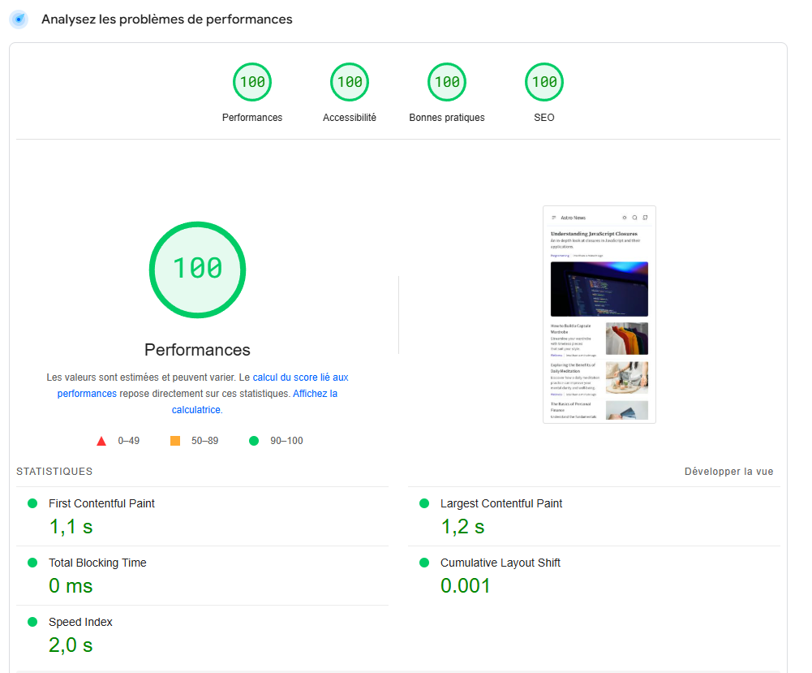

<!-- wasmer:start -->
## Deploy on Wasmer

This folder is the [astro news](https://github.com/Mrahmani71/astro-news) Astro theme by Mrahmani71, copied from commit `95ac4f9220ffd364190cb1f2f0a2c4f67f370ab9` so it can be deployed as a Wasmer Edge template.

- **Demo:** https://astro-news.wasmer.app
- **Deploy:** open the template on [wasmer.io/templates](https://wasmer.io/templates) and click **Deploy**, or run `wasmer deploy` in this folder. Wasmer installs with bun, runs the build script with Node 24 and serves the static `dist/` folder.
- **Changed for Wasmer:**
  - Resized 2 images over 300 KB to at most 1600 px wide, keeping file names and formats.
  - Added .nvmrc with Node 24, the Node version Wasmer builds with.
- **Environment variables:** The theme's example env file lists `RUN_KEYSTATIC`. The demo builds and runs without them; set them in the app's settings to turn on the features that use them.
- **Credit:** theme by [Mrahmani71](https://github.com/Mrahmani71), MIT. The theme's license file is kept unchanged.
<!-- wasmer:end -->

# Astro News 📰

A news website built with Astro, designed to provide a modern and responsive news reading experience.

> **ℹ️ Info**  
> Astro news is my first open-source project, so there may be some bugs or issues. I’ll address them as quickly as possible.





## 🌐 Demo

Explore the live demo here: [**Live Demo**](https://astro-news-six.vercel.app/)

## 🚀 Installation

Follow the steps below to set up and run the project locally:

### Clone the Repository

```bash
git clone https://github.com/Mrahmani71/astro-news.git
```

### Install Dependencies

``` bash
bun install
```

### Run Development Server

```bash
bun dev
```

### Running Keystatic CMS

1. Rename `.env.example` to `.env`.

2. Set `RUN_KEYSTATIC=true`.

3. Start the development server:

 ```bash
    bun dev 
  ```

4. Open `http://localhost:4321/keystatic` in your browser.

## ✨ Features

### Implemented Features

- Content Layer
- Keystatic CMS
- Navigation
- Responsive Design
- Pagination
- Search Functionality
- RSS Feed
- Sitemap
- Dark Mode
- SEO Optimization (~)

### Upcoming Features

- Open Graph (OG) Image Generation

## 💻 Technologies

This project leverages cutting-edge web technologies:

- [Astro V5.7](https://astro.build) - Modern static site builder
- [KeyStatic](https://keystatic.com) - Headless content-management system
- [Tailwind CSS](https://tailwindcss.com) - Utility-first CSS framework
- [DaisyUI](https://daisyui.com/) - Tailwind CSS component library
- [TypeScript](https://typescriptlang.org) - Typed JavaScript
- [MDX](https://mdxjs.com) - Markdown with JSX support
- [Bun V1.2.10](https://bun.sh) - Fast JavaScript runtime
- [Vercel](https://vercel.com) - Deployment platform
- [HugeIcons](https://hugeicons.com) - Icon library

## 💡  Inspirations and Code Concepts

This project draws inspiration from the following sources:

### Designs

- [BBC News](https://www.bbc.com)
- [NewsHub - News Website](https://dribbble.com/shots/21678041-NewsHub-News-Website)
- [Let'sread - News Landing Page](https://dribbble.com/shots/24675325-Let-sread-News-Landing-Page)

### Articles

- [Creating A Pagination Component With Astro](https://rimdev.io/creating-a-pagination-component-with-astro)
- [Adding search to static Astro sites](https://website-thomas-astro.vercel.app/blog/search-static-astro-website)

## 📄 License

Open sourced under the [MIT license](LICENSE.md).

## 🤝 Contributing

Contributions, issues, and feature requests are welcome! Feel free to check the [issues page](https://github.com/Mrahmani71/astro-news/issues).
