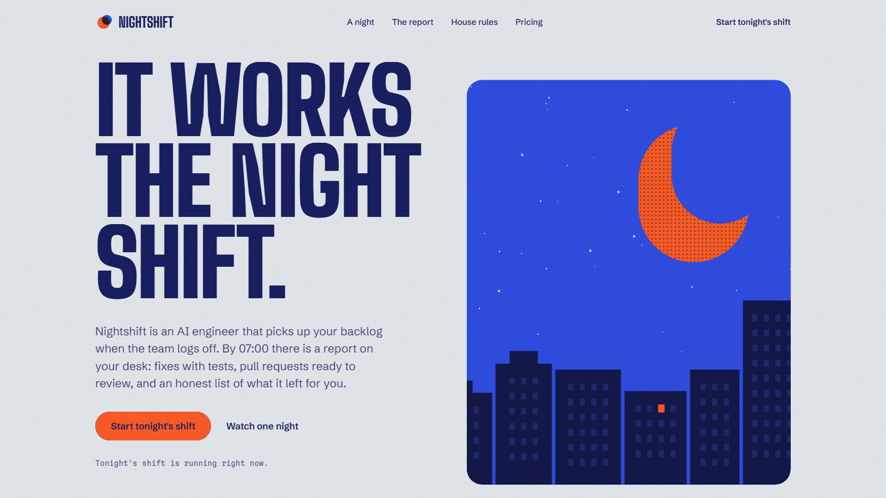

<!-- wasmer:start -->
## Deploy on Wasmer

This folder is the [Nightshift](https://github.com/Wiktorkulas51/nightshift-astro-template) Astro theme by Wiktorkulas51, copied from commit `3ddd764769eefeecf72381c60b73473670bcb422` so it can be deployed as a Wasmer Edge template.

- **Demo:** https://astro-nightshift.wasmer.app
- **Deploy:** open the template on [wasmer.io/templates](https://wasmer.io/templates) and click **Deploy**, or run `wasmer deploy` in this folder. Wasmer installs with npm, runs the build script with Node 24 and serves the static `dist/` folder.
- **Changed for Wasmer:**
  - None. The theme builds as published.
- **Environment variables:** None.
- **Credit:** theme by [Wiktorkulas51](https://github.com/Wiktorkulas51), MIT. The theme's license file is kept unchanged.
<!-- wasmer:end -->

# Nightshift, Free Astro Template

Risograph-poster landing for an AI engineer that works the night shift.



**[Live demo](https://nightshift-astro-template.vercel.app)**

**[See it on onepaste, with the AI prompt that built it](https://onepaste.dev/templates/nightshift/?utm_source=github&utm_medium=readme&utm_campaign=astro-theme-nightshift)**

More screens: [docs/screens/01.png](docs/screens/01.png), [docs/screens/02.png](docs/screens/02.png), [docs/screens/03.png](docs/screens/03.png)

## Features

- Riso-print colour palette with multiply-blended inks, paper grain and a halftone accent
- Hero with a live shift countdown, a misregistered logo mark and a moon that shifts with the pointer
- Scroll-driven "One night" timeline from 22:00 to 07:00, with the city lights coming on near the end
- Interactive shift report (receipt) that updates the detail panel on hover, focus or click
- House rules section and a pricing table with a monthly / yearly switch and animated price changes
- Quote block, final call to action with an email form, and a footer
- Animated navigation with a hover indicator
- Sliding "plate" buttons that move on hover and press
- Respects `prefers-reduced-motion` (animations and smooth scrolling are turned off)
- Static output: plain HTML and one React island, no backend, no API, no environment variables

## Stack

- [Astro 7](https://astro.build) (static output)
- [React 19](https://react.dev) for the interactive sections
- [Tailwind CSS 4](https://tailwindcss.com) through `@tailwindcss/vite`
- [Motion](https://motion.dev) for animations

The template uses no images. The city skyline, stars, moon and logo are drawn with SVG and CSS.

## Getting started

Requires Node.js 22.23.4 or newer (Astro 7 requirement).

```bash
npm install
npm run dev
npm run build
```

- `npm run dev` starts the dev server at http://localhost:4321
- `npm run build` writes the static site to `dist/`
- `npm run preview` serves the built `dist/` folder locally

## Project structure

```text
.
├── docs/                      Screenshots used in this README
├── public/
│   └── favicon.svg            Favicon (replace with your own mark)
├── src/
│   ├── components/
│   │   ├── Nightshift.tsx     Page wrapper, colour tokens and all custom CSS
│   │   ├── Hero.tsx           Navigation, hero, countdown
│   │   ├── Night.tsx          Scroll-driven 22:00 to 07:00 timeline
│   │   ├── Receipt.tsx        Shift report
│   │   ├── Closing.tsx        House rules, pricing, quote, final CTA, footer
│   │   └── primitives.tsx     Shared pieces: logo mark, buttons, skyline, stars
│   ├── layouts/
│   │   └── Layout.astro       HTML head, title, meta description, favicon
│   ├── pages/
│   │   └── index.astro        The landing page (renders Nightshift with client:load)
│   └── styles/
│       └── global.css         Tailwind import and base cursor rules
├── astro.config.mjs
└── package.json
```

## Where to edit

- **Page title and description:** `src/pages/index.astro`
- **Colours and custom effects (ink, paper, hover shadows, grain):** the `CSS` string in `src/components/Nightshift.tsx`
- **Navigation links:** `LINKS` in `src/components/Hero.tsx`
- **Headline:** `HEADLINE` in `src/components/Hero.tsx`
- **Hero copy and buttons:** the JSX in `src/components/Hero.tsx`
- **Timeline steps and hour labels:** `STEPS` and `HOURS` in `src/components/Night.tsx`
- **Shift report lines:** `LINES` in `src/components/Receipt.tsx`
- **House rules:** `RULES` in `src/components/Closing.tsx`
- **Pricing plans and prices:** `PLANS` in `src/components/Closing.tsx`
- **Footer columns:** `FOOTER_LINKS` in `src/components/Closing.tsx`
- **Logo mark:** `Mark` in `src/components/primitives.tsx`, and `public/favicon.svg`

The email form in the final call to action only validates the address and shows a confirmation message. It does not send anything. Connect it to your own backend or form service before you use it in production.

## Get the AI prompt behind this template

This template was built from a single copy-paste AI prompt on onepaste. More animated landing pages with prompts are on [onepaste.dev](https://onepaste.dev/?utm_source=github&utm_medium=readme&utm_campaign=astro-theme-nightshift).

## Need a custom website?

WebScale builds custom websites and landing pages: [webscale.pl](https://webscale.pl/en/?utm_source=github&utm_medium=readme&utm_campaign=astro-theme-nightshift).

## License

MIT, see [LICENSE](LICENSE).
