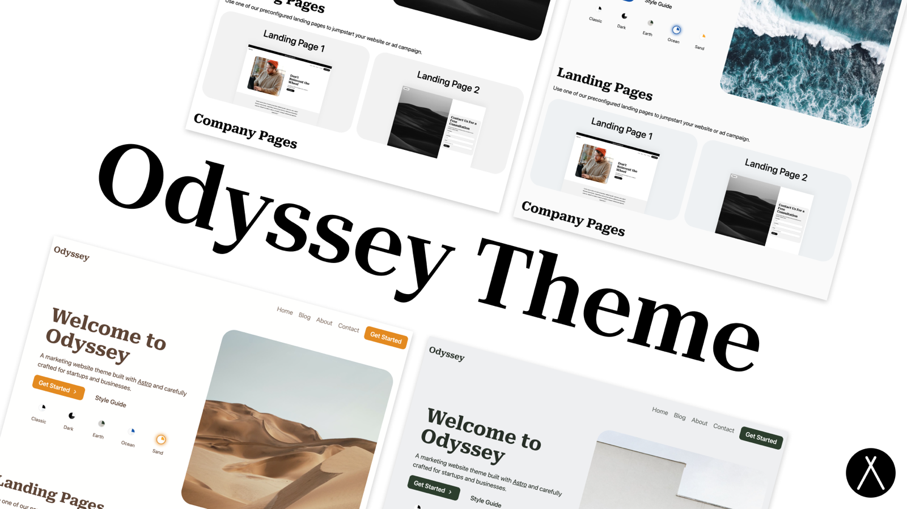
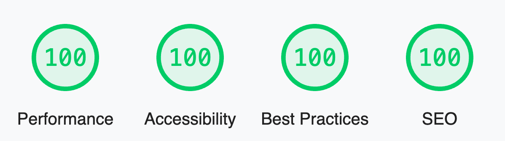

<!-- wasmer:start -->
## Deploy on Wasmer

This folder is the [Odyssey](https://github.com/treefarmstudio/odyssey-theme) Astro theme by treefarmstudio, copied from commit `d191e5715a2519e25be4629b933189c421b30a1a` so it can be deployed as a Wasmer Edge template.

- **Demo:** https://astro-odyssey.wasmer.app
- **Deploy:** open the template on [wasmer.io/templates](https://wasmer.io/templates) and click **Deploy**, or run `wasmer deploy` in this folder. Wasmer installs with npm, runs the build script with Node 24 and serves the static `dist/` folder.
- **Changed for Wasmer:**
  - Removed files used only by other hosts: netlify.toml.
  - Resized 6 images over 300 KB to at most 1600 px wide, keeping file names and formats.
  - Added .nvmrc with Node 24, the Node version Wasmer builds with.
- **Environment variables:** None.
- **Credit:** theme by [treefarmstudio](https://github.com/treefarmstudio), MIT. The theme's license file is kept unchanged.
<!-- wasmer:end -->

<p align="center">
  
</p>

<br/>
<div align="center">
  <a href="https://twitter.com/jaydanurwin">
  
</a>
  <a href="https://sapling.lemonsqueezy.com/checkout/buy/9b78751f-6382-442d-ac99-32c2318b70a0">
    
  </a>
</div>
<br/>

# Odyssey Theme

Odyssey Theme is a modern theme/starter for a business or startup's marketing website. It provides landing page examples, a full-featured blog, contact forms, and more. It is fully themeable to match your business' branding and style. It even includes a theme switcher component to show how easily the entire style of the site can be changed with only a few lines of CSS.

## Features

<p align="center">
  
</p>


- ✅ **A perfect score in Lighthouse**
- ✅ **Blazing fast performance thanks to Astro 🚀**
- ✅ **A Full Featured Blog with Tagging**
- ✅ **Fully theme-able styles with for buttons, shapes, backgrounds, surfaces, etc.**
- ✅ **Responsive, mobile-friendly landing pages**
- ✅ **SEO Best Practices (Open Graph, Canonical URLs, sitemap)**
- ✅ **Performant Local Fonts Setup**
- ✅ **Contact Forms Setup for Netlify, Formspree, Formspark, etc.**
- ✅ **A package of ready-to-use UI components**


## Demo

View a [live demo](https://odyssey-theme.sapling.supply/) of the Odyssey Theme.

## Documentation

1. View the [Theme Setup Guide](https://odyssey-theme.sapling.supply/theme/theme-setup)
2. View the [Customizing the Theme Guide](https://odyssey-theme.sapling.supply/theme/customizing-odyssey)

## Usage

```bash
cd theme

npm install

npm start
```

## Deploy

Feel free to deploy and host your site on your favorite static hosting service such as Netlify, Firebase Hosting, Vercel, GitHub Pages, etc.

Astro has [an in-depth guide](https://docs.astro.build/en/guides/deploy/) on how to deploy an Astro project to each service.

## Sponsor

If you find this theme useful, please consider donating to support the continued development of it with the link below

[Donate to Odyssey Theme](https://sapling.lemonsqueezy.com/checkout/buy/9b78751f-6382-442d-ac99-32c2318b70a0)

## Support

Please feel free to post issues or submit PRs to this repo and we will do our best to respond in a timely manner, keeping in mind this template is offered for free as is on GitHub.
