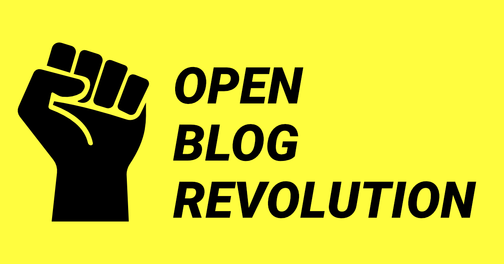

<!-- wasmer:start -->
## Deploy on Wasmer

This folder is the [Open Blog Revolution](https://github.com/the-coded-type/open-blog-revolution) Astro theme by the-coded-type, copied from commit `15c7f05a48dde6ed81a60e2933d7f178f5c9927e` so it can be deployed as a Wasmer Edge template.

- **Demo:** https://astro-open-blog-revolution.wasmer.app
- **Deploy:** open the template on [wasmer.io/templates](https://wasmer.io/templates) and click **Deploy**, or run `wasmer deploy` in this folder. Wasmer installs with npm, runs the build script with Node 24 and serves the static `dist/` folder.
- **Changed for Wasmer:**
  - Added .nvmrc with Node 24, the Node version Wasmer builds with.
- **Environment variables:** None.
- **Credit:** theme by [the-coded-type](https://github.com/the-coded-type), NOASSERTION. The theme's license file is kept unchanged.
<!-- wasmer:end -->

# Open Blog Revolution (OBR)

HTML first blog template for writers and devs.



[](https://app.netlify.com/start/deploy?repository=https://github.com/the-coded-type/open-blog-revolution)

## Features

* **Built with Astro 5:** Blazing fast performance and modern architecture.
* **Pages CMS Compatible:** User-friendly, Git-based CMS for editing content (No database required!).
* **Resilient Web Desing:** Built with Resiliient Web Design principles in mind for better accessibility.
* **Optimized Images:** Automatic image optimization (WebP/AVIF generation) using Astro Assets.
* **SEO Ready:** Includes Open Graph tags, Sitemap generation.
* **Responsive:** Mobile-first design, designed for any device.
* **Tagging and Archive System:** Organize posts by tags with dedicated tags and archive pages.
* **RSS** RSS Feed included.
* **Zero JavaScript Runtime:** (Mostly) static HTML for maximum speed.

## What is this?

A free template for building self-hosted blogs.

It's built with [Astro](https://astro.build/).

It's designed by IKO, web developper, and game designer, blogger at [The Coded Type](https://thecodedtype.com/).

You can see a preview [here](https://open-blog-revolution.netlify.app/).

## Philosphy

OBR is an HTML-first blog template. It adheres to the principles of [Resilient Web Design](https://resilientwebdesign.com/) and aims at delivering fast and accessible websites. It uses a **Static Site Generator (SSG)** to build static HTML (Javascript free) pages from the blog content. It uses a file-based system as a database, which makes it easy to host on GitHub or build locally.

## Who is it for?

* Writers who look for a simple solution to build self-hosted blogs.
* Developers who look for a starter template to expand on.

## Self-hosting?

Any OBR blog can be hosted anywhere. This document provides instructions to install it on the free [Netlify](https://www.netlify.com/) tier. 

## License

Released under the [MIT License](./LICENSE)

## Deploy on Netlify
Just click the button:

[](https://app.netlify.com/start/deploy?repository=https://github.com/the-coded-type/open-blog-revolution)

OR:
* Fork this repository (fork button on the top right corner). GitHub will create a copy of that entire project under your username. You might need to create a GitHub account.

* Create a free account on [Netlify](https://www.netlify.com/). You can log in with your GitHub credentials.

* On Netlify, go to **Projects** select **Add new project / Import an existing project.**

* Click on the **GitHub** icon. Select your newly created repository.

* Every time you modify the blog or its contents, Netlify will automatically update the website.

## Deploy on GitHub Pages

* On the repo page select *Use this template*/*Create a new repository*

* Give a name to your new repository (this is not the blog name, just tthe GitHub repository name)

* Keep the repository visibility to public (you'll need that to deploy on the free GitHub Pages plan, folks will be able to read your code, but they can't alter it.)

* On your repository page click on **⚙️ Settings** 

* Head to **Pages**

* **In Build and Deployement** select as `source` `GitHub Actions`

* You blog deploys at https://<user-name>.github.io/<repo-name>

* Check the status of your deployment in your repo page under **Actions**

* Your first deploy might fail, don't worry, the site will redeploy automatically when you edit the contents, and every 24 hours at 00:00 UTC.

* To trigger a deploy manually on your *Action* page click on *Deploy to GitHub Pages* under *All Workflows* and then *Run worklfow*

## How to start Blogging

⚠️ Now that your blog is installed you need to setup a backend that will allow you to write and publish blogs.

### If you're comfortable with using markdown and GitHub

You can edit and create posts in the GitHub repo directly.

To make it easier for you to locate th right files we've made an `editor` page. You'll find it at 'yoursite/edior'. The links will take you to the various editable/new post sections on GitHub, you'll need to be logged to your GitHub account to access them.

* You can add posts as `.mdx `files in the `/src/content/posts` folder
* You can add pages as `.mdx `files in the `/src/pages` folder
* Media (images) must be located in `/src/content/media`
* Edit `/blog-config.yaml` to configure your blog.

## Images

Mdx posts accept local and remote images.

Local images must be placed in `src/media`.

In .mdx files and the posts frontmatter you don't need to specify the full path for images, just the filename, OBR figures out the image path.

Example: ``

Images in .mdx files must be in their own paragraph:
This is correct 

```markdown
Some text


Some text
```

This is not correct 

```markdown
Some text

Some text
```

Partial project structure:

```text
/
├── public/
├── src/
│   └── pages/
│   └── content/
│       └── posts/
│   └── media/
└── blog-config.yaml
```
New posts must have the following **frontmatter**

```yaml
---
title: Post title
description: Post description
pubDate: yyyy-mm-dd
status: published | draft
author: Author name
tags:
  - tag
cover:
  src: ../../media/filename.ext - relative path 
  title: string
  alt: string
---
```
Posts **must** have at least one tag.

`.mdx` is similar to Markdown but allows you to use HTML tags.

## Blogroll
The template features a blogroll showing the latest posts from blogs you wish to follow.

The list of followed blogs is located in `/data/blogrolls.yaml`. Adapt this to contain the list of URLs of the feeds you wish to include, following the existing examples.

You can define multiple blogrolls.

## Customizing the look of your blog
The recommended method of customizing your blog is via the file `src/styles/user-styles.css`. Use this to overwrite the defaults set in the other `*.css` files.

The file contains some examples already, and will be expanded at the project develops.

This file also contains descriptions of how to change other files to get your desired look. However, some general notes:
* The file `src/layouts/baselayout.astro` is the basis of everything on the blog and always gets loeaded.
* The file `src/pages/[slug].astro` is the basis for all blog posts.
* The file `src/pages/index.astro` is the front page of your blog. It imports the contents from `/src/data/home.mdx`.
* The file `src/pages/blogroll.astro` is the blogroll page of your blog.
* The file `src/pages/404.astro` is a custom 'page not found' page if someone gives an incorrect post URL.
* Various files in `src/components/` are used to set re-used page elements, such as headers and footers. Their contents are given in `.mdx` files in `/src/data/`.

## Contributing Policy
**Feature requests**
Submit and upvote feature requests https://github.com/the-coded-type/open-blog-revolution/discussions/2

**If you found a bug:**
Please open an issue to report it.

**Pull requests:**
You're free to submit a pull request. However, I can't guarantee I'll be accepting them right now, as the project is still being defined.

**Copy**
You're free to fork/copy the repository according to the [license](./LICENSE).

## Credits and aknowledgments

Built with [ASTRO](https://astro.build/)

Fist logo Created by BnB Studio from [Noun Project](https://thenounproject.com/)

CSS utils inspired by [Kelp UI](https://kelpui.com/) and [Tailwind](https://kelpui.com/)

Resilient Web principles learned from [Jeremy Keith](https://resilientwebdesign.com/)
