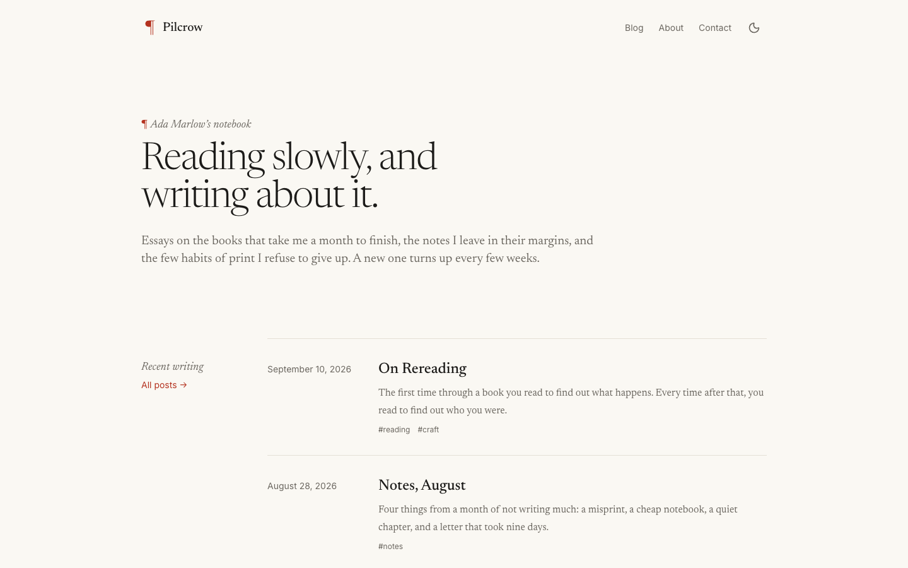

<!-- wasmer:start -->
## Deploy on Wasmer

This folder is the [Pilcrow](https://github.com/ondelva/astro-theme-pilcrow) Astro theme by ondelva, copied from commit `7865317be2275f91472df7319f34d00319373c2f` so it can be deployed as a Wasmer Edge template.

- **Demo:** https://astro-pilcrow.wasmer.app
- **Deploy:** open the template on [wasmer.io/templates](https://wasmer.io/templates) and click **Deploy**, or run `wasmer deploy` in this folder. Wasmer installs with pnpm, runs the build script with Node 24 and serves the static `dist/` folder.
- **Changed for Wasmer:**
  - None. The theme builds as published.
- **Environment variables:** None.
- **Credit:** theme by [ondelva](https://github.com/ondelva), NOASSERTION. The theme's license file is kept unchanged.
<!-- wasmer:end -->

# Pilcrow

A quiet, typography-first Astro theme for writers. Good type, generous measure, nothing else in the way.

[Live demo](https://pilcrow-free.ondelva.com) · [Pro demo](https://pilcrow.ondelva.com) · [Get Pro](https://buy.polar.sh/polar_cl_8dCt7ufpdKweXNgPSp3DH73SlxkMoirMTbBuF3WJooD?utm_source=github)

What's new: [release notes](https://github.com/ondelva/astro-theme-pilcrow/releases) · [changelog in the demo](https://pilcrow-free.ondelva.com/whats-new/)



## Features

- Astro 7 + Tailwind CSS v4, zero client-side JS by default
- Blog with tags, pagination, RSS, sitemap, JSON-LD
- Dark mode, responsive from 360px, Lighthouse 95+
- Type-safe content collections (MDX)
- `AGENTS.md` included — works out of the box with Claude Code / Cursor

## Quick start

You need Node.js 22.12+ and pnpm 9 or newer (`npm i -g pnpm`). `package.json` pins the exact pnpm version, and pnpm 10+ switches to it on its own.

```sh
pnpm create astro@latest my-site -- --template ondelva/astro-theme-pilcrow
cd my-site
pnpm install
pnpm dev
```

## Configure

Edit `src/config.ts`. Everything site-specific lives there: name, URL, navigation, social links, SEO defaults.
Colors and fonts: `src/styles/global.css` (`@theme` block). See [docs/customization.md](docs/customization.md).

## Deploy

Static output. Works on Cloudflare Pages, Vercel, Netlify.

[](https://deploy.workers.cloudflare.com/?url=https://github.com/ondelva/astro-theme-pilcrow)

[](https://vercel.com/new/clone?repository-url=https://github.com/ondelva/astro-theme-pilcrow)

[](https://app.netlify.com/start/deploy?repository=https://github.com/ondelva/astro-theme-pilcrow)

See [docs/deploy.md](docs/deploy.md).

## Free vs Pro

This is the free, MIT-licensed edition. Pilcrow Pro is built on the same code and adds the following ([Pro demo](https://pilcrow.ondelva.com)):

|                | Free                                            | Pro                                                                                           |
| -------------- | ----------------------------------------------- | --------------------------------------------------------------------------------------------- |
| Pages          | Home, About, Blog, Contact, Privacy, Terms, 404 | + Pricing, Features, Team, Newsletter, Changelog, Docs, Work, Cookies, Accessibility          |
| Home sections  | 5                                               | 20                                                                                            |
| Blog           | Tags, pagination, RSS                           | + Authors, series, table of contents, reading time, related posts, callouts, copy-code button |
| SEO            | Meta, Open Graph, sitemap, JSON-LD              | + Generated Open Graph image per post                                                         |
| Search         | –                                               | Pagefind                                                                                      |
| i18n           | UI strings (en, ko, hu)                         | + Localized routes, language switcher, hreflang                                               |
| Integrations   | Analytics, Web3Forms contact form               | + Buttondown / Kit newsletter, Giscus comments, in-page form submit                           |
| Theme variants | 1 color preset                                  | 4 color presets, 3 font pairings                                                              |
| Footer credit  | One line, easy to remove                        | None                                                                                          |
| Support        | GitHub Issues                                   | Email (im@ondelva.com), 2 business days                                                       |

[See the Pro demo →](https://pilcrow.ondelva.com) · [Get Pro →](https://buy.polar.sh/polar_cl_8dCt7ufpdKweXNgPSp3DH73SlxkMoirMTbBuF3WJooD?utm_source=github)

## License

[MIT](LICENSE).
Third-party assets: [THIRD-PARTY-NOTICES.md](THIRD-PARTY-NOTICES.md)
