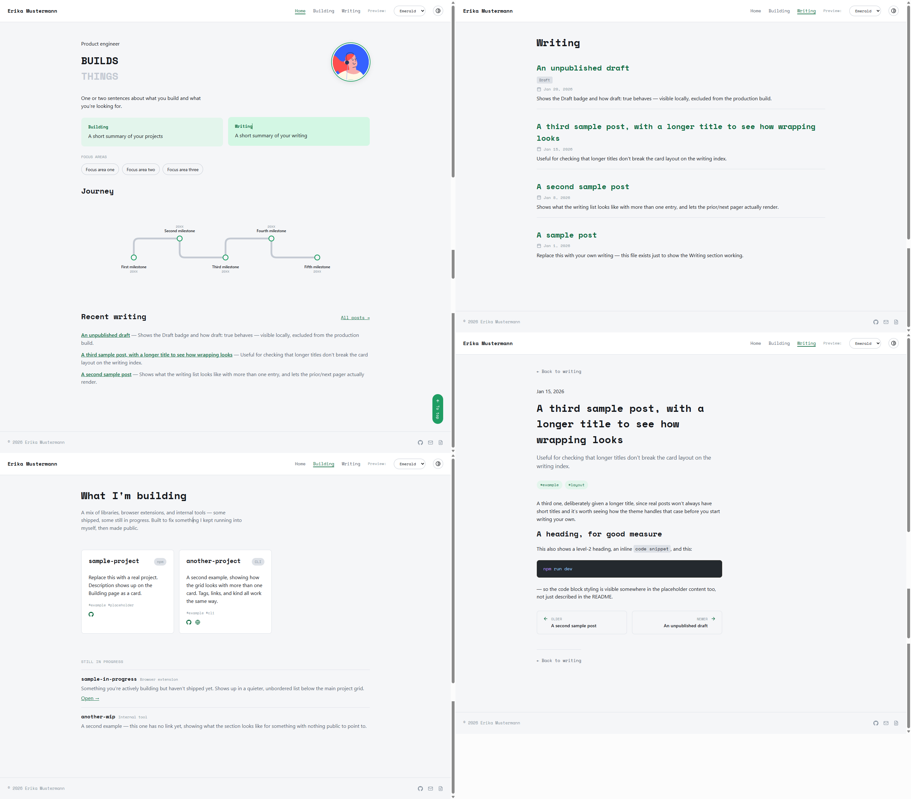
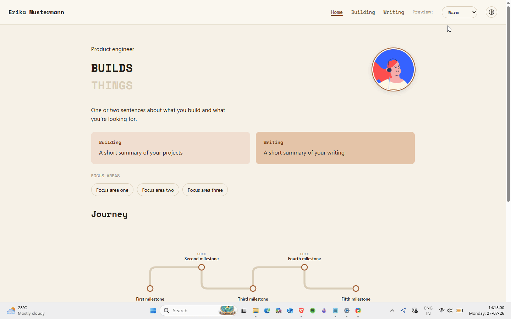

<!-- wasmer:start -->
## Deploy on Wasmer

This folder is the [Pinefold](https://github.com/anoopsmn/pinefold) Astro theme by anoopsmn, copied from commit `d47ef861ae7ddb8708f621ac570d54645d43e039` so it can be deployed as a Wasmer Edge template.

- **Demo:** https://astro-pinefold.wasmer.app
- **Deploy:** open the template on [wasmer.io/templates](https://wasmer.io/templates) and click **Deploy**, or run `wasmer deploy` in this folder. Wasmer installs with npm, runs the build script with Node 24 and serves the static `dist/` folder.
- **Changed for Wasmer:**
  - None. The theme builds as published.
- **Environment variables:** None.
- **Credit:** theme by [anoopsmn](https://github.com/anoopsmn), MIT. The theme's license file is kept unchanged.
<!-- wasmer:end -->

# Pinefold


A minimal Astro portfolio theme built around one idea: your data lives in
a single config file and a folder of markdown posts, and nothing else
needs to be touched to make the site yours. No CMS, no database, no
build step beyond `astro build`.

**[Live demo →](https://pinefold.vercel.app)**



## Features

- Six built-in color palettes, switchable with one line in config 
- Light/dark mode, no flash of the wrong theme on load, persisted across visits
- A timeline component that generates its own curve from your data — add or remove milestones and the shape adjusts, nothing is hand-drawn
- Content collections for writing, with typed frontmatter (title, description, date, draft, tags)
- Draft posts stay visible while you're running the dev server and disappear from the production build automatically
- Prior/next post navigation, generated from your post list, no manual linking
- Mobile navigation with a CSS-only collapsible menu — no JavaScript framework, no client-side router
- SEO tags (Open Graph, Twitter Card, canonical URL, sitemap) wired up out of the box
- Every color in every component reads from CSS variables — there is no hardcoded hex value anywhere outside the palette definitions themselves

## Project structure

```
/
├── public/
│   └── favicon.svg
├── src/
│   ├── components/
│   │   ├── Nav.astro
│   │   ├── ThemeToggle.astro
│   │   ├── BackToTop.astro
│   │   ├── ToolCard.astro
│   │   └── Timeline.astro
│   ├── content/
│   │   └── writing/            # your posts live here, one markdown file each
│   ├── content.config.ts       # the writing collection's schema
│   ├── layouts/
│   │   └── Layout.astro
│   ├── lib/
│   │   └── timelinePath.ts     # the curve-generation math behind Timeline.astro
│   ├── pages/
│   │   ├── index.astro
│   │   ├── building.astro
│   │   └── writing/
│   ├── styles/
│   │   ├── global.css
│   │   └── palettes.css        # all six color palettes live here
│   └── config.ts               # the one file to edit — see below
├── astro.config.mjs
└── package.json
```

## Make it yours

Everything structural lives in **`src/config.ts`**: your name, hero copy,
timeline milestones, projects, focus areas, and footer links.

```typescript
export const site = {
  name: "Your Name",
  url: "https://yourname.github.io",
  palette: "warm", // see Palettes below
};
```

The footer's "Resume" link expects a file at `public/resume.pdf` — the
theme doesn't ship one, so add your own PDF there (or remove that entry
from `footerLinks` in `config.ts` if you don't want a resume link at all).

### Adding a blog post

Drop a markdown file into `src/content/writing/` — no route or config
change needed, it's picked up automatically:

```markdown
---
title: "Your post title"
description: "One sentence for the post list and SEO."
date: 2026-01-01
draft: false
tags: ["example"]
---

Your post content here.
```

### Palettes

Six built-in options, set via `site.palette` in `config.ts`:

| Name | Feel |
|---|---|
| `emerald` | Cool, clean, technical |
| `warm` | Warm paper tone, terracotta accent |
| `slate` | Indigo-blue, conventional/professional |
| `mono` | Black and white, no color |
| `ink` | Dark-first, amber accent |
| `forest` | Muted green, cream paper |

Each works correctly with the built-in light/dark toggle. To add a
seventh, copy any block in `src/styles/palettes.css`, give it a new
`[data-palette="..."]` name, and add that name to the type union in
`config.ts`.

### Timeline curve

The rounded route on the homepage timeline is generated from your data
at build time, not hand-drawn — the shape, node spacing, and label
wrapping all adjust automatically as you add or remove entries. The
generator lives in `src/lib/timelinePath.ts`, independent of Astro, if
you ever want to reuse it elsewhere.

## Running locally

```bash
git clone https://github.com/anoopsmn/pinefold.git
cd pinefold
npm install
npm run dev
```

| Command | Action |
|---|---|
| `npm install` | Install dependencies |
| `npm run dev` | Start the dev server at `localhost:4321`, drafts visible |
| `npm run build` | Type-check and build the production site to `dist/`, drafts excluded |
| `npm run preview` | Preview the production build locally before deploying |

## Deploying

Static output — works anywhere that serves static files. Connect the
repo to Vercel, Netlify, or Cloudflare Pages and deploy with the
defaults, no extra configuration needed.

## Feedback

Found a bug or have a suggestion? Open an issue.

## Credits

The placeholder avatar is from [Alohe's Avatars](https://alohe.github.io/avatars/).

## License

MIT