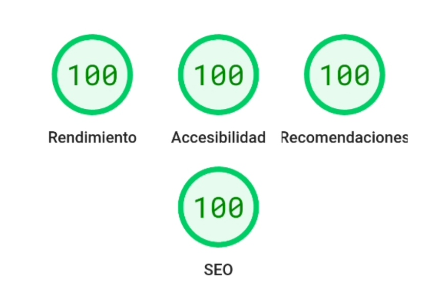
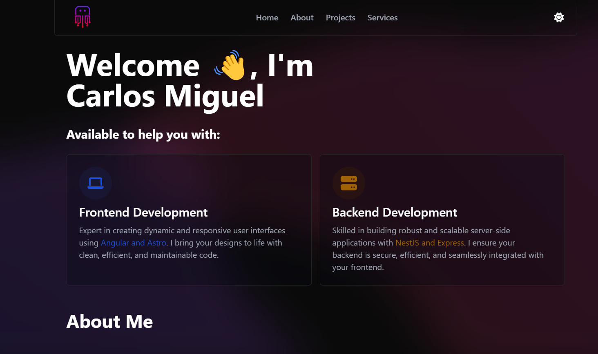
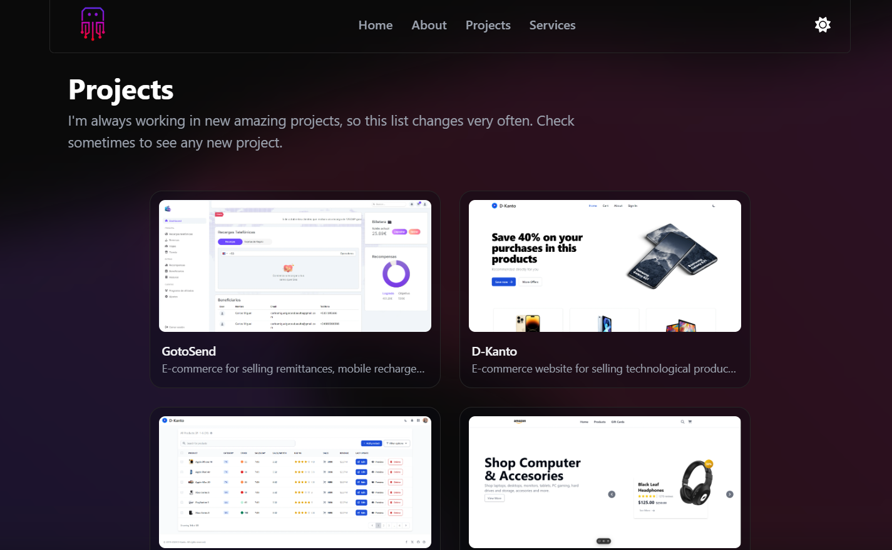
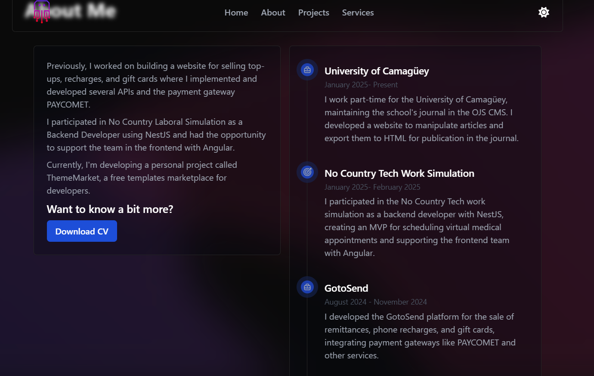
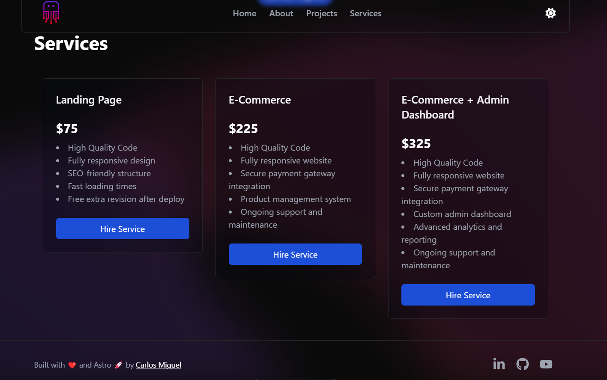

<!-- wasmer:start -->
## Deploy on Wasmer

This folder is the [Simple Portfolio Template](https://github.com/ThemeMarket/portfolio-demo-1) Astro theme by ThemeMarket, copied from commit `6ad558dcf19cf7ac4f76697835267601dfc645fe` so it can be deployed as a Wasmer Edge template.

- **Demo:** https://astro-portfolio-demo-1.wasmer.app
- **Deploy:** open the template on [wasmer.io/templates](https://wasmer.io/templates) and click **Deploy**, or run `wasmer deploy` in this folder. Wasmer installs with npm, runs the build script with Node 24 and runs the `@astrojs/node` standalone server on Wasmer Edge.
- **Changed for Wasmer:**
  - Replaced the @astrojs/vercel adapter with @astrojs/node 9.0.3 in standalone mode, because some pages render on the server. Added @astrojs/node to package.json and the lockfile.
  - Added .nvmrc with Node 24, the Node version Wasmer builds with.
  - The theme has no lockfile, so this folder adds a package-lock.json generated with npm.
  - Added a `start` script (`node ./dist/server/entry.mjs`) to package.json so Wasmer can start the Node server.
- **Environment variables:** The theme's example env file lists `RESEND_API_KEY`, `MY_EMAIL`. The demo builds and runs without them; set them in the app's settings to turn on the features that use them.
- **Credit:** theme by [ThemeMarket](https://github.com/ThemeMarket), MIT. The theme's license file is kept unchanged.
<!-- wasmer:end -->

# Portfolio Demo 1

Esta es una plantilla de portafolio para Desarrollador Web creada usando Astro y TailwindCSS, desarrollada aprovechando las características del Server Side Rendering (SSR) de Astro con el adaptador de Vercel y envío de emails con Resend.

## Estadísticas

<table style="width: 100%">
  <td>
    
  </td>
</table>

## Características

1. Envío de emails con Resend y generación de plantillas con Handlebars
2. Server Side Rendering con Vercel
3. Animaciones con Motion
4. Modo oscuro

## Dependencias

- Astro v5.2.5
- Astro Vercel Adapter v8.0.6
- TailwindCSS v4.0.5
- Motion v12.0.5
- Resend v4.1.2
- Handlebars 4.7.8

## ¿Cómo levantar el proyecto?

1. Clona el repositorio `https://github.com/ThemeMarket/portfolio-demo-1.git`.
2. Dirígete hacia la carpeta del proyecto `cd portfolio-demo-1`.
3. Instala las dependencias `npm install`
4. Levanta el servidor de desarrollo `npm run dev`

## Previews

<table style="width: 100%">
  <tr>
    <td style="width: 25%"></td>
    <td style="width: 25%"></td>
    <td style="width: 25%"></td>
    <td style="width: 25%"></td>
  </tr>
</table>
