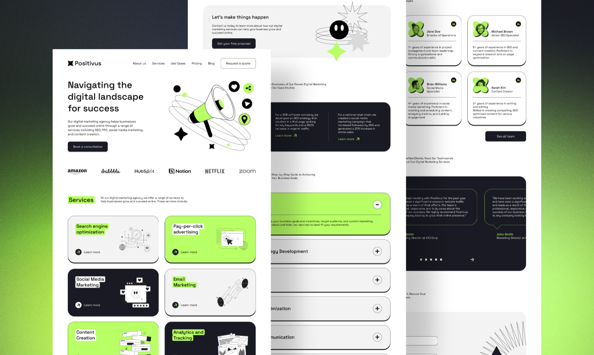

<!-- wasmer:start -->
## Deploy on Wasmer

This folder is the [positivus](https://github.com/manulthanura/Positivus) Astro theme by manulthanura, copied from commit `bef52c3b56745f1a6e974c4da6fea6ca2d02eff7` so it can be deployed as a Wasmer Edge template.

- **Demo:** https://astro-positivus.wasmer.app
- **Deploy:** open the template on [wasmer.io/templates](https://wasmer.io/templates) and click **Deploy**, or run `wasmer deploy` in this folder. Wasmer installs with npm, runs the build script with Node 24 and runs the `@astrojs/node` standalone server on Wasmer Edge.
- **Changed for Wasmer:**
  - Replaced the @astrojs/vercel adapter with @astrojs/node 9.0.3 in standalone mode, because some pages render on the server. Added @astrojs/node to package.json and the lockfile.
  - Resized 6 images over 300 KB to at most 1600 px wide, keeping file names and formats.
  - Added .nvmrc with Node 24, the Node version Wasmer builds with.
- **Environment variables:** None.
- **Credit:** theme by [manulthanura](https://github.com/manulthanura), MIT. The theme's license file is kept unchanged.
<!-- wasmer:end -->

# Positivus - Digital Marketing Agency Landing Page

Introducing "Positivus" - a stunning and versatile Astro theme designed for digital marketing agencies.

Built with clean, modern aesthetics and leveraging the power of Astro and Tailwind, Positivus empowers you to craft a captivating website that showcases your agency's expertise and fosters trust with potential clients.

 

## Theme Features

Leveraging the power of Astro and Tailwind CSS, Positivus offers:

- Clean and modern design.
- SEO-friendly.
- Multiple Layouts.
- Seamless Navigation.
- Pre-built Sections.
- Customizable Components.
- Mobile-Responsiveness.

## 🚀 Project Structure

The project is built using Astro.js and Tailwind CSS. Here's a quick look at the project structure:

Astro looks for `.astro` or `.md` files in the `src/pages/` directory. Each page is exposed as a route based on its file name.

There's nothing special about `src/components/`, but that's where we like to put any Astro/React/Vue/Svelte/Preact components.

Any static assets, like images, can be placed in the `public/` directory.

## 🧞 Commands

All commands are run from the root of the project, from a terminal:

| Command                   | Action                                           |
| :------------------------ | :----------------------------------------------- |
| `npm install`             | Installs dependencies                            |
| `npm run dev`             | Starts local dev server at `localhost:4321`      |
| `npm run build`           | Build your production site to `./dist/`          |
| `npm run preview`         | Preview your build locally, before deploying     |
| `npm run astro ...`       | Run CLI commands like `astro add`, `astro check` |
| `npm run astro -- --help` | Get help using the Astro CLI                     |

## 👀 Want to learn more?

Feel free to check [Astro documentation](https://docs.astro.build) or jump into our [Discord server](https://astro.build/chat).

## 📄 License

This project is licensed under the MIT License - see the [LICENSE.md](LICENSE.md) file for details
